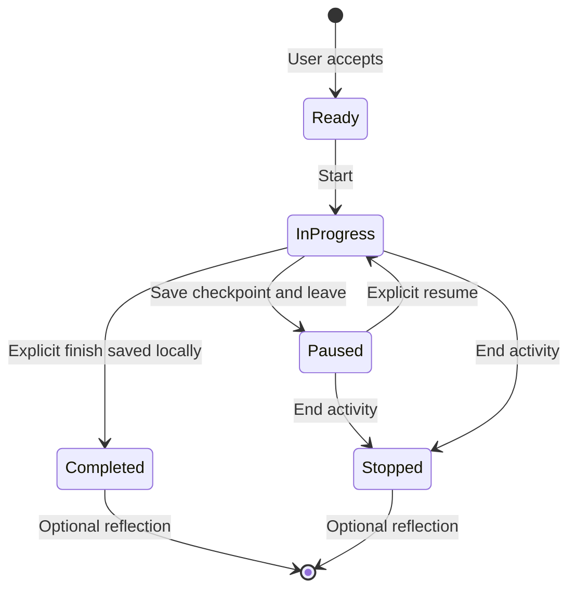

# MindFriend — a session that follows through

**Canonical product and implementation specification · 6 November 2026 · version 1.0**

Repository: **scalinity/MindFriend**. Reviewed branch: **main**. Final frozen source revision: **`bba67bb6e059e32fe60765f0ed0c77697d71bc7b`**. Initial deep-review revision: `a2b38f5ca8a88bf5c05655453dc1d9973f2e02ac`. Companion execution document: **`kickoff-prompt.txt`**.

## 1. Decision and scope

MindFriend will organize its primary experience around a **resumable support session**. A person can say what matters now, talk for as long as that is useful, choose one practical or guided action, record what happened, and return to the same work without reconstructing the context. Simply talking remains a complete, valid session. An exercise, goal, mood score, physiological measurement, or subscription purchase is never a required step in this loop.

The flagship is the continuity of a useful piece of work across conversation, an activity, reflection, interruption, and later return. The supporting changes are a quieter Today screen, four stable navigation destinations, inspectable memory, typed handoffs into existing tools, and durable state. These changes reinforce one experience rather than adding another collection of features.

**Implementation readiness:** this is a complete specification for gated implementation against the reviewed source. It is not a claim of a working current build, deployed contract parity, provider feature availability beyond verified documentation, or completed validation. Gate G0 resolves the exact development checkout and available test environment. Gates G1–G4 below cover runtime, provider, migration, and service evidence before their dependent capabilities can be accepted. Independent local implementation can proceed while a service or device gate is unavailable. Production deployment and App Store submission require a separate explicit instruction.

### 1.1 Outcomes

1. A person can start something useful without interpreting a dashboard of competing scores and recommendations.
2. A conversation can hand off to a concrete chosen activity without making the person restate their concern.
3. Acknowledged work survives interruption, process termination, reconnection, and ordinary multi-device use without silently duplicating completion or changing its meaning.
4. A person can see which personal context was shared with the AI, correct it, and stop it being used.
5. Existing conversation, practices, programs, mood/progress, social support, optional physiology, private journaling, and paid capabilities retain clear routes and their meaningful boundaries.

### 1.2 Explicit limits

This iteration does not introduce a new model provider, autonomous wellness agent, automatic life-topic graph, clinical diagnosis, new social network, general task manager, or engagement-driven recommendation system. It does not remove advanced existing capabilities because they are outside the flagship. It gives them stable homes and connects only the adapters defined here. It does not upgrade the minimum iOS version or rewrite the app architecture wholesale.

## 2. Verified baseline and evidence discipline

### 2.1 Identity, instructions, and provenance

The GitHub repository identity was verified as `scalinity/MindFriend`, repository ID `1135506345`, public, default branch `main`, origin `https://github.com/scalinity/MindFriend.git`. The initial deep review used clean main at `a2b38f5ca8a88bf5c05655453dc1d9973f2e02ac`, the PR #55 restoration merge, committed `2026-11-05T21:36:05-05:00`. A final remote-head check found main had advanced to **`bba67bb6e059e32fe60765f0ed0c77697d71bc7b`**, **“Merge pull request #59 from scalinity/ai-provider-migration”**, committed `2026-11-06T16:38:23-05:00`. A second clean read-only clone and focused source comparison reconciled that merge before these documents were finalized. **The latter is the implementation baseline.** Both review worktrees remained clean. The user's original development worktree was not available; this says nothing about uncommitted work there.

The delta changes provider routing/keys, related safety/transport adapters, image-model configuration, documentation/legal content, tests, a historical sleep migration edit, and the app version/build. The complete iOS comparison found only the version/build settings and one image-provider comment changed; no executable iOS UX/state/route logic changed. Root instructions and MindFriend-spec.md are byte-identical. The reviewed product/continuity findings therefore still apply. Provider preservation rules below incorporate the new switch instead of freezing the older xAI-only ancillary paths. [S28–S30, R04]

Applicable root `AGENTS.md` and `CLAUDE.md` contain matching conditional production/App Store delivery instructions. Those instructions apply when delivery is requested. Neither this read-only discovery task nor the companion implementation prompt requests that delivery. No nested instruction file was found in the repository tree inspected. Re-read applicable instructions in the eventual implementation checkout because they may change.

The entire root `MindFriend-spec.md` was read. It remains the source for the original nonclinical wellbeing vision and requirements not explicitly superseded here. The indexes and relevant documents under `specs/`, `kimispecs/`, and `minimax-specs/` contain a mixture of proposals and implemented ideas; their existence is not evidence of functionality. Historical reliability reports and PR descriptions are attributed reports, not results of this review.

The review read source, migrations, project configuration, recent repository issue/PR context, and available images. It did **not** build the app, run tests, operate a simulator/device, query production data, mutate a service, apply a migration, or inspect a current signed binary.

### 2.2 Evidence notation

References `[S01]`–`[S30]` resolve to exact revision-pinned source paths in Appendix A. The original deep-review ranges are retained for the few provider files whose lines moved; the final-revision delta references explicitly supersede their provider configuration. Unchanged-source links and current iOS settings point to the final baseline. `[D01]` onward are current primary platform/provider documentation. `[R01]` onward are repository reports, whose claims require the stated independent validation. A **verified source observation** describes code or configuration. A **source-based inference** describes a plausible consequence that has not been observed at runtime. A **proposal** is a decision in this specification. A **measured baseline** requires an actual measurement; no UX timing or outcome baseline was measured here.

### 2.3 Stack and implementation footprint

| Area | Verified source baseline | Consequence |
|---|---|---|
| iOS | SwiftUI application, iOS 17.0 minimum, Swift 5.9, iPhone and iPad, portrait and landscape; version 1.0.5, build 202611061625. Supabase Swift 2.55.4, Google Sign-In 10.0.0, Sentry 9.31.0 are declared. [S02] | Preserve deployment target and packages unless a concrete compatibility issue requires a separately explained change. |
| App organization | Existing `AppState`, `DependencyContainer`, feature views, observable services/view models, central deep-link routing, and Supabase data/service wrappers. [S03, S04] | Add a focused session domain and adapters; do not make each screen a second source of truth. |
| Backend | Supabase Postgres migrations, Edge Functions, authenticated service wrappers, shared AI budget/auth/safety code. `deno.json` enables strict checking and pins Supabase JS 2.118.0. [S16] | Use forward migrations and existing ownership, budget, and idempotency conventions. |
| Text chat | Main `chat` path calls OpenAI Responses through `_shared/openai-chat.ts`, model constant `gpt-6-luna`, `store:false`, 500 maximum output tokens, 128,000-byte prompt cap, linked cancellation, 45-second provider timeout, streamed text parsing. [S11] | This migration is present on main. Do not infer otherwise from a separate historical migration branch. Preserve budget limits and account for any richer response envelope within them. |
| Other AI and voice | A committed server switch now routes ancillary text/relay voice/STT: `AI_PROVIDER=standard` selects `gpt-6-luna` / `gpt-realtime-2.1-mini` / `gpt-transcribe`; unset or other values retain `grok-4.3` / `grok-voice-3.0` / `grok-voice-transcribe-2.0`. Main chat remains Luna independently. The iOS service name remains GrokVoiceService. [S28, S29] | Preserve the switch, both compatible paths, safety notes, routed budgets and no cross-vendor retry. The active deployed value is unverified; do not choose or flip it as part of this project. |
| Breadth | Inventory found 747 application Swift files, 77 feature directories, 210 Edge `index.ts` entrypoints, 212 SQL migration files, 78 iOS unit-test Swift files, and two UI-test Swift files. | Counts establish breadth, not coverage, correctness, or successful execution. |

### Current provider and key preservation

| Surface | Committed standard route | Retained xAI/other route | Required preservation |
|---|---|---|---|
| Main chat | OpenAI `gpt-6-luna` Responses, independent of AI_PROVIDER | No cross-provider fallback | Chat-specific 500-token/128,000-byte bounds and request receipts |
| Ancillary text | `gpt-6-luna` through the existing budgeted seam | `grok-4.3` when standard is not selected | Per-feature caps, including decision.analysis 800 tokens on standard; safety-note/refusal handling |
| Realtime relay | `gpt-realtime-2.1-mini`, input transcription `gpt-transcribe` | `grok-voice-3.0` with existing xAI input transcription | 120-second cap, voice/event mapping, harmless-error normalization, budget/admission and tools disabled |
| Voice-journal STT | `gpt-transcribe` | `grok-voice-transcribe-2.0` | Actual PCM-derived duration always bounds input; do not require an xAI-only duration field from OpenAI JSON |
| Image generation | `gpt-image-2.6-flare`, explicit low quality | Existing configured image path | Preserve the just-merged image configuration; no image redesign/migration is part of this scope |
| Generated practice/sleep speech | Existing Google TTS helper | Other untouched existing speech paths remain outside this change | Native timing; no provider change inferred from the realtime migration |

Non-image OpenAI uses **VOICE_AND_NONIMAGE_OPENAI_API_KEY**; **OPENAI_API_KEY** remains for images. These are configuration names, not values inspected by this review. Preserve that split. Retain XAI_API_KEY while legacy direct-voice clients and existing caller presence checks need it. Do not print secrets or change deployed settings. [S28–S30]

The merged decision document reports evaluation results, a real relay check, legacy 1.0.3 direct-xAI compatibility, and image deployment. Those are attributed repository reports. This review did not reproduce them or establish that production AI_PROVIDER is standard. The committed privacy/terms changes are source evidence, not proof of currently served legal pages. Preserve the reported compatibility prohibition against deploying the repository's relay-only voice-token over a still-used direct-token endpoint. [R04]

### 2.4 What is implemented, partial, and proposed

| Capability | Evidence and classification | Product implication |
|---|---|---|
| First launch and onboarding | Authentication/profile initialization and a quiz/greeting/buddy/completion onboarding flow exist. The greeting is selected from canned responses after a delay, rather than being a verified live AI reply. [S03, S05] | Do not present a demonstration as an actual personalized conversation. Preserve consent and age requirements; get to a real useful session sooner. |
| Home and navigation | Home composes many independent sections; Programs and Progress tabs depend on activation. Related deep links can wait for activation. This is verified composition, not observed confusion. [S04, S06] | Stable destinations and one primary decision are justified. |
| Conversation | Text streaming, conversation history, quota handling, crisis UI, voice entry, request UUID reuse, account/view-generation guards, and cancellation exist. The view's pending message and draft are in-memory state. [S07, S08, S11] | Preserve current hardening. Add durable drafts and explicit session continuity instead of replacing the conversation service. |
| Context and memory | The chat server includes recent history, generated memory fragments, curated companion memory, daily intent, and re-engagement context. Two cloud-memory interfaces and a separate device-only Private Vault exist. [S09, S10, S13] | Unify control semantics without merging private journal content into cloud memory. |
| Memory transparency gap | The server returns memory IDs, but `ChatService` assigns `memoryUsed` and `memoryIdsUsed` to nil. Re-engagement context is appended outside the nearby privacy-mode guards in the reviewed chat handler. [S08, S09] | Repair metadata and apply one context policy to every personal context source before relying on personalized continuity. This is a source finding, not proof of a production disclosure. |
| Guided activities | Exercise library/player, grounding, journaling, breathing/meditation, session creation, and idempotent completion RPC exist. Player responses and progress are largely view-model state. [S14, S15] | Reuse the player and real completion contract; add checkpoints and typed return results. |
| Action cards | Card models, views, service, and backend exist. Production chat integration was not found in the inspected callsites. Generation uses template identifiers such as `grounding-1`, while exercise session creation validates UUIDs. A card tap can record “completed” without actual activity completion. [S17] | Treat the new handoff as real integration work. Resolve catalog identity; never equate tapping a card with doing an exercise. |
| Plans, rewrites, and programs | Programs have dedicated routes. Action-plan fetch/update and progress UI exist, but an accessible initial-generation UI callsite was not found. Rewrite and thought-record UI/services exist without verified main-chat integration. [S18] | Preserve existing routes and scaffolding. The new Untangle adapter is real integration work; do not claim that all historical flows are already reachable. |
| Offline foundations | Offline storage, content service, and queue exist. Static searches found declarations for identity setup and handler configuration without production callers. Queue code includes swallowed persistence errors and index-based mutation across suspension points. [S19] | Durable continuity cannot assume this foundation is integrated. Bind ownership, surface write failures, and repair cancellation/sync before acceptance. These are source risks, not reproduced data-loss events. |
| Entitlement display | Home reconstructs entitlements with `dailyAiUsed: 0` and local free/premium limits, potentially overwriting newer quota information. [S06] | One confirmed entitlement/quota authority is a prerequisite; a Home refresh must never reset the usage display. |
| Recovery and physiology | Recovery Mode withholds manual exit for 24 hours; physiological state logic combines voice/HRV/behavior and stores sufficiently confident classifications. HealthKit setup status can be presented as authorization. [S20, S21] | Make the simplified presentation reversible. Separate measurements, interpretations, and self-report. Read access cannot be inferred from HealthKit setup status. |
| Voice | Voice view joins the conversation, receives transcripts, and ends/dismisses on background. Relay compatibility changes exist in source and have reported deployment gates. [S12, R02] | Resume context, never automatic microphone capture; do not assume the deployed endpoint matches source. |

### 2.5 Existing journeys and friction

| Journey | Current source route | Evidence-based opportunity |
|---|---|---|
| First launch | App bootstrap → authentication/profile → onboarding quiz/greeting/buddy → home, with separate permission/tutorial/activation behavior. | Reduce serial decisions and competing presentations. The first meaningful action should be available before optional personalization, Health, notifications, or buddy setup. [S03, S05] |
| Returning use | Home may render Recovery Mode or the multi-section dashboard; destinations can vary with activation. | Offer one resumable piece of work and a stable way to start something else. [S04, S06, S20] |
| Express a concern | Navigate to Chat or a specialized feature and type; most context is assembled invisibly on the server. | One direct entry, visible scope, and no requirement to classify the concern first. [S07, S09] |
| Choose an activity | Browse library/quick actions or specialized recommendations; action-card infrastructure is separate from main chat. | A small typed handoff from the current conversation into a known executable activity. [S14, S17] |
| Review previous work | Chat history, Progress, journals, plans, memories, and feature-specific history are spread across destinations. | A common session timeline that links to the original records without replacing their ownership. [S04, S10, S15, S18] |
| Resume after interruption | Chat cancels work on disappearance/account change; player/draft state is not a durable cross-feature session. | Return to acknowledged state, with accurate pending/completed status and deliberate voice resumption. [S07, S14, S19] |

These are source-based opportunities. No claim is made that users have been measured making a particular error or taking a particular number of seconds.

### 2.6 Visual evidence and reliability reports

`screenshots/bg_01_home.png` is a gradient background, not an app screenshot. `landing-page/assets/app-screenshot.jpg` is a marketing composition showing a dark Home with XP, mood, quest, capacity, and streak content. It is not tied to the reviewed build. Its appearance supports only a limited observation about marketed identity; it does not verify current layout, responsiveness, accessibility, or interactions. No recording or current running build was available.

PR #55 reports restoration validation and explicitly says its source merge was not a production deployment. Its reported simulator build, migration reset, and mixed backend test results are historical evidence, not this review's test results. Open issues #56 and #57 describe unresolved schema/deployment reconciliation. Source confirms that the narrowed mood-analysis function selects `NULL::text AS source`, while a later migration adds the column without redefining that body; the deployed body remains unverified. [S22, R01–R03] Do not expand that finding into an assertion that all mood analysis is currently broken.

## 3. Alternatives and selected product thesis

The following ordinal ratings are design judgments, not experiment results. Difficulty and uncertainty are relative to the inspected codebase.

| Direction | User value | Distinctiveness | Coherence | Difficulty / uncertainty | Architectural consequence |
|---|---|---|---|---|---|
| **Adaptive front door**: a situation-aware Home selects one useful next step | Immediate first-use value | Moderate; recommendations are common | Good if tightly constrained | Medium / ranking and signal validity | Consolidate Home recommenders; maintain explainable ranking and fallbacks |
| **Persistent life threads**: organize years of conversations, goals, and memories into continuing topics | Potentially high for recurring concerns | High if retrieval is trustworthy | Good over time, weak before history exists | High / topic errors, privacy, stale assumptions | New topic identity, retrieval, merge/split, long-lived summary and deletion dependency graph |
| **Resumable support session**: concern → conversation/choice → action → reflection → return | High now and on return | High through execution quality and continuity | Strongest fit with existing chat, exercise, plan, and reflection capabilities | High but bounded / state and sync correctness | One session owner, typed adapters, durable journal, provenance-aware context |

**Select the resumable support session.** Use the adaptive front door as its entry and transparent memory as its context layer. Defer automatic life-thread organization until actual session use demonstrates a need that search and explicit titles cannot meet.

A physiological regulation dashboard was considered as a stronger alternative and rejected as the flagship. It would center optional hardware/data coverage and uncertain interpretation. Optional physiological observations remain accessible and can help a person reflect; they cannot authoritatively identify what the person feels.

### 3.1 What becomes simpler

- Today opens with a time-of-day greeting by first name, then one primary next action. Prediction, debt, sleep, insights, and programs stop competing for automatic top-level placement. Streak counts are not shown anywhere; streak data stays on the server.
- Navigation never changes because a person has not completed a mood, quest, or chat milestone.
- One destination, **What MindFriend remembers**, controls cloud personalization. Private Vault remains separately named **Private journal · on this device**.
- A suggestion offers one next action and an explicit alternative. It does not generate an unsolicited multi-step treatment-like plan.
- A paused session creates an opportunity to return, not an obligation, streak warning, or implied deterioration.

### 3.2 Ambition retained and deferred

The iteration includes a native redesign of the primary shell, real cross-feature state, three complete activity adapters, context inspection/correction, accountable AI suggestions, text/voice continuity, robust offline recovery, and accessible states. It retains the breadth of the catalog and social/physiology tools.

Deferred work: automatic long-running topic graphs; embedding infrastructure solely for 20 curated memories; autonomous scheduling or contacting people; automatic inference of emotional state; expanding subscriptions or provider migrations; generated exercises with unrestricted instructions; new health predictions; new engagement campaigns; and adapting every advanced tool to session completion in the first release. Existing routes for those tools remain available. An unsupported tool can open from Explore without pretending it produces a structured session result.

## 4. Information architecture and navigation

### 4.1 Four fixed tabs

Use the native tab bar on compact iPhone layouts: **Today**, **Chat**, **Explore**, **You**. Labels remain visible. Preserve each tab's navigation stack and scroll position. On iPad use the same destination identity in an adaptive native sidebar/split view where space permits; do not invent extra product sections. Minimum target remains iOS 17.

| Destination | Order and responsibilities | Primary action |
|---|---|---|
| Today | Greeting; primary start/resume card; quick ways in (mood check-in, breathing, an activity); a little progress (today's quest, level); pins; a quiet route to all history | Start or resume one session |
| Chat | Current conversation/session; new conversation action; searchable conversation/session history sheet; context control | Talk or continue typing |
| Explore | Search; active program; Practices; Programs and Pathways; Tools and Experiments; People and Circles | Choose an existing capability |
| You | Progress summary; History; Saved steps; What MindFriend remembers; optional measurements; profile/privacy/settings/subscription | Review, correct, and manage |

No activation milestone hides a tab or blocks a valid deep link. Paid entitlements still govern paid actions. Do not put a paywall in front of history, memory correction/deletion, crisis information, or an already stored local checkpoint.

### 4.2 Retained destination map

The implementation must generate a registry inventory from existing navigation and feature entrypoints and reconcile it against this map before removing the old More shell. That inventory is a migration check, not a redesign decision delegated to the implementer.

| Existing capability/route family | New home | Legacy link behavior |
|---|---|---|
| Home, recovery presentation, daily quest, habits, active action plan | Today compact active-work area; You → Progress → Daily quests / Habits / Plans; existing plans remain separate from session-owned Saved steps | `home` selects Today; quest detail remains directly reachable |
| Chat, voice, distortion coach; rewrite scaffolding | Chat and relevant existing message actions; new Untangle adapter supplies the integrated reflection path; separate rewrite UI/services are preserved but their new integration is deferred | `chat/{id}` opens the owned conversation and attaches/resumes its session when present |
| Exercises, grounding, breathing, meditation, micro-moments, sensory toolkit, coping kit | Explore → Practices, searchable and pinnable | Existing library/exercise/breathing/meditation/micro-moment links resolve to canonical content |
| Programs, therapeutic programs, quest arcs, transition pathways | Explore → Programs and Pathways; active item at top | Program links open directly after ownership/entitlement validation; no activation hold |
| Circles, buddies, invitations, together/couples/family, mentorship, peer support | Explore → People and Circles, direct named rows for each; active circles/invitations first | Preserve circle IDs and buddy invite parsing; Circles reachable in two deliberate taps from any tab root |
| Mood entry, mood history, outcomes, XP/levels/achievements, certificates, longitudinal Journey, progress stories, weekly insights | Today optional mood entry; named rows in You → Progress / History; the You summary shows level, quests and badges | `progress`, `streak`, `achievements`, `mood/history`, `insights` open corresponding views |
| Text and voice journals; sleep; quotes; assessments | Explore → Practices → Journal (Text / Voice), Sleep, and Quotes; You → Progress → Assessments with an Explore → Tools and Experiments shortcut; records linked from You → History | Preserve journal, sleep, quote and assessment links; do not recategorize stored records destructively |
| Health/biometrics, nervous-system estimates, Insight Lab, experiments, advanced personalization / For You | You → Measurements for personal data; Explore → Tools and Experiments for tools; direct For You entry on Explore | Keep explicit access and provenance; no automatic Home dominance |
| Cloud generated/curated memories and daily intent | You → What MindFriend remembers; Chat → Context | Existing memory routes redirect with a source filter if relevant |
| Device-only Private Vault | You → Private journal · on this device | Preserve local encryption and device-only boundary; never alias it to cloud memory |
| Account, privacy, app lock, notifications, SOS preferences, subscription, export/delete, therapist connections; AI/intervention/proactive/recovery preferences, Wellness Agent and Our Approach | You → Settings and their existing named subviews | `profile`/`settings` open You / Settings; identity-sensitive destinations retain authentication guards |
| Crisis resources and safety plan | Chat toolbar and persistent Help entry in You; compact Help action on Today | Available without AI quota and independent of SOS personalization toggle |

Explore root uses inline named sections with direct destination rows, plus search; Circles is a direct root row, not hidden behind a category-only intermediary. Selecting a category heading may open its full list, but common destinations remain directly tappable. Each pinnable destination has a visible Pin to Today / Unpin menu; at three pins, choosing another opens a Replace a pin chooser rather than silently evicting one. Reordering has visible Move up / Move down controls in addition to optional drag.

Unknown, deleted, unauthorized, or unavailable destination IDs show a native unavailable screen with a route back to the relevant category. Never select a different person's record or silently substitute another exercise. Repeated links remain distinct navigation requests, preserving the current request identity and account-change safeguards. [S04]

### 4.3 Presentation rules

Use a navigation push for full work and history, a sheet for short choices or editing, and a full-screen cover only for existing truly immersive players/voice where needed. A player launched from a support session receives a typed return target, not a new nested tab view. A single presentation coordinator arbitrates consent, paywall, tutorial, crisis, and activity presentation; do not stack unrelated sheets. Critical safety information takes precedence, while a pending noncritical presentation can be resumed explicitly afterward.

## 5. Detailed experience

### 5.1 First launch

Keep existing authentication and required legal/age boundaries. Verify where the original 13+ age gate and consent are enforced at G0; if missing, implement that existing requirement before accepting first-run completion. A targeted App/Auth/Onboarding source search did not find the age gate, and sign-in consent copy is plain text rather than linked documents. Provide accessible working Terms/Privacy links; do not invent parental features or claim verified age compliance. After required consent, offer a compact welcome: **“What would be useful right now?”** Primary **“Talk about something”**, secondary **“Try a short practice”**, tertiary **“Explore first”**. Personalization questions, buddy invitations, tutorials, and optional measurements can be skipped and revisited. No Health, microphone, or notification system prompt appears before the corresponding person-initiated feature.

Replace the ambiguous canned AI greeting with this ordinary interface copy. If the existing canned experience is kept as an optional demo, label it **“Example conversation”** and keep it out of real history, memory, quota, and activation analytics. The first real message goes through the actual chat contract. Do not fabricate a personal insight to make onboarding seem intelligent.

The first practice can run from curated bundled instructions without creating a cloud conversation. Authentication requirements remain as currently established; this iteration does not introduce guest-account migration. After one useful result, show at most one optional setup invitation, chosen by relevance and dismissible without consequence.

### 5.2 Today: one clear decision

At default text size on a 375 × 667-point iPhone, the greeting, primary card, primary action, and alternative entry must be reachable without horizontal scrolling. Do not promise that all secondary content fits above the fold. At accessibility sizes, vertical scrolling is expected and every action remains reachable.

| Slot | Exact behavior and representative content |
|---|---|
| Navigation/header | Inline “Today” title; the greeting is the page's large heading (first name, no emotional inference) over “A little room for what matters to you.”; Help button with accessible label “Support and crisis resources” |
| Primary card: no unfinished work | Heading “What would help right now?”; one sentence “We can talk it through or try one small thing.”; primary “Start a conversation” |
| Primary card: unfinished work | Heading “Continue where you left off”; neutral status “Grounding · step 3 of 5” or “Conversation draft saved”; primary “Continue”; secondary “Start something else”; overflow “View session”, “Close session” |
| Quick ways in | Three secondary tiles of equal height: “Check in” (accessible label “Check in with yourself”; opens the existing mood interface), “1-minute breathing”, “Untangle a thought”. They stack at accessibility sizes. “Settle for a moment” and “Choose a next step” follow as text rows. No required score before chat/practice; never preselect a score from sensors |
| A little progress | Card with today's quest (a quest cached from an earlier day is not shown), then level, total XP and progress to the next level. No streak counts |
| Pinned to Today | At most three user-chosen pins, including an active program, saved practical step, circle, or existing tool. An Edit/Done mode shows Move up, Move down and Unpin for each pin. A first active program can be suggested as a pin, never added through unlimited recommender insertion |
| Footer | “View your history” and last-sync status only when materially stale/pending; no empty rows for absent features |

The default primary card chooses the most recently intentionally active unfinished session. It does not rank people by predicted distress. If several sessions are paused, add “Other unfinished sessions (N)” beneath it. Do not silently merge them. After 14 days without an explicit return, use “Previous session available” instead of an imperative continue prompt; retain the record until the person closes/deletes it. This is a display rule, not deletion or a diagnosis.

Default Home previews are discreet: no quoted intimate text, inferred condition, or remembered relationship detail. A person may enable concern-title previews in Settings. The greeting does not say “You seem stressed,” “Your HRV is low,” “You have wellbeing debt,” or “You missed us.” Today greets the person by time of day and first name, for example “Good evening, Sam”, using only the account's name; placeholders, handles and email prefixes are left out. No streak repair or recovery countdown interrupts entry. Earned XP, levels, badges, quests, and milestones appear once, as a calm moment after the action that earned them.

### 5.3 Session entry and Chat

Chat remains a normal native conversation. The header contains a short editable session title, back/history affordance, and **Context** button. Until named, use “Conversation” or the selected practice title. User-entered titles are limited to 80 characters and never automatically copied into lock-screen notifications. The composer supports text and the existing entitled voice entry. An empty conversation offers “Just talk” and the same three activity intentions; choosing one is optional.

The Context button opens a sheet with: **This session**, **Saved context shared**, **Not included**, and **Manage memory**. Before the first send it shows the proposed scope; after a response it shows the immutable receipt of what was actually included. Distinguish “shared with this reply” from “the model definitely relied on this”; causal model attribution is not available. Do not expose hidden reasoning or claim to.

The conversation's stable footer can show **“A small next step”** after the latest completed assistant turn when a valid suggestion exists. One card contains title, duration estimate, a short grounded rationale, **Start**, **Another option**, and **Not now**. The card never blocks sending another message. “Another option” opens the three curated choices; it does not automatically spend another model call. After “Not now,” do not repeat the same unsolicited proposal in that session unless the user asks for an activity. During a safety response, suppress ordinary recommendation and monetization cards.

Representative card: **“Notice what is around you · about 2 min”**; “You asked for a moment to settle before choosing what to do.” Actions: **“Try grounding”**, “Another option”, “Keep talking”. If the basis is a saved preference, add a compact **“Why this?”** link: “You saved a preference for activities without breath counting on 2 Nov. Change this.” Do not claim that the suggestion is clinically optimal.

Messages remain editable only through established supported paths; a revised thought is a new associated artifact, not a silent rewrite of historical user speech. Preserve original timestamps and author attribution. Partial streamed text is visibly incomplete until the server completion acknowledgement. Failed partial text is not fed back as a completed assistant turn.

### 5.4 Three complete initial activity adapters

These are the release scope for structured session handoff. They reuse existing visual/player infrastructure and canonical completion where it exists. Other tools remain accessible through Explore and existing links.

| Adapter | Inputs and exact experience | Completion and return |
|---|---|---|
| **Grounding: notice the room** | Curated grounding content; a canonical exercise UUID resolved through the catalog. Intro states “You can skip any prompt.” Five prompts: notice up to five things seen, four felt, three heard, two smelled, one tasted or one neutral detail. Text entry is optional; alternatives accommodate sensory differences. “Next”, “Skip this prompt”, “Pause” always available. No forced breathing or eyes-closed instruction | Completing the final acknowledged step calls the existing exercise completion path once. Return result includes acknowledged/skipped steps and elapsed active time; private sensory answers enter AI context only if the person includes them |
| **Untangle a thought** | New session-owned reflection using extracted journal prompt-rendering components: “What is on your mind?”, “What feels certain, and what is still unclear?”, “What would be a fairer or more useful way to say it?” Each prompt can be skipped; “Keep my original wording” is valid. No canonical exercise session or cloud journal entry is implicitly created. Optional “Ask for help” previews selected answers, then uses “Share these answers and ask” for an explicit entitled call | “Save reflection” records a session result. “Save draft and leave” retains protected checkpoints. “Discard this reflection” removes all answer drafts for this activity, including queued copies, and retains only a content-free stopped/discarded event. Original wording stays separate from any alternative; separate rewrite scaffolding is preserved without pretending it is already integrated |
| **Choose one next step** | One short user-authored action, up to 400 characters; optional “Make it smaller” deterministic prompt (“What is the first part you could do?”). Choice: “I did it”, “Save for later”, “Not now”. Save/done require nonempty trimmed text; Not now creates no empty saved step. No automatic calendar event, contact, deadline, or multi-item plan | A saved step belongs to this session and You → Saved steps. Completion is explicitly self-reported. The new short step is not a shadow copy of an existing ActionPlan item. Existing plans keep their own owner and are linked, not duplicated, if opened separately |

Curated instructions and template versions are bundled so all three adapters are usable offline after required app authentication. Catalog mapping includes versioned stable template keys and real UUIDs for exercise records. If the required catalog record is unavailable, the local practice may still run with a local execution ID; cloud reconciliation must create/resolve the actual exercise session before recording server completion. Do not send a fabricated UUID, and do not award canonical exercise completion twice. The migration seeds or maps the catalog record in a disposable environment before integration acceptance.

For grounding, the last step has an explicit Finish button. Acknowledging a prompt means the person chose to move on; the app does not claim a verified count of sensory observations. If every prompt was skipped, record stopped with reason skipped_all and no canonical completion/XP. Silent participation followed by Finish is valid. Untangle may finish without written answers but creates no empty journal entry.

The old library journaling component writes unscoped UserDefaults drafts on completion, while the old player owns exercise-start/rating/XP behavior. Reuse its rendering components, not those persistence/completion side effects. New Untangle answers use the protected per-account/session repository, with no implicit JournalService.createEntry and no extra exercise award. [S26] State plainly: “Saved to your account. Shared with AI only when you choose.” Offline copy states that account sync is pending. The later sharing toggle governs subsequent AI use, not whether the account stores the reflection; an earlier Ask for help call has its own explicit preview/consent.

Activity header: title; “Step N of M” where meaningful; explicit Pause/Close. Body: one instruction and optional response field. Footer: the primary progression action plus Skip. Avoid a dense floating chat panel inside a practice. For a Chat-origin activity, **“Back to conversation”** saves the checkpoint, pauses the activity, and returns to the same Chat with an “Activity paused” row. For a direct Today/Explore/onboarding practice without a conversation, show **“Save and leave”** returning to that origin and optional **“Talk about this”**. The latter opens a sharing preview and editable Chat draft; create a cloud conversation only on the first deliberate send.

On Pause/Close offer **“Save and leave”**, **“Keep going”**, and **“End this activity”**. Ending records `stopped`, not `completed` or `failed`. A short acknowledgement is sufficient; no loss warning unless there is genuinely unsaved local text because a write failed. For timer-based existing practices, store acknowledged phase and accumulated active time; time away does not count as completed practice and resumption does not jump forward through unobserved steps.

### 5.5 Reflection and the return to conversation

After activity completion or stopping, show a brief reflection sheet: **“How was that for you?”** Choices **“Helpful”**, **“Not for me”**, **“Not sure”**, **“Skip”**, with optional note up to 1,000 characters. No option is preselected. A mood rating is optional and separate; never infer it from this answer.

Below, show the exact compact result to be brought into the session: for example, “Completed grounding. Your reflection: not sure.” A toggle **“Include my written answers in the conversation”** is off by default. The activity's status can be part of the session's minimal context; intimate free text requires this deliberate inclusion. Private Vault content is never eligible through this toggle. The person can edit the shareable note before continuing.

For Chat-origin work, primary **“Back to conversation”** returns to the original conversation with a system-styled event row and the previewed context. It does not automatically trigger or bill an AI reply. A prefilled, editable composer suggestion can read “Help me choose what to do next.” For standalone work, primary **“Done for now”** returns to its origin; **“Talk about this”** opens the sharing preview and an editable draft, creating a conversation only on deliberate Send. In either case, Done for now leaves the session open if it contains an unfinished activity, saved step, or unsent draft; otherwise it closes the session. **Close session** is a separate explicit action: when unfinished work exists, choose Save and leave or End unfinished work and close. Closing stops/dismisses that pending work and cancels its reminders; it never silently completes it. “Not for me” suppresses repetition of that template for the current session and can offer Keep talking once; it does not launch escalating interventions.

### 5.6 History and saved work

You begins with a compact Progress section and **History**, not account settings. History combines references to support sessions, standalone conversations, exercises/journals, and existing records, grouped by date. Filters: All, Conversations, Activities, Saved steps. Search uses titles and explicitly searchable local content within the current account; no new cloud embedding service is required. Paginate past the current source's fixed recent-record limits. Preserve the original record's title/date and open its original detail view where it has no session adapter.

Session detail shows a concise timeline: concern/title, conversation link, chosen activity, acknowledged completion/stopping, optional reflection, and saved next step. It exposes **Continue**, **Close session**, **Rename**, **Delete**, and **Context**. A closed session remains inspectable. “Continue as a new session” creates a new session with previous_session_id pointing to the old one and, only on deliberate Send, a new conversation; it does not reuse the old conversation under the one-session-per-conversation invariant or alter completed history. Deleting explains which session-owned notes are removed and which separately owned original records remain, with explicit choices to delete those too where supported. No misleading “erase everything” label for a soft-delete-only operation.

### 5.7 What MindFriend remembers

One page reconciles existing curated memory and generated fragments through an adapter/facade. Sections: **Saved by you**, **Suggestions to review**, **For today**, and **Personalization controls**. “Private journal · on this device” is a separate link with an explicit boundary.

Each saved item shows its plain-language content, category, origin (“You added this” / “Suggested from your message on …, then approved”), last confirmation date, expiration/review state, and **Edit**, **Stop using**, **Forget**. “Stop using” excludes it while retaining an inspectable item; “Forget” removes its active content and derived-use eligibility according to §8. Do not make a confidence percentage stand in for evidence. Pending suggestions have **Save**, **Edit first**, and **Dismiss** and are excluded from future personalization until approved.

The Context sheet offers correction directly: **“That no longer applies.”** The affected item is excluded locally immediately, dependent future context is invalidated, and the UI says **“Stopped using this here. Syncing the change…”** until acknowledged. It never says “Forgotten everywhere” before server acknowledgement. “Use only this conversation” is available for a session. Its consequences for older statements and physiology are explicit in §8.

### 5.8 Voice

Keep the existing paid voice boundary and switched provider relay integration, including its current OpenAI/xAI normalization. Before starting, show the selected conversation/session and context scope, with a clear **Start voice** button. Request microphone access only at that point. Voice has an unmistakable capture indicator, live transcript/status, accessible End control, and a text fallback. Do not use a constant ambient animation as the only capture indicator.

Switching to text stops microphone capture, closes the voice transport, reconciles acknowledged transcript IDs, and opens the same session. On background, audio interruption, route loss, auth change, or End, stop capture promptly. Preserve the transcript already acknowledged and an interrupted status; never fabricate the remainder. Returning shows **“Voice session paused. Continue by text or start voice again.”** Starting voice again requires deliberate action and current entitlement/context checks. Previously shared voice context cannot be recalled from a provider; apply corrections to subsequent turns and terminate a transport whose context is now invalid.

## 6. Native visual and interaction system

### 6.1 Identity

Preserve MindFriend's established blue family, but use a restrained canvas, readable typography, and content-led hierarchy. Avoid a dashboard full of gradients, permanent glowing orbs, and rainbow status cards. Distinctiveness comes from the session's small, legible thread of work and a warm editorial voice.

Rewards use one calm vocabulary on the canvas: a soft glow, an emblem that settles into place, and slow particles in the accent, glow, and gold hues. Levels, badges, quests, and milestones get the full moment with a Continue action. A finished activity, a done step, or a saved reflection gets a brief check with an accent bloom; a closed session or a mood check-in gets only a quiet check, never particles. XP appears as a small toast at the top. No moment blocks touches it does not own, and VoiceOver hears each one once.

| Token | Light | Dark | Use |
|---|---|---|---|
| Canvas | `#F7F8FC` | `#0E1522` | Main backgrounds |
| Surface | `#FFFFFF` | `#192335` | Cards and grouped sections |
| Primary text | `#182234` | `#EDF2FC` | Titles, body, primary information |
| Secondary text | `#526176` | `#AFBDD1` | Supporting text; never essential low-contrast placeholder-only labels |
| Accent/action | `#3557B7` | `#9BB5FF` | Primary button background, selected controls, links; dark action text uses `#0E1522` |
| Field | `#FFFFFF` | `#131C2C` | Text entry fill, distinct from canvas and surface |
| Border | `#76839A` | `#64779A` | 1pt boundary of fields and controls; at least 3:1 against canvas, surface and field |
| Elevated | `#FFFFFF` | `#22304A` | Toasts, celebration cards and other surfaces raised over content |
| Separator | `#DDE2EC` | `#26324A` | Decorative row dividers; never the only boundary of a control |
| Celebration glow | `#C9D7FF` | `#3E5A9E` | Soft light behind reward moments |
| Celebration gold | `#9A6A12` | `#F2C46D` | Levels and badges; always paired with text or a symbol |
| Success/caution/destructive | Semantic system colors | Semantic system colors | Always paired with text/icon; never infer wellbeing from traffic-light color |

Under Increase Contrast, secondary text (`#3D4A5E` / `#C9D4E5`), accent (`#26449A` / `#B9CCFF`), border (`#4F5C72` / `#8A9CC0`) and separator (`#8592A6` / `#5C6F8E`) use stronger values. The app's AccentColor asset matches the accent token, and every screen reached from the shell uses the canvas, surface and field tokens rather than system backgrounds. Use semantic color assets, support Increase Contrast, and verify final composited contrast rather than assuming hex tokens guarantee every combination. Primary text target ≥4.5:1; large text ≥3:1; essential nontext control boundaries ≥3:1. Do not use accent colors for small text on tinted backgrounds without measurement. No physiology score becomes an alarming red Home state by default.

Typography uses SF and Dynamic Type: large navigation title 34pt, feature heading 28pt semibold, section heading 22pt semibold, card title 20pt semibold, body 17pt regular, supporting text 15pt, metadata 13pt minimum at default size. Use native text styles/relative metrics rather than fixed point sizes. Body line spacing is modest, with full multiline wrapping. Monospaced digits only for timers. Avoid all-caps paragraph labels and thin text.

Spacing scale: 4, 8, 12, 16, 24, 32 points. Page margins 16pt on small compact screens, 20pt normally; readable content width 680pt on large layouts. Card radius 20pt, small controls 12pt, sheets use native treatment. Primary buttons have at least 48pt visual height and grow for text; all targets have at least 44 × 44pt hit regions. Use native materials only for bars/overlays where the background does not impair legibility; ordinary content surfaces are opaque. No glass requirement or newer-OS-only material dependency.

### 6.2 Reusable components

| Component | Required variants and contract |
|---|---|
| `SessionFocusCard` | Start, draft, paused activity, pending sync, older session; one primary button, one alternative, optional overflow |
| `SupportActionCard` | Suggested, accepted, unavailable, declined; duration is an estimate; typed destination; rationale/provenance disclosure |
| `SessionEventRow` | Started, checkpoint saved, stopped, completed, reflected; human-readable verb and timestamp; not visually authored by the assistant |
| `ContextBadge` / `ContextSheet` | Conversation-only, saved context included, privacy changes pending; exact receipt available after response |
| `StatusLine` | Loading, saved on device, syncing, offline, failed; icon + text + optional retry; no spinner for a completed local save |
| `ActivityScaffold` | One instruction, accessible step progress, response field, Next/Skip/Pause, typed return target |
| `ReflectionChoiceGroup` | Four neutral outcomes, no default, optional note and sharing preview |
| `MemoryRow` | Confirmed, pending review, stale, disabled, deletion pending; provenance and direct correction |
| `UnavailableState` | What remains available, specific retry or alternative, retained draft/checkpoint |

Use these within existing design/theme conventions; do not create a second competing component library. UI-only state belongs to the feature view model. Domain state and mutations go through the session coordinator described below.

### 6.3 Motion, haptics, and keyboard

Normal transitions: 180–240ms opacity/position changes; use native navigation animation. A newly accepted card can collapse into a session event row without a celebration. Under Reduce Motion every reward moment cross-fades: no scale, travel, symbol bounce, or particles. No background pulsing crisis button. Haptics: light selection on deliberate choice and one soft confirmation when a local checkpoint is durably saved, respecting system/user settings; no repeated haptic reward for mood disclosure. Do not haptically signal “healthy” versus “unhealthy.”

Reduce Motion replaces breathing scale/orbit motion with static phase text and a discrete progress indicator; instructions remain complete without motion. Reduce Transparency uses solid surfaces. Screen-reader speech does not read every token during streaming: announce “Reply started,” let the user explore, then “Reply complete” when appropriate without interrupting an active utterance.

Use `safeAreaInset`/native keyboard avoidance for the composer and activity controls. Composer grows from one to six lines, then scrolls internally. Preserve draft and selection on tab changes. Return inserts a newline by default; Send remains an explicit accessible button, with hardware Command-Return support. Interactive scroll dismissal does not send or discard. Focus enters an empty composer only after an intentional conversation action, not whenever returning to Today. Activity Next advances focus to the next heading; sheet dismissal returns focus to its initiating control.

### 6.4 Accessibility and device acceptance

Smallest supported iPhone reference is a 375 × 667-point second/third-generation SE-class layout compatible with the iOS 17 floor, not the unsupported first-generation SE. Validate portrait and landscape, safe areas, iPad, split view, and all Dynamic Type sizes including the largest accessibility sizes. At large sizes, chip rows stack, side-by-side actions become vertical, cards expand, charts offer textual summaries, and primary labels do not truncate.

VoiceOver reading order follows heading → content → status → action. Every icon-only control has a meaningful action label. Activity progress exposes “Step 3 of 5,” not five unlabeled dots. Timer state includes paused/running and remaining time without a continuous announcement flood. Do not rely on drag, long press, color, gesture-only dismissal, sound, or haptics for an essential action. Offer equivalent visible controls. Maintain native focus during stream growth and restore it after correction.

Health, microphone, notifications, network, and account states have independent explanations. A denied microphone request offers text and a Settings link; Health with no recent data says **“No recent data available”**, not “Permission denied.” Notifications remain off unless explicitly requested for a chosen reminder. The core session works without Health data or notifications. [D01–D04]

## 7. Behavioral contracts and concrete journeys

### 7.1 Successful returning session

1. A returning person opens Today. The primary card offers an unfinished conversation, but **“Start something else”** is equally legible. They choose it and type, “I keep putting off an email to my supervisor.” No mood, goal category, or Health request intervenes.
2. Chat acknowledges the concern and asks one useful question. Context shows the current conversation and one approved preference for practical suggestions. It does not retrieve an old relationship concern simply because it was recently used.
3. After the person asks for a small step, a completed response includes **“Choose one next step · about 1 min.”** The rationale refers to their current request. They choose Start.
4. The activity opens with the same session ID. They enter “Write the subject line and the first sentence.” They choose **“Save for later.”** The acknowledged local record appears as a saved step, not a completed task or completed exercise.
5. They return to Chat. A compact event row states “Saved a next step.” The composer is empty; no additional model call occurs. They choose Done for now.
6. Later, You → Saved steps or the discreet Today resume card opens the exact step. They mark **“I did it.”** Reflection offers Helpful / Not for me / Not sure / Skip. They select Helpful and close the session. Progress can show completed self-reported action without claiming a measured reduction in anxiety.

### 7.2 Difficult session: stale memory, service loss, and interruption

1. A person opens a previous session and sees a proposed suggestion based on an old work situation. **Why this?** reveals the specific saved item and confirmation date. They choose **“That no longer applies”**, replace it with their current situation, and decline saving the replacement permanently.
2. The old item becomes ineligible locally immediately. The new statement applies to this session. A concurrent generation is cancelled; any late output from its older local context generation or acknowledged privacy revision is not rendered as a valid new response. The app acknowledges that context already sent cannot be recalled.
3. The network drops before the correction is acknowledged. UI says **“Your change is saved here. Reconnect to apply it to future cloud replies.”** Personalized cloud generation is paused on this device until privacy changes reconcile. Other devices cannot know this offline correction before server acknowledgement; after acknowledgement the account-wide privacy revision governs new requests. History and local practices remain usable.
4. They choose grounding. No AI or Health service is needed. At step three, a phone call interrupts the app. Audio/capture stop; the last acknowledged step is already saved. The app does not count background time as completed practice.
5. On return, the activity is still open at step three; if the app ended in the meantime, Today offers **“Grounding · continue from step 3.”** No microphone restarts. They select End this activity and “Not for me.” That is a valid result; no warning says they failed.
6. Reconnection applies the correction first, then session mutations using their existing operation IDs. A stale server memory cannot reappear during conflict resolution. The app shows the corrected context receipt on the next deliberate send. The person can keep talking or close the session.

### 7.3 Consequential state matrix

| State | Visible behavior | Data/action contract |
|---|---|---|
| First load | Native shell and cached content immediately; small placeholders for unresolved sections | Do not hold the whole Today screen until every old Home service completes |
| Empty history | “Your conversations and activities will appear here.” Actions Start conversation / Explore practices | No fabricated sample records in real history |
| AI starting | User message shows Sending, then Sent after acknowledgement; cancel available; brief status without fake progress percentages | One request ID; server ownership/budget checks precede provider work |
| Streaming | Partial text grows without stealing scroll/focus; Stop available | Partial output is provisional; validated final response is required for a usable action card |
| Cancelled/unknown request result | “Stopped. Checking what was saved…” then server-reconciled result or retained retry option | Retry reuses original request identity; never blindly create a second billed turn |
| Offline chat | Editable local draft with “Offline — saved on this device”; Send unavailable | **No automatic send queue**. Reconnection never sends intimate text without a new deliberate Send action |
| Offline local activity | Normal instructions; “Saved on this device” on acknowledgement | Outbox contains structured activity mutations, not hidden AI requests |
| Local write failure | Explicit “This change is not saved”; keep screen content and offer Retry / Copy text / Leave anyway | Do not advance past an acknowledged checkpoint or claim Saved until atomic write succeeds |
| Provider unavailable | Keep draft/history; Retry or Choose a practice; no invented assistant answer | No automatic provider substitution or unbounded hidden retries |
| Entitlement/quota unavailable | Existing confirmed entitlement shown with freshness; paid request verifies online before work | Never reset quota to zero or advertise unverified unlimited access |
| Quota exhausted | Exact server-supplied status/reset time if known; choose a local practice, view history, or deliberate upgrade | No paywall on crisis resources, correction, history, or local checkpoint recovery |
| Activity unavailable | Explain missing catalog/download/service; offer another explicit choice | Never swap a selected activity silently or mark it complete |
| Background/termination | Save acknowledged state before background where possible; blur sensitive app-switcher content consistent with app lock | Correctness relies on earlier acknowledged writes, not on guaranteed termination callbacks |
| Multi-device conflict | Load latest compatible snapshot; preserve an uncommitted local draft as a separate draft and explain | Revision conflict cannot overwrite a correction, completion, or newer activity silently |
| Auth expiry | Keep current account's encrypted/protected local state inaccessible to a different account; sign in to sync | No cross-account replay, fallback shared directory, or provider call after auth changes |
| Memory correction/forget pending | Clear pending state and cloud-personalization pause | Revocation precedes queued context-bearing work and invalidates cached context receipts for new sends |
| Safety refusal/escalation | Existing safety response, clear boundaries, relevant support resources; conversation can continue safely | No ordinary action/upsell card; preserve crisis classification and existing consented escalation behavior |

### 7.4 Healthy return

No streak loss, guilt copy, scarcity timer, or inference from absence motivates return. Notifications are opt-in and tied to a specific chosen reminder; default lock-screen copy is **“A step you saved is here when you want it.”** The reminder neither reveals its title nor claims concern about the person. One reminder per chosen step; no escalating campaign. Saved Step detail has an optional Remind me row opening a native date/time picker, a visible local time-zone label, and Set reminder. Ask notification permission only on that confirmation if status is undetermined. Denial offers Settings and retains the step without falsely claiming a scheduled alert. Store the chosen absolute instant plus displayed IANA time zone; travel does not silently move it. Editing the time replaces the same local notification ID. Cancel from the step or Settings; completing, deleting, dismissing, or explicitly closing unfinished work cancels it. Reminders are local to the device where explicitly set and labeled “On this device”; sync does not schedule duplicate notifications on other devices. Scheduling failure leaves a visible retry state, not a claimed reminder.

Closing a session, stopping an exercise, rejecting personalization, or choosing “Not for me” counts as exercising agency. The success measures in §13 focus on finding useful help and trustworthy continuity, not minutes in app, daily return, or increased AI turns.

## 8. AI, context, memory, and wellbeing boundaries

### 8.1 Authority and agency

The app may select eligible context, generate conversational text, propose one allowlisted activity, and prepare an editable draft. It may not start an activity, complete work, save an inferred personal fact, schedule a reminder, contact another person, change Health permissions, alter a paid plan, or publish a journal because the model emitted a tool call. Those actions require the person's explicit choice and ordinary server authorization. Existing separately consented therapist-crisis behavior remains governed by its current opt-in contract; this spec does not broaden it. [S09]

A new current statement overrides older information for the current interaction. It does not silently rewrite historical speech or permanently save a new fact. Distinguish: **what the person said**, **what the app recorded**, **what an AI inferred**, and **what a measurement actually measures**. An inferred emotional label is not a confirmed fact. A model confidence number is not a calibrated clinical probability.

### 8.2 Context assembly contract

Introduce one server-owned `ContextPolicy`/`ContextAssembler` used by text chat and voice admission. All context selection happens after authenticated ownership and privacy checks. Client input may identify a session and request scope; it cannot submit arbitrary trusted memory or instructions. Bind every assembled packet to `user_id`, `support_session_id`, `conversation_id`, `privacy_revision`, and source record revisions.

Priority and selection:

1. Existing system safety and product boundaries and account privacy/authorization controls. Saved personal preferences or avoid-topic memories are included only in personalized scope, as bounded data rather than executable instructions; current-session boundaries remain available in either scope.
2. Current user message and explicitly selected current session concern. Preserve the existing 4,000-character message limit and never silently truncate the current message.
3. Current activity state and the exact shareable result approved in §5.5. No automatically generated summary is required for continuity; a deterministic event summary is sufficient.
4. Up to 20 recent complete conversation messages, counting user and assistant messages separately, according to the existing history contract, excluding suppressed source material and incomplete assistant output. Keep chronology. Bound history to 64,000 UTF-8 bytes before the global trim.
5. Eligible confirmed memory: all applicable explicit boundaries/avoid-topics, then at most five additional relevant items, within the existing maximum of 20 confirmed curated records. Rank explicit user-selected references first, then match to the current request/selected intent, with confirmation date as a tie-breaker. No cross-conversation retrieval based only on recency or a fixed confidence value. Start with deterministic matching over this small collection; do not introduce embeddings merely to rank 20 items.
6. A current daily intent only when the person selected personalization and the intent has not expired. Optional measurements require an explicit request to discuss them in this session, with provenance and time window.

The personal-memory packet is capped at 48,000 UTF-8 bytes and session/event context at 8,000 bytes. The **entire serialized model prompt, including instruction/tool overhead, must remain within the existing 128,000-byte maximum**. Trim oldest optional history and low-priority optional memory first. Never discard an account privacy/authorization control or a boundary required within the selected scope, or replace the current message with an inferred summary to fit. If required content cannot fit, explain that a shorter message/context selection is needed before calling the provider. These are implementation bounds, not a promise that byte count equals provider token count; cost admission remains conservative.

Memory, titles, activity notes, and measurements are quoted/structured untrusted data. A stored instruction such as “ignore safety” or a model-produced URL cannot alter tool permissions, destination routing, provider configuration, or system policy. No unrelated social/therapist/private-journal data enters context merely because it belongs to the same account.

**Conversation-only mode:** includes the selected conversation, current user input, explicitly shared current activity result, and essential product safety policy. It excludes both memory stores, daily intent, absence/re-engagement metadata, unrelated past conversations, inferred affect, and Health data. Apply this rule across all reads and all text/voice paths. Disabling personalization does not disable basic safety rules or delete history.

### 8.3 Context receipts and explanations

Every confirmed response carries a `context_receipt` with: schema version; receipt ID; request ID; session/conversation IDs; privacy revision; scope; actual provider vendor/model and route version; included source references with kind/ID/revision/date; exclusions by category; and created time. The receipt stores references and minimal explanatory labels, not another full copy of sensitive text. Its provider label reflects the server route actually used, without hard-coding xAI voice or implying all clients use OpenAI. Preserve logical voice preferences across the existing mapping without promising identical timbre across providers. Resolve displayed source text through current ownership and deletion rules; after forgetting, show “Context removed” rather than resurrecting the old content from a receipt.

Repair the entire existing wire path: `chat/index.ts` → `ChatFunctionResponse` → `ChatResponse` → `SupabaseDataService` → `ChatService` → UI. [S08] Backward-compatible `memoryUsed` and `memoryIdsUsed` remain where needed; the new receipt is the complete source for user-facing disclosure. Missing legacy metadata is shown as **“Context details are unavailable for this older reply”**, not “No memory was used.”

An action rationale is generated from validated source references and a small reason code. Examples: “You asked for a practical next step,” or “You saved a preference for activities without breath counting.” If there is no valid attributable reason, label it **“An option you can try”**. Do not fabricate a reason or claim that physiological data proves the suggestion will help.

### 8.4 Memory lifecycle

Retain the existing two storage domains behind one facade: curated `companion_memories` and generated `memory_fragments`. Do not create a third store of the same personal facts. Add provenance, review status, revision, source-message references, supersession, and suppression metadata through forward migrations. Confirmed count limit remains 20 unless a separate product decision changes it.

| Kind | Eligibility and retention decision |
|---|---|
| Current user statement | Highest authority for this interaction; retained as conversation according to existing controls; not automatically a permanent memory |
| User-created/edited memory | Eligible when enabled, within scope, and current; origin explicitly user-authored |
| AI-extracted candidate | Pending review, excluded from personalization; source message required; no diagnosis or inferred hidden motive; candidate expires after seven days if unreviewed |
| User-approved candidate | Transactionally promote to one canonical companion_memories record with approval time and original source; mark the fragment promoted and ineligible as a separate context item. Enforce the 20 confirmed-item limit against that canonical set; later edits create a new revision and supersede the old one |
| Daily intent | Expires 24 hours after creation; visible and editable; never rolls over automatically |
| Time-bound event | Explicit event end/expiry controls relevance; no follow-up after expiry without the person's request |
| Life-context fact | Review due after 90 days by default, configurable sooner; stale items are excluded until confirmed when their relevance could materially affect advice |
| Boundaries/preferences | No automatic expiry; unobtrusive review after 180 days; applies in personalized scope until changed. Conversation-only excludes saved preference memories; account privacy/authorization controls and current-session instructions always apply |
| Historical automatic fragment without message provenance/approval | Mark “From earlier conversations · review before use”; excluded from new personalized context until approved; do not fabricate provenance or delete it silently |

These lifetimes are product decisions, not scientific thresholds. The interface does not make memory review a daily chore. Show at most one pending-memory invitation after a completed ordinary session; no invitation during crisis handling or while someone is trying to leave. Auto-save of inferred memory is off in the redesigned path. Automatic candidate generation is also off by default. What MindFriend remembers offers Suggest memories from this session only after an explicit scope preview and Generate choice; use the existing bounded extraction capability to produce review-only candidates, with an idempotent request and existing AI entitlement/budget checks. Do not run a hidden extra extraction merely to obtain a card or complete a session. An existing explicit opt-in to automatic suggestions may be retained only with the same source/privacy policy, budget admission and review-before-use behavior. Background extraction must recheck the current privacy revision and suppression set before persisting candidates. Session titles have a deterministic/user-edited fallback and never require another model call to finish the primary interaction. Preserve the meaningful approval/default-off requirements of the existing companion-memory proposal. [S23]

Conflict rule: a later explicit correction wins over an older inference or saved item for current context. Keep the conflicting older record disabled/superseded, not silently merged. If two current explicit statements materially conflict and neither is identified as a correction, ask one concise question or avoid using that fact. Do not infer which relationship, job, or identity is “really” current.

### 8.5 Correction, forgetting, and deletion

**Edit** creates a new revision and invalidates dependent cached summaries/proposals. **Stop using** disables personalization without deleting visible history. **Forget** removes active memory content and prevents its old sources and derived summaries from silently reintroducing it. **Delete conversation** is a separate operation affecting original history. Present those distinctions before destructive confirmation.

Implement suppression using source message IDs, legacy source conversation IDs when finer provenance is absent, record revision/tombstone identity, and dependent derived-record IDs. After forgetting a legacy conversation-level fragment, exclude that source conversation from automatic extraction/personalization until the person deliberately re-enables it; tell the person the scope. For message-level sources, exclude affected source messages from future assembled context, even when the old transcript remains visible. Invalidate the known transitive dependency closure: assistant replies whose context receipts included the memory/source, derived summaries, generated step drafts/proposal explanations, and later derived records referencing any of those. Keep historical replies visible where the person retained history, but exclude suppressed derived turns from subsequent model history until deliberately shared again. This prevents a forgotten fact from returning through an assistant reply in the recent-message window. Do not retain the forgotten fact's plaintext in the suppression ledger, analytics, or old context receipts. A tombstone may retain identifiers and timestamps necessary to prevent resurrection.

This guarantees exclusion of identified records/sources; it does not claim semantic omniscience over every paraphrase in all history. If the person wants stronger deletion, offer the source conversation and account-data controls. Future voluntary restatement can be used in the current turn but does not automatically re-create a suppressed permanent memory. A deliberate “Save this again” creates new consent and provenance.

Apply local suppression immediately. Increment a per-account `privacy_revision` on the server when the mutation is accepted. Pending privacy mutations take priority over session outbox work; pause new personalized cloud generation on the originating device until acknowledged. An offline correction cannot immediately change another device; server acknowledgement makes the revision account-wide. Every text generation validates the current revision before provider dispatch and before publishing final results; the confirmation transaction compares privacy_revision atomically, so a concurrent accepted correction prevents stale confirmation. Realtime voice uses the explicit admission and bounded revocation lease in §9.8; do not claim an atomic privacy check before every provider-VAD response. Existing in-flight requests with obsolete privacy context are cancelled where possible; late results are quarantined from the new session context. Explain honestly that information already transmitted to a provider cannot be recalled. `store:false` is a request setting, not a verified promise of zero provider retention. [S11]

Forget operations must hard-remove active content or redact it under the established deletion policy; the current curated soft-delete flag alone cannot justify an erasure claim. Export and account deletion must include the new session records, memory metadata, cached copies, and suppression records with their appropriate purposes. Private Vault keeps its existing device-only export/delete boundary. Do not claim encryption beyond the implementation actually verified.

### 8.6 One model request, one optional proposal

Keep `gpt-6-luna`, Responses, current reasoning configuration, safety checks, budget admission, and the chat-specific 500 output-token ceiling. This limit must not clamp other migrated text features, such as the existing standard-route decision.analysis 800-token override. Current primary documentation supports streaming, function calling, and structured outputs for this model. Strict function arguments and `parallel_tool_calls:false` permit zero or one proposal; they do not guarantee both conversational prose and a call in the same response. [D05–D07]

Expose one function, **`propose_support_action`**, to the existing text request. It is a declaration of a suggested UI action, not an executable tool. Use `strict:true`, all fields required, nullable optional values, and `additionalProperties:false` on every object. The version-1 argument contract is:

| Field | Type and allowed values | Validation |
|---|---|---|
| `template_key` | `ground_present_v1`, `untangle_thought_v1`, `choose_step_v1` | Resolve through server catalog registry; model cannot supply a URL or database destination |
| `reason_code` | `current_request`, `approved_preference`, `selected_intent`, `general_option` | Verify against actual context and consent |
| `basis_ref` | Nullable string referencing one included source ID | Must be present in this request's context receipt and owned by the user; otherwise downgrade to general option |
| `suggested_step` | Nullable string | Up to 400 characters; permitted only for `choose_step_v1`; always an editable draft requiring approval |

Tool schema constraints do not replace post-parse validation. Bound argument buffers to 8,192 bytes and reject duplicates, unknown keys, unknown templates, unsafe routes, ownership errors, and incompatible versions. Total generated prose and arguments still share the 500-token budget. Do not increase this budget to mask an overlong prompt or force multiple card variants. Supply concise model instructions and short tool descriptions.

Extend `openai-chat.ts` from a text-only result to an additive typed result that accumulates function events and requires `response.completed`. Attach a validated proposal to the existing confirmed-result protocol. The current assistant save and receipt confirmation are separate operations, not an existing atomic transaction. Add one database confirmation RPC that atomically persists the completed assistant message (body and content origin), proposal/context receipt, and terminal request receipt after provider completion, while preserving ambiguous-save reconciliation and the existing request claim. No card becomes actionable from a streamed argument fragment, a partial text response, or an unconfirmed database save. Replayed request IDs return the same confirmed proposal ID; no duplicate random cards.

Response handling is explicit:

- **Text plus valid proposal:** render text and one card after terminal server confirmation.
- **Valid proposal without text:** persist a self-contained tagged interface fallback generated from the allowlisted template (for example, “App option: Try a short grounding activity, or keep talking.”), render it as interface guidance rather than a fabricated model quote, and show the validated card. Preserve a nonempty backward-compatible text field for older clients. Exclude the interface fallback from future conversational claims.
- **Text without proposal:** render the conversation normally. The person can open the deterministic chooser. No proposal is a valid result.
- **Invalid proposal:** retain valid completed text; drop the card and offer the manual chooser. Do not make a second paid generation to repair it.
- **Refusal:** preserve safe refusal/help behavior; no ordinary action card unless the existing safety contract explicitly permits a relevant resource.
- **Incomplete, errored, or ambiguous-save response:** retain provisional UI and reconcile by existing request identity; never activate a card or automatically charge again.

A proposal expires after 24 hours or any change to its basis/context/privacy revision, whichever comes first. Expiration does not delete conversation history. An expired card offers the curated chooser; it does not auto-regenerate. Explicit acceptance creates an activity execution with a new stable activity ID; acceptance alone is not completion.

### 8.7 Physiology and wellbeing boundaries

Preserve essential existing crisis classification, supportive refusal, non-diagnostic language, resources, and user-consented professional connections. Make offline help available independently of backend entitlement/settings reads. Do not promise that MindFriend continuously monitors for emergencies or contacts help automatically.

HealthKit authorization is granular and read decisions are intentionally concealed from apps. The UI can know that a request completed and that a query returned samples; it cannot conclude that all read permissions were granted or that an empty result means denial. [D01] Remove `isAuthorized`/`authorizedTypes` wording from user-facing claims where it means only “no new authorization request required.”

Display optional measurements with source, collection window, units, freshness, and missing-data status. “HRV from Apple Health, last available sample …” is a measurement. “Possible pattern in your recent data” is an interpretation. “You are anxious/dysregulated” is not established by HRV, voice, app use, a classifier score, or absence. Let current self-report lead the experience. Never change a person's mood entry, silently enter a restricted mode, or contact someone because an estimate crossed an unvalidated threshold.

Recovery Mode becomes an immediately reversible **Simpler view** choice. If offered after low mood, use “Would a simpler screen help?” with Keep current view / Try simpler view. The person can exit at any time. Preserve access to existing coping tools and resources. No 24-hour lockout.

Voice instructions must stop claiming access to emotion detection when that injection is disabled, while retaining the newly merged standard-route safety note and refusal behavior. Voice-journal energy/emotion/pace output based on transcript text is labeled interpretation of language, not acoustic measurement. [S12, S24] No new clinical outcome claim is introduced. Claims about effectiveness require appropriate evidence outside this implementation; usability and self-reported helpfulness are the measures here.

## 9. Architecture and data contracts

### 9.1 Ownership and integration

Preserve SwiftUI, existing services, Supabase, StoreKit, and existing player/domain models. Add a small explicit session domain with one authority per layer:

| Owner | Responsibilities | Must not own |
|---|---|---|
| `AppState` / existing auth bootstrap | Authenticated account, account epoch, top-level route, entitlement snapshot, dependencies | Per-keystroke session state or duplicate player progress |
| `SupportSessionCoordinator` (`@MainActor`) | Current session snapshot, allowed transitions, presentation/return target, commands to repository/adapters; one instance per authenticated scope | Network protocol parsing, direct SQL, independent copies of canonical exercise completion |
| `SupportSessionRepository` actor | Per-account protected local journal, atomic snapshot/outbox writes, immutable identity/epoch checks, fetch/reconcile, persistence errors | SwiftUI views or microphone state |
| Existing chat service plus typed result adapter | Message identity, streaming, receipt reconciliation, context/proposal metadata | Starting activities from model calls |
| `ActivityAdapter` implementations | Bind canonical exercise/journal/step execution to session; checkpoint and return typed results | New global task lists or fabricated existing completion |
| `ContextPolicy` + server assembler | Owned source selection, privacy revision, provenance receipt, bounded text/voice packets | Client-supplied trusted instructions |
| Existing voice service + transcript journal | Audio transport and event stream, stable transcript identities, explicit capture lifecycle | Background mic restart, hidden emotion inference, unbounded tools |
| Supabase session RPC/Edge boundary | Ownership, revisions, idempotency, transactional mutation, authoritative persisted result | Trust in client `user_id`, model URLs, or client-reported subscription tier |

Inject the coordinator/repository through the existing dependency container. Views derive state from snapshots and send commands; they do not synchronize each other through ad hoc notifications. An activity detail can still be opened standalone. The optional session attachment is a typed context, not a second copy of the activity's canonical record.

### 9.2 State model

Keep product lifecycle separate from network and transport state:

- `SupportSession.status`: `open`, `closed`, `deleted`. `open` can be idle, talking, in an activity, or paused according to its current child activity and UI mode. Do not encode every combination in a giant session enum.
- `SupportActivity.status`: `proposed` is proposal metadata only; actual executions are `ready`, `in_progress`, `paused`, `completed`, or `stopped`.
- `sync_status`: `local_only`, `pending`, `synced`, `conflict`, `failed`; this never turns `completed` back into “not done” locally.
- `chat_transport`: `idle`, `sending`, `streaming`, `reconciling`, `failed`.
- `voice_transport`: `idle`, `requesting_permission`, `connecting`, `listening`, `speaking`, `interrupted`, `ending`, `failed`.

A session has an explicit nullable `selected_activity_id`. At most one execution is selected and at most one is `in_progress`; older executions may remain paused and deselected. Starting another offers Save previous and start / End previous and start / Cancel. Saving pauses and deselects the prior execution, then selects the new one transactionally. Resuming a different paused execution follows the same rule. Multiple unfinished sessions are allowed, with one foreground session. A completed activity is immutable except for an appended correction/reflection; it is never silently reset and replayed.

An offline exercise can be `completed` locally with `sync_status=pending`; the UI calls it **“Finished on this device · waiting to sync.”** Server XP/program progression is not confirmed until canonical completion is acknowledged. Model output and card telemetry do not drive this state machine.

### 9.3 Additive persistence model

Use forward-only migrations with server-generated or client-preallocated UUIDs and owner-scoped constraints. Final SQL should follow repository naming conventions, but these fields and invariants are normative.

| Record | Required fields and invariants |
|---|---|
| `support_sessions` | `id uuid`, `user_id uuid`, nullable owned `conversation_id uuid`, nullable owned `previous_session_id uuid`, nullable same-session `selected_activity_id uuid`, `title` ≤80 chars, optional user-authored concern ≤4,000 chars, `status`, `context_scope`, `revision bigint`, `created_at`, `updated_at`, nullable `closed_at/deleted_at`; at most one support session per attached conversation initially; no empty cloud conversation required for local practice |
| `support_activities` | `id`, `user_id`, `support_session_id`, allowlisted `template_key/template_version`, `kind`, `status`, nullable typed canonical reference (`exercise_session`, `journal_entry`, or none), `last_changed_revision`, versioned `checkpoint` JSON, bounded result/shareable payload, active elapsed time, created/updated/finished times; at most one selected and one in-progress execution per session; additional paused executions remain deselected |
| `support_session_events` | Stable `id`, owner/session/activity IDs, operation ID, event kind, server sequence/revision, client occurred time, server accepted time, minimal bounded payload; no full transcript duplication |
| `support_mutation_receipts` | Unique `(user_id, operation_id)`, operation kind, target ID, normalized payload hash, confirmed resulting revision/response reference; same ID + different payload is a conflict; retain through session lifetime and retain a minimal content-free owner/session-ID tombstone after deletion so late replay cannot resurrect work |
| Existing chat request/message metadata | Optional schema-versioned `support_session_id`, proposal, context receipt reference, and content origin; old clients may omit them; IDs remain existing canonical message/request IDs |
| Existing memory metadata | Review state, provenance/message references, revision, superseded ID, expiration/review due, disabled state; suppression records use identifiers rather than forgotten plaintext |
| Per-user privacy state | Monotonic `privacy_revision`, effective scope/settings, accepted revocation operation IDs; every context-bearing request binds this revision |

Checkpoint payload version 1 contains template version, last acknowledged prompt/phase, completed/skipped step identifiers, optional typed responses, accumulated active milliseconds, and last durable write time. Bound a checkpoint/result request to 32 KiB UTF-8; the journal adapter's fields have individual limits and total bound. A template upgrade must supply a deterministic checkpoint migration or open the retained old template version. Never guess a “similar” step after an update.

The practical step payload has `action_text` ≤400 characters, `state` (`saved`, `self_reported_done`, `dismissed`), optional explicit reminder timestamp/time zone, and completion/confirmation time. It is owned by the session activity; no simultaneous `ActionPlanItem` is created. If a person chooses an existing plan item later, reference its canonical ID and adapter instead of copying it. Save for later maps to activity paused + step saved; I did it maps to activity completed + self_reported_done; Not now maps to stopped + dismissed with no saved-step row. No exercise completion or XP belongs to this adapter. Full ActionPlan integration is deferred; retain its existing UI and status.

### 9.4 API boundary

Implement one authenticated session endpoint/RPC facade, `support-session`, with these operations. Use existing Edge auth and database RPC patterns; do not create one Edge deployment for every UI event.

Mutation envelope: `schema_version:1`, `operation_id:UUID`, `session_id:UUID`, `expected_revision:integer|null` (the session-wide serialization revision; null only on create), `kind`, and a discriminated bounded `payload`. Ownership always comes from verified auth. Every referenced conversation/activity/canonical record must belong to the same user and session where applicable.

| Operation | Result and rules |
|---|---|
| `create` | Idempotent new local/client ID; optional attach to owned conversation; returns complete session snapshot and revision |
| `update_session` | Rename/context scope/close/reopen-by-new-session according to product rules; explicit revision compare |
| `accept_proposal` | Validate confirmed assistant message, proposal ID, expiry, context/privacy revision and catalog; create exactly one execution; no completion |
| `start_activity` | Start chosen curated template or accepted execution; resolve canonical exercise session idempotently where needed |
| `checkpoint_activity` | Persist acknowledged state and return revision; never move backward over a completed status |
| `finish_activity` | Completed exercise: canonical completion plus existing idempotent XP, then support confirmation in one transaction. Stopped: record stopped only, never canonical completion/reward. Non-exercise: explicit local/self-reported result. Append one event |
| `record_reflection` | Save explicit outcome and approved shareable context; no implicit model call or mood overwrite |
| `delete_session` | Apply stated deletion scope and derived-reference cleanup; preserve unrelated canonical records unless separately chosen |
| `get` / `list` | Separate read envelope with schema version and optional filters/cursor; get requires a session ID, list does not. No operation ID or CAS precondition. Owner-scoped snapshots use stable `(updated_at,id)` ordering and tombstones for reconciliation |

Revision/replay order is normative: authenticate and verify owner; check the owner/operation receipt before CAS; return a confirmed replay without mutation even if `expected_revision` is now old. A new state-changing accepted mutation increments the session-wide revision by one, and a changed activity records that resulting revision as `last_changed_revision`. A semantic no-op returns the current revision with `no_op:true` and no new completion event. The normalized identity includes schema, kind, session/target IDs, and canonicalized semantic payload; a replay with changed semantic content is rejected. Once a request has been transmitted, keep its entire wire envelope immutable until reconciled.

For offline work, keep ordered local intents separate from immutable transmitted attempts. After each acknowledged operation, assign the next unsent intent the returned expected revision. If a remote change causes a 409, reconcile the old attempt first; only after its definite rejection may a compatible rebased intent receive a new operation ID and current expected revision. Ambiguous outcomes query/replay the same original ID. Never silently rewrite an already sent operation. Deletion retains a minimal owner/session-ID tombstone for the account lifetime, without deleted content; queued operations targeting it are rejected. Account deletion removes the tombstone with the account.

Success contains `operation_id`, authoritative revision, snapshot/event IDs, server time, and sync acknowledgement. Error codes distinguish `AUTH_REQUIRED`, `NOT_FOUND`, `REVISION_CONFLICT` (409 + current snapshot), `INVALID_PAYLOAD`, `PRIVACY_REVISION_STALE`, `PROPOSAL_EXPIRED`, `CONTENT_UNAVAILABLE`, `ENTITLEMENT_REQUIRED`, `RATE_LIMITED`, and `TEMPORARY_FAILURE`. Use 404 for records not visible to this user rather than exposing another owner's existence. Do not loop on non-retryable errors.

Database transactions atomically validate ownership/revision, write state/event, and confirm the operation receipt. External model/provider calls do not run inside database transactions. Reserve a stable local execution ID before any network request. Extend exercise-start with an owner-scoped idempotency key if needed so a timeout cannot create a second exercise session. For a completed grounding execution, one authenticated database transaction validates/locks the support revision, calls existing `complete_exercise_session` and `award_exercise_session_xp` using the same canonical exercise-session ID, and writes support state/event/receipt. Lock in a consistent order and preserve current reward amount/rules. A stopped execution calls neither routine. This prevents a concurrent Stop from landing between completion and support confirmation and preserves idempotent XP without intrusive celebration. [S15, S27]

### 9.5 RLS and database constraints

Enable RLS for new user data; owner policies must cover SELECT, INSERT, UPDATE with both `USING` and `WITH CHECK`, and DELETE as appropriate. Authenticate and check ownership of joined canonical records even when a service-role function bypasses RLS. Use composite owner/reference constraints or explicit transactional validation; a valid UUID alone proves nothing. Favor security-invoker functions; any required security-definer function uses a safe fixed `search_path`, explicit auth/owner checks, and deliberately restricted execute grants. [D08, D09]

Index owner/list access `(user_id, updated_at, id)`, session/activity lookups, operation uniqueness, and active-status constraints. Match the actual query shape; do not add speculative indexes on every JSON field. Test two users and unauthenticated access for both reads and mutations, including the case where a denied update returns zero rows instead of throwing. New migration names must sort after the current authoritative chain; never edit an already applied migration to pretend drift is resolved.

### 9.6 Local durability, sync, and concurrency

Implement the session repository on the existing file/actor foundation with a versioned **per-account atomic journal** containing the current snapshot, pending mutations, privacy suppressions, and pending transcript events. No second database package is necessary. For each acknowledged mutation, construct the next snapshot and outbox entry and write them atomically as one recoverable unit before showing Saved. Use protected storage appropriate to sensitive foreground data (`NSFileProtectionComplete` for the new journal), exclude caches from unnecessary backups, and handle protected-data unavailability as a real state. Do not assume the existing metadata JSON has explicit protection. [S19]

Bind storage and sync handlers after authenticated user restoration, before loading user data. The repository requires an immutable user ID; never fall back to a shared folder when identity is missing. Capture account epoch in every task. On logout/account switch: cancel task groups/streams, stop capture, discard in-memory references, detach observers, and prevent all late writes to another account. Follow the existing account's local-data policy; if logout clears local state and there is unsynced work, offer a precise sync/export/discard decision rather than silently losing it. No unsynced data is automatically evicted to meet a cache limit.

Draft text autosaves after a 300ms debounce and immediately on deliberate navigation/background where available. The promise is last acknowledged save, not every keystroke before sudden process death. Step progression, accept/complete/correct/forget, and reflection confirmation require a successful durable write before acknowledgement. Never depend on `onDisappear` or termination callbacks for correctness.

Sync processes stable operation IDs, not array indices held across `await`. Serialize mutations per session; different sessions may sync independently with bounded concurrency. Re-fetch current account epoch and target record after suspension. Retry transient transport/5xx failures with capped exponential backoff and jitter; respect server retry hints. Auth/validation/ownership/expired-proposal errors stop automatic retry and expose the appropriate next action. A rejected stale proposal still allows a manually chosen local practice; it does not pretend its old personalization was validated.

Conflict resolution uses expected revisions. Merge nonoverlapping event IDs; never last-write-wins a privacy correction, completed canonical exercise, or two different user-authored step texts. Retain a conflicting local draft separately and ask which text to keep. Prioritize privacy suppression over incoming memory data. Fetch changes on foreground and reconnect; Realtime is optional for freshness, not a correctness dependency.

### 9.7 Chat streaming and responsiveness

Preserve current request UUID/content-hash claims, owned conversation checks, quota reservation, cancellation, view/account generation guards, confirmed receipts, and reconciliation. [S07–S11] UI tasks are scoped to account, session, conversation, and privacy revision. Switching sessions stops presentation of the old stream and reconciles its save; a late frame cannot appear in the newly selected conversation.

Do not hold final confirmation behind optional coach/analytics/usage work. The reviewed chat handler performs coach work after assistant save and before final response; move optional noncritical work to a bounded background path or separate fetch when it can be done without changing safety/deduplication semantics. This is a source-based latency risk, not a measured regression. Publish one authoritative terminal result only after the message, proposal, and receipt are confirmed. A delayed decorative card must not keep the main composer blocked.

Today reads local session state first, then refreshes required account/session data independently of optional legacy insight services. Avoid copying the current aggregate Home fan-out into the new critical path. Cancel superseded refreshes, coalesce equivalent fetches, and do not create a new model request for merely opening Today, returning to a session, or reflecting on an activity.

### 9.8 Voice context and transcript reliability

Voice context is new work. Admission through the currently used `test-auth-diagnostic` relay path must assemble a server-owned bounded packet from the same context policy: current concern, latest relevant complete turns, approved boundaries/preferences, and current activity/result. Cap the voice packet at 8,000 UTF-8 bytes, prioritize current request/boundaries, and disclose omitted categories in its receipt. If required boundaries cannot fit, start only after the person chooses a narrower scope; do not silently omit them. Bind packet hash, context receipt ID, privacy revision, session/conversation IDs, owner, and selected provider/model to the admission claim. Freeze that route for the admitted socket; a later switch affects new admissions rather than silently changing an active conversation. Revalidate on WebSocket claim. For new-contract sessions, client session.update cannot replace instructions or context; the relay substitutes authoritative instructions and accepts only allowed voice/audio/VAD preferences.

Voice revocation is deliberately bounded rather than claimed instantaneous across devices. Originating-device correction stops capture/playback and closes its transport immediately. An active relay holds a privacy lease lasting at most five seconds from the start of its last successful revision check; refresh after two seconds with a two-second timeout, and fail closed when the lease expires. Before forwarding every frame in either direction, including response.create and session.update as well as audio/text, verify that the lease is live and the packet revision remains eligible. A detected changed revision closes the provider and client sockets, cancels output, and discards queued frames. Lease expiry is terminal: close both sockets, stop client capture/playback, discard queued frames, and ignore late refresh results; an expired session cannot revive. No continued capture/output or provider-affecting command is forwarded on failed refresh beyond lease expiry. An optional revocation signal can make this faster, but polling/lease expiry is the correctness path.

This permits at most the remaining lease window after an acknowledged correction on another device before an already active relay observes it; provider computation already dispatched cannot be recalled. Do not claim a per-response atomic privacy check while provider-VAD automatic response creation remains enabled. All new admissions use the current revision. Surface an interrupted-context status and require explicit restart. The five-second lease is a required implementation bound to validate at G2, not a measured current property.

Preserve the selected server route: `gpt-realtime-2.1-mini` under standard, `grok-voice-3.0` otherwise. Keep PCM 24 kHz, approved VAD/voices and existing cross-provider voice mapping, `tools:[]`, bounded frame buffering, budget/admission claims, and the current 120-second relay cap. Preserve the standard route's SAFETY_NOTE when composing authoritative instructions, event renaming/filtering, and specifically normalized harmless cancel/empty-commit/active-response errors; do not broaden suppression to arbitrary provider failures. Provider-side resumption support does not authorize app socket resumption that the relay currently rejects. End and restart deliberately under a new admission when needed. No new voice tool execution is part of this release. Validate the context/lease/transition contract on both adapter paths with fixtures and on the explicitly selected nonproduction route with a bounded live check. [S12, S28, S29, D10, D11, D16, D17]

Replace array-index interleaving with transcript events carrying stable local ID, provider item/event ID when available, role, ordered sequence, timestamp, final/partial state, session and conversation IDs. Persist each final event locally before considering it recoverable. Server upsert/merge is idempotent by owner + event identity. Set “saved” only after confirmation; failures keep retryable pending events. Mark partial transcripts as partial and do not treat them as complete turns. Preserve event order rather than assuming one user item always pairs with one assistant item. [S25]

Use iOS-17-compatible `AVAudioSession` interruption and route-change handling. Newer lifecycle APIs in current Apple documentation require availability guards; they do not justify increasing the deployment floor. Playback `shouldResume` is not permission to restart recording. Device tests must verify actual capture shutdown, Bluetooth/headphone route loss, interruptions, lock/background, and transition to text. [D02]

### 9.9 Entitlements and cost

Create one `EntitlementSnapshot` adapter over existing StoreKit verification, server subscription/sponsorship resolution, and per-capability quotas. Include confirmed tier/capabilities, usage/remaining/reset time where supplied, verification source, and freshness. A UI cache can explain known state; the server remains authoritative before billable work. StoreKit current entitlements and transaction updates inform local purchase state, not a fabricated server quota. [D12]

Remove Home's reconstructed zero-usage snapshot. Keep existing text quota/sponsorship logic, premium voice boundary, generated-exercise quota, and any other existing paid gates. Do not promise “unlimited” from a local `9999` sentinel. All three curated local flagship activities, history, memory controls, and crisis resources work without an additional AI generation purchase. A server-bound generated helper remains an explicit separately entitled action. No silent fallback to another billable service.

Use minimal content-free observability: operation/request IDs, event kinds, durations, provider status/error category, and counts. Never log concern text, memory contents, journal answers, Health samples, audio, or transcript bodies to ordinary analytics/crash breadcrumbs. Existing private-data handling must be preserved and verified for new fields. No raw sensitive-content experiment is required to validate this design.

## 10. Migration, compatibility, and rollout boundaries

### 10.1 Migration strategy

1. Freeze the implementation baseline and record local changes. Inventory actual schema/RPC state in the selected disposable development environment. Do not assume a source migration ledger matches production.
2. Add session tables, policies, indexes, owner-bound idempotency, privacy revisions, memory provenance/suppression, and optional chat metadata through forward migrations. Validate on a fresh disposable database **and** a production-shaped fixture representing the known migration history, without production data.
3. Add server contracts backward-compatibly. Existing clients continue to receive nonempty text/legacy quota fields; new clients advertise a session-contract version and decode optional metadata. Capability negotiation must distinguish “not deployed” from a temporary error. Negotiate session_contract, context_policy, and voice_context versions separately. Missing session persistence can leave ordinary chat available only if the server proves it can enforce the selected context scope and acknowledged privacy revision. Missing privacy support pauses cloud chat requiring that protection and retains local drafts/history/practices with an honest unavailable state. Never silently route through an older privacy policy or synthesize fake cloud saves.
4. Lazily attach existing conversations to sessions when deliberately continued. Do not bulk-generate inferred concerns, summaries, or life topics. Standalone history remains visible without conversion. Preserve existing IDs, dates, quotas, progress, exercise completions, social memberships, and private-journal storage.
5. Import user-authored curated memory with its honest available origin. Mark legacy inferred fragments for review and suppress them from new personalization until approved. Show one concise explanation of the new controls; do not erase history or pretend old provenance exists.
6. Migrate local journals by version with atomic backup/replace and failure recovery. Never delete a readable old journal before the replacement is confirmed. Corrupt files are quarantined under the same owner and surfaced for recovery; no silent reset of unsynced work.
7. Enable the shell/session capability in development through a single coherent feature switch. Do not build an elaborate experimentation framework. A rollback disables new entrypoints and preserves records; it does not destructively undo applied schema, delete user work, roll back accepted suppression, or reactivate unreviewed/forgotten memory.

### 10.2 Known restoration gates

Open issue #57 reports five pending restoration migrations `20261105210000`–`20261105210400`, deployment-order constraints, and private-media work requiring separate validation. Issue #56 reports source/production disagreement in mood-analysis source handling. [R02, R03] These must be reconciled by reading the actual selected environment's ledger and function body before dependent service validation or a separately authorized rollout. Do not apply an old SQL patch based only on a historical issue description.

Preserve the legacy-client boundaries: relay-only voice source returns HTTP 426 `VOICE_APP_UPDATE_REQUIRED` for old non-relay requests, and voice-journal analysis returns HTTP 428 `PCM_REQUIRED` for unsupported compressed input. Confirm the released client matrix and exact deployed endpoints before changing those services. The new session project must not deploy all Edge Functions incidentally, rename `test-auth-diagnostic` casually, or fold private-media access changes into a visual redesign. The latest decisions explicitly report 1.0.3 direct-xAI clients and warn not to deploy repository voice-token over their legacy endpoint; preserve this specific prohibition and verify actual released-client and processor-disclosure parity before any separately authorized rollout. [R04] [S12, S24, R02]

The final merge also changes the historical sleep_recorded_periods migration. Preserve that committed baseline; do not treat its inclusion as proof the deployed ledger/function body was reconciled. New work still uses forward migrations. This is an added G3 inspection item, not permission to rewrite history again. [S30]

Supabase CLI v3 changed defaults and command/confirmation behavior in the current changelog. Inspect the repository's actual CLI version and relevant `--help`, preserve a working pinned version, and explicitly target a disposable local/development environment. Do not copy commands that might now default to a different environment. [D13]

### 10.3 Release boundary

Implementation may create local code, migrations, test fixtures, documentation, and a reviewable branch/PR as authorized by the kickoff. No production database writes, function deployment, secrets changes, App Store Connect upload, submission, or release is authorized by this specification. Prepare exact migration/function/client ordering and rollback evidence for a later explicit release request. Separate local implementation completion from simulator, physical-device, service, and human usability acceptance.

## 11. Prerequisite gates and ordered milestones

### 11.1 Gates

| Gate | Exact evidence required | What it blocks if absent |
|---|---|---|
| **G0 — source and scope** | Verified `scalinity/MindFriend` checkout, current branch/revision/dirty state, applicable instructions, comparison to frozen SHA, source-of-truth reconciliation, toolchain inventory, destination inventory, and location/enforcement of original age/consent requirement | Implementation conclusions about a different checkout; first-run acceptance until age/consent is resolved. Does not require deployment |
| **G1 — trustworthy local state** | Owner/epoch binding, acknowledged durable checkpoint, idempotent request/result recovery, privacy suppression and no quota reset demonstrated in focused tests | Claiming resumable sessions or reliable offline/correction behavior |
| **G2 — provider contract** | In an explicitly nonproduction service/test environment: exact Luna request/stream supports the new schema including tool-only/refusal/incomplete cases; selected server provider, key-purpose split, both relay adapters' fixtures, safety-note preservation and voice context/lease work; bounded credentials/budgets available | Acceptance of live AI proposal and voice continuity. Pure UI/local activities can proceed with fixtures/manual chooser |
| **G3 — schema and contract parity** | Disposable fresh and production-shaped migration validation; owner/RLS/RPC contract checks; exact selected-environment ledger; reported #56/#57 dependencies reconciled where touched | Acceptance of cloud sync/memory/entitlement integration; any eventual rollout. Unrelated #56 mood-analysis reconciliation does not block local session UI |
| **G4 — Apple runtime** | A Mac/Xcode build, simulator captures at target sizes, and physical-device evidence for Health/audio/permissions/background/protected storage | Simulator/device acceptance. Source review or compilation alone cannot substitute |
| **G5 — human product acceptance** | Representative first-use and difficult journeys reviewed by people, with failures recorded against the criteria below | Claim of validated usefulness/intuitiveness; implementation completeness can be reported separately |

No unavailable gate authorizes guessing results or bypassing controls. Continue independent work, record the exact blocker, and state which acceptance remains pending. Do not stop useful local work merely because production access is absent; production access is not required for implementing this spec.

### 11.2 Milestones

| Milestone | Work and usable checkpoint | Required acceptance / dependencies |
|---|---|---|
| **M0 — establish and preserve** | G0 identity/instruction review; capture current UI when available; inventory routes and entitlements; document original age/consent enforcement; baseline focused checks and existing unrelated failures; add progress ledger | AC-01, AC-02; retain exact frozen-source comparison and no unrelated overwrites |
| **M1 — continuity foundations** | Bind per-account repository and existing offline handlers; atomic session journal/outbox; stable operation IDs; repair quota authority and full memory metadata chain; privacy gates cover re-engagement; cancellation/epoch rules; transcript event persistence foundation. Existing app remains usable | G1; AC-03–AC-08, AC-17. This is prerequisite work, not optional polish |
| **M2 — stable shell and useful Today** | Four fixed destinations, explicit legacy route map, source-derived reusable design tokens, local-first Today, direct concern entry, one resume card, pins, reversible Simpler view, contextual permissions and real onboarding path. Manual chooser launches local adapters as they land | AC-09–AC-12, AC-23; no waiting on new model behavior |
| **M3 — memory and server session contract** | Additive migrations/RLS/RPC, privacy revisions, reviewed memory lifecycle, suppression/forget semantics, context receipts, lazy conversation attachment, cursor history. Dev build can create/sync/correct a session without generated proposals | G3 for cloud acceptance; AC-04, AC-06–AC-08, AC-13, AC-18–AC-20 |
| **M4 — conversation to typed action** | Extend the current Responses result/receipt, integrate one validated proposal, manual alternative chooser, tool-only/refusal/incomplete fallback, catalog resolution and proposal expiry. Existing main chat remains streaming and useful if no card is returned | G2 text contract; AC-14–AC-17; preserve all original safety/budget/receipt behavior |
| **M5 — complete the three activity loops** | Grounding checkpoint/resume and canonical completion; session-only Untangle with protected drafts/sharing; one practical step with clear pending/done semantics; reflection, origin-aware return, saved steps, explicit local reminder. The flagship works end to end by text and offline practice | AC-21–AC-26; no duplicate exercise XP or implicit journal creation |
| **M6 — voice and meaningful return** | Server-owned voice context packet, honest fixed instructions, durable ordered transcripts, intentional voice/text switching, paginated unified history, older-session treatment, account/interrupt recovery. Existing advanced capabilities remain discoverable | G2 voice + G4 device for acceptance; AC-27–AC-30 |
| **M7 — finish and independently verify** | Visual/accessibility refinement on real target layouts; focused performance captures; safety/entitlement regressions; difficult-session walkthrough; resolved review ledger; exact remaining device/service/human gates and release plan prepared | AC-31–AC-36; G4/G5 evidence reported separately; no implied deployment |

Implement in these usable slices. A milestone should leave a working path, not a broad set of inert screens. Use fixtures only where clearly labeled in development; never show fake successes in the user's real history. The implementation agent may adjust file placement and internal helper names to fit source conventions but may not silently drop the product contracts or weaken acceptance.

## 12. Acceptance criteria and validation plan

Every criterion has a pass/fail evidence record. A source inspection, automated test, simulator observation, real-device observation, nonproduction service result, and human judgment are different evidence types. Report each honestly. The list is focused on consequential behavior; it does not require rewriting the repository's entire test suite or resolving every unrelated historical failure.

### 12.1 Identity, durability, privacy, and navigation

| ID | Measurable acceptance | Evidence type |
|---|---|---|
| **AC-01** | Repository identity, actual implementation branch/base SHA, applicable instructions, and pre-existing local changes recorded before edits. Final diff contains only intended work; no user change lost | Git/source review |
| **AC-02** | Every existing `DeepLinkRoute` case and production feature entry in the migration inventory has a destination, retained capability, explicit unavailable treatment, or documented pre-existing unreachability. No reachable feature silently disappears | Source registry + focused navigation validation |
| **AC-03** | After each acknowledged checkpoint, force termination/relaunch restores exact step/version/responses/status. A write failure never displays Saved or advances an acknowledged step. Last keystrokes within the disclosed debounce may remain unsaved | Persistence tests + simulator |
| **AC-04** | 100 repeated sends/mutations with the same operation/request ID and payload produce one canonical result; changed payload under the same ID is rejected. Exercise start and completion retries award no duplicate completion/XP | Focused DB/service tests with synthetic data |
| **AC-05** | Logout/account switch while streaming, syncing, loading, or saving yields zero data writes/displays in the other account. Late callbacks are ignored by owner/epoch. No user journal is read from an identityless shared directory | Concurrency tests + simulator |
| **AC-06** | Editing/forgetting a memory excludes the old revision locally immediately and from every new server context after acknowledgement; in-flight stale results do not appear as current. Offline UI explains the device boundary and pending sync | Context tests + two-device/service scenario |
| **AC-07** | Conversation-only mode excludes both memory stores, intent, absence metadata, unrelated conversation content, inferred affect, Health data, and Private Vault. Receipts accurately list eligible included sources | Payload fixtures + nonproduction request capture with synthetic content |
| **AC-08** | Forget suppresses identified source messages/legacy conversations and the known transitive closure of dependent assistant turns, summaries and drafts from context/re-extraction; removes active plaintext and cached receipt text; a sync conflict cannot resurrect it. Conversation deletion remains a distinct, truthful choice | DB/repository tests + UI review |
| **AC-09** | Today/Chat/Explore/You appear in stable order for new, activated, free, premium, sponsored, offline, and returning accounts. Old Programs/Progress links open without activation requirements | Simulator route matrix |
| **AC-10** | Today has exactly one primary start/resume card and no automatically inserted competing recommendation sections. Three-pin maximum, explicit replacement, mood optional, and other unfinished sessions reachable | UI inspection |
| **AC-11** | From any tab root: Explore → Circles takes two deliberate taps; Chat takes one tab selection; stored history, memory controls, and help are accessible without AI quota | UI task checks |
| **AC-12** | Required first-run consent/13+ boundary is verified or implemented; legal links work; optional setup is skippable; a disclosure in a simulated greeting never enters real history or replaces the first real conversation | Source + simulator, human wording review |
| **AC-13** | Unified memory UI distinguishes confirmed, pending, stale, disabled, and deletion-pending records; Private Vault remains device-only and outside context. Legacy unknown provenance is labeled unknown | UI + data-contract checks |

### 12.2 AI, action, and entitlement behavior

| ID | Measurable acceptance | Evidence type |
|---|---|---|
| **AC-14** | Strict proposal fixtures cover text-only, text+tool, tool-only, refusal, malformed/oversized/duplicate tool, unknown template, expired basis, partial SSE, incomplete final, and ambiguous save. Exactly zero or one validated card becomes actionable only after terminal confirmed receipt | Parser/contract tests + bounded provider smoke |
| **AC-15** | A proposal never starts or completes work. Accept creates exactly one activity. A model-supplied URL/ID outside the registry cannot navigate or mutate. Another option/Not now/opening Today do not trigger a paid generation | Unit/integration request-count tests |
| **AC-16** | Existing main-chat 4,000-character input, 128,000-byte prompt and 500-output-token limits, cost reservation, atomic quota, owner checks, cancellation and request receipts remain enforced. Prompt-overflow handling preserves current input/privacy boundaries; the provider switch, key split, safety note and ancillary per-feature caps remain intact | Contract tests + configuration diff |
| **AC-17** | Home refresh cannot reduce confirmed usage to zero. Free/premium/sponsored/expired/revoked/unknown entitlement cases use one authority; quota exhaustion retains history, local activities, correction and help | Focused entitlement tests + StoreKit sandbox where available |
| **AC-18** | RLS/canonical-reference checks deny cross-user reads, inserts, updates, deletes, forged session attachment and forged completion. Zero-row denial is handled. Unauthenticated requests cannot access user data | Disposable DB tests using two synthetic accounts |
| **AC-19** | Fresh and production-shaped disposable migration paths both succeed; forward migrations do not edit historical applied files; old clients tolerate new optional fields; missing session API does not create fake synced state, and missing privacy capability cannot fall back to an unsafe old context path | Migration + compatibility tests |
| **AC-20** | Reflection/draft text, memory, Health samples, transcripts and audio do not enter ordinary analytics/error breadcrumbs. Export/delete includes new records, with accurate scope and no private-journal boundary change | Source/log inspection with synthetic fixtures |
| **AC-21** | Grounding supports silent/optional responses, explicit Skip/Finish, exact checkpoint resume, all-skipped stopped outcome, and at most one canonical completion. No field claims that one typed response equals five observed objects | Player tests + simulator |
| **AC-22** | Untangle keeps original wording, allows all prompts to be skipped, never creates an implicit journal/exercise record, never writes unscoped UserDefaults drafts, and discarding removes all answer drafts/queued copies. AI help shows exact selected answers before Send | Repository + UI tests |
| **AC-23** | Simpler view can be entered/exited immediately. Crisis/resource access does not depend on SOS personalization, activation, AI quota, Health data, or a network round trip. Existing opted-in therapist behavior is neither removed nor broadened | Source + safety regression scenarios |
| **AC-24** | A practical step cannot be saved/done with empty text; Save for later is pending, I did it is self-reported complete, Not now produces no empty saved record. Completing one saved step twice produces one completion event | Domain tests + UI |
| **AC-25** | Reflection uses Helpful / Not for me / Not sure / Skip with no default. Written-answer AI sharing defaults off. Returning to Chat sends no automatic paid request. Standalone completion creates no conversation unless the person deliberately sends | UI + request-count assertions |
| **AC-26** | Done for now preserves unfinished work; Close session explicitly stops/dismisses it; Done with no pending work closes normally. Reminder permission occurs only after Set reminder, one device schedules one ID, and completion/delete/close cancels it | State-transition tests + notification simulator/device check |

### 12.3 Voice, accessibility, product, and final status

| ID | Measurable acceptance | Evidence type |
|---|---|---|
| **AC-27** | Text→voice→text preserves one session/conversation and privacy scope. Voice sees only the claim-bound server packet, client instructions cannot replace it, and no unsupported emotion-access claim remains. Origin correction closes immediately; cross-device correction or refresh failure stops forwarding by privacy-lease expiry (≤5 seconds). Relay tools remain empty and model/format/duration allowlists unchanged | Context/relay tests + live nonproduction smoke |
| **AC-28** | Phone interruption, background, lock, route loss, cancel, logout, and relay timeout stop capture and never restart the mic automatically. Explicit resume handles denied permission and expired entitlement | Physical iPhone, headphones/Bluetooth where available |
| **AC-29** | Transcript write failure retains retryable events. Duplicate/out-of-order provider events merge into one correctly ordered role/finality sequence; saved status appears only after acknowledgement; partial speech is labeled | Transcript tests + device/service interruption |
| **AC-30** | History loads beyond 100 conversations via cursor paging without duplicates/omissions, preserves names/dates, and finds older unfinished steps across date/time-zone boundaries. Closed sessions remain inspectable and continue via a new linked session | Synthetic history dataset + UI |
| **AC-31** | All core screens work at 375×667, landscape, iPad/split view, light/dark, all Dynamic Type sizes, VoiceOver, Reduce Motion/Transparency and Increase Contrast. No essential clipped control, inaccessible gesture-only action, color-only state or unsolicited stream speech | Simulator screenshots + accessibility audit; VoiceOver on device preferred |
| **AC-32** | Health statuses distinguish request completion, samples available, no recent data and unavailable capability; no empty query is labeled denied. Measurements and model interpretations have source/time/uncertainty; user self-report is never overwritten | Source/unit + physical-device permission cases |
| **AC-33** | No new blocker-level defect in the successful or difficult journey. At least 4 of 5 representative first-use participants can start a chosen activity, return to the conversation, and locate saved work without coaching; every failed step is recorded | Proposed small human usability check, directional rather than statistical proof |
| **AC-34** | At least 4 of those 5 can identify what context was shared and correct it without expecting transcript deletion. No participant is shown “Forgotten everywhere” before acknowledgement or pressured by a failure/streak warning | Human comprehension walkthrough |
| **AC-35** | Proposed performance targets in §13 are measured with named device/build/network/sample size; unmet targets have traces and a concrete fix or explicit unresolved acceptance status | Instruments/signposts and service timing, not source inference |
| **AC-36** | Final report separately lists implementation, automated, simulator, physical-device, service and human acceptance; exact unverified gates are named; production/App Store actions remain unperformed without separate authorization | Independent final review |

Safety evaluation uses synthetic scenarios covering ordinary distress, current self-correction, ambiguous statements, imminent-risk language handled by the existing detector, no-resource/network state, minors within the original age policy, and prompt injection through memory/action text. Preserve the nonclinical boundary and existing verified safeguards. Do not use real private conversations as fixtures.

## 13. Proposed measures and performance targets

### 13.1 Baseline versus target

**Measured baseline in this discovery:** none for task time, conversion, perceived helpfulness, memory comprehension, first-token latency, render time, resume success, energy use, or audio latency. Source counts/configured limits and historical PR results are not performance measurements. The canonical original spec's p95 first-token ≤1 second and nonstreaming response ≤3.5 seconds are **pre-existing targets**, not evidence that the current system meets them. [S01]

Retain those response targets and instrument them before changing them. This design does not quietly relax them. Provider/network variability may mean they remain unmet; report that honestly, isolate the cause, and seek an explicit target change only if evidence makes the original target incompatible with the established stack/budget. Do not fabricate a faster assistant response with canned text.

| Measure | Proposed target / interpretation | Method |
|---|---|---|
| Local action feedback | Pressed/selected state visible within 100ms p95 | Main-thread signposts, representative oldest supported hardware |
| Warm Today readiness | Cached primary card and its usable action within 500ms p95 after foreground | 30 warm returns per reference build/device; no dependence on optional insight calls |
| Local activity start/resume | Usable acknowledged checkpoint within 300ms p95 after selection when assets are local | 30 repetitions per adapter/device; record cold vs warm separately |
| Chat first token / nonstreaming completion | Preserve original ≤1s / ≤3.5s p95 targets; actual results may be pending or unmet | Separate auth/context/provider/receipt timings; named network, 30 synthetic requests within normal budget; do not run a costly load test to claim statistical certainty |
| Stream rendering | No sustained main-thread stalls over 100ms during a representative long reply or VoiceOver navigation | Instruments on representative device; token batching allowed without changing content |
| Durable acknowledgement | Zero lost acknowledged checkpoints, duplicated completions, or cross-account leaks in the specified fault-injection matrix | Deterministic process/IO/network/replay tests; this is scenario coverage, not a universal failure-rate claim |
| Navigation/usefulness | AC-33/34 task and comprehension targets; optional “Was this useful?” after selected sessions | Small qualitative sessions plus voluntary self-report; no claimed clinical efficacy |
| Recommendation quality | Track accepted/declined/manual alternative and subsequent helpful/not-for-me/not-sure/skip separately | Content-free counts; never treat acceptance or more sessions as proof of benefit |

Record median/p95 only with sample count and raw range; the small samples above are development diagnostics, not production service-level guarantees. Use production telemetry only under existing user consent and a separately authorized rollout. Do not add mandatory analytics consent as a prerequisite for support.

### 13.2 Focused verification strategy

Automate the risk-bearing contracts: schema/parser validation, source selection/suppression, owner/epoch races, idempotency, state transitions, exact adapter completion, retry and conflict behavior. Use integration tests for the specific DB policies/RPCs and provider boundaries touched. Use snapshot/layout inspection for changed screens at critical sizes, not exhaustive screenshot tests for every unrelated feature.

Before claiming a fix, reproduce or demonstrate the relevant failure at the implementation baseline and verify the corrected contract. The static source findings in this document justify targeted work; they do not authorize a sweeping rewrite of unrelated services. Existing unrelated failing tests are recorded with exact command/output and assessed for impact. Do not label a full suite green from a filtered subset, and do not stop the flagship indefinitely to repair stale unrelated fixtures.

## 14. Resolved independent review findings

The design received independent product, iOS, and AI/backend source reviews. The following decisions resolve the substantive findings; they are part of the canonical design rather than optional suggestions.

| Finding | Resolution |
|---|---|
| Cleaner Home could hide a still-fragmented product | Flagship acceptance requires real typed handoff, result, context, and durable resume; a visual shell alone cannot pass |
| Explore/You could become feature graveyards | Explicit retained route map; direct Circles entry; active programs and pins; You starts with Progress/History; legacy route inventory is required |
| Mandatory action funnel could burden someone who only wants conversation | Just talk is first-class; no action required; Not now suppresses unsolicited repetition; no automatic extra AI reply |
| Done/close/pause semantics contradicted the return journey | Done for now preserves pending work and otherwise closes; explicit Close ends pending work with a choice; closed history continues through a new linked session |
| Standalone practice assumed an existing conversation | Origin-aware return; Talk about this opens a preview/draft and creates a conversation only on deliberate Send |
| Discard copy could leave private draft answers behind | Discard reflection removes all activity answer drafts/queued copies, retaining only a content-free stopped event |
| Journal component reuse could inherit unscoped persistence and duplicate rewards | Reuse rendering only; protected session-owned Untangle result; no implicit journal entry, canonical exercise start, or extra XP |
| Rewrite and plan inventory overstated usable existing UI | Baseline distinguishes scaffolding and accessible routes; no claim that uncalled rewrite/generation UI is already integrated |
| Helpful AI prompts could bypass answer-sharing consent | Ask for help has its own field-level preview and explicit Send; storage and later AI sharing are separately explained |
| Offline correction was described as instantly account-wide | Origin device enforces immediately; server acknowledgement advances shared privacy revision; other devices before acknowledgement are an explicit limitation |
| Reminder policy lacked a product flow | Optional Remind me picker, contextual permission, local-device scope, absolute time, deterministic replacement/cancellation, visible failure |
| Model tool output might lack prose or arrive partially | Typed final envelope; interface-origin fallback for tool-only; never activate partial cards or force another billable generation |
| New coordinator could duplicate existing domain ownership | Session references canonical exercise/plan/chat records; one domain owner, typed adapter, idempotent start/complete contract |
| Memory deletion could re-extract forgotten information | Source and known dependent assistant-turn suppression, provenance, revision invalidation, plaintext removal, honest transcript distinction and limits |
| Active voice could outlive a privacy correction | Server-bound packet, immutable relay instructions, immediate originating-device stop and an explicitly bounded five-second cross-device privacy lease; no false per-VAD-turn atomicity claim |
| Old-service fallback could violate new privacy controls | Separate capability negotiation; protected cloud work pauses when its policy cannot be enforced; rollback never removes accepted suppression |
| Exercise completion omitted XP or raced with Stop | One authenticated transaction validates revision, calls existing completion and reward only for completed exercise, then confirms support state and receipt |
| Revision/replay and paused-selection semantics were underdefined | Session-wide CAS, receipt lookup before CAS, immutable transmitted attempts, explicit selected activity, separate read envelopes and deletion tombstones |
| Physiology could overrule self-report or restrict the user | Measurements optional/attributed; no diagnostic inference; immediately reversible Simpler view; unsupported voice emotion claim removed |
| Reliability work could consume the whole project | Specific M1 prerequisites; focused validation; unrelated historical test failures tracked, not expanded into a rewrite |

## 15. Remaining evidence gaps and final readiness

| Gap | What is known | Exact resolution / owner |
|---|---|---|
| User's actual worktree and subsequent changes | Review clone is clean at the frozen main revision; original local changes unknown | Implementation agent G0: inspect actual checkout/diff and reconcile newer source before editing |
| Current binary visuals and behavior | Only a background asset and unversioned marketing composition were observed | Mac/Xcode operator or implementation agent with runtime access: build, record primary journeys, capture target layouts; G4 |
| Live schema/function/client parity | Source contains new relay/PCM boundaries and open restoration reports; no production query was performed | Nonproduction integration first; separately authorized release owner later verifies exact deployed ledger/endpoints/client matrix; G3 and release boundary |
| Provider credentials and exact new payload behavior | Primary docs support Luna tools, the standard Realtime/Transcribe models, and retained xAI paths; live AI_PROVIDER value, credentials and new payload behavior remain unverified | G2 bounded synthetic smoke in explicitly nonproduction context; no provider migration assumed |
| Age/consent enforcement | Canonical 13+ requirement exists; targeted iOS paths did not reveal enforcement; legal copy is plain text | G0 source/backend check and focused implementation if absent, before first-run acceptance |
| Physical Health/audio/background behavior | Source and primary platform documentation establish constraints, not device success | G4 device testing with permission/no-data/interruption/route cases; no fabricated Health evidence |
| Real usefulness and comprehension | Design judgments and independent source review only | G5 small representative usability/comprehension sessions; no clinical outcome claim |
| Performance | Configured limits and historical targets, no measured baseline | M7 traces and measurements against §13; disclose every unmet target |

**Largest remaining uncertainty:** whether the committed client/backend contracts, actual deployed AI_PROVIDER selection and processor disclosures, released client versions, and device behavior align in the environment where this will run. That uncertainty is bounded by explicit gates; it does not justify abandoning the flagship or switching providers. This specification is ready for staged implementation, with service/device/human acceptance pending the evidence above.

## 16. Preservation and justified supersession

| Existing requirement or behavior | Decision and reason |
|---|---|
| Original nonclinical supportive companion, practical self-care, mood/quest/exercise/social support | Preserve; the selected session makes the original conversation-to-action/reflection vision more complete |
| Original privacy, crisis access, backend keys, ownership, deletion/export, StoreKit and quota protections | Preserve and extend to new records/flows; repair concrete gaps without adding institutional overhead |
| iOS 17 floor; final-revision provider switch/key split and native app architecture | Preserve; no evidence warrants a migration |
| Original offline chat disabled with local draft | Preserve; no auto-send queue; add durable drafts and structured activity synchronization |
| Original first-token/nonstreaming latency targets | Preserve as targets; not measured baseline |
| Behavioral unlocking of Programs/Progress navigation | Supersede with stable destinations; preserve analytics and actual paid gates |
| Home's accumulated automatically visible metric/recommender cards | Supersede default hierarchy; preserve capabilities in explicit destinations/pins |
| Simulated personalized onboarding conversation | Replace with truthful choices/optional labeled demo and real persisted first session |
| Separate cloud memory labels and unreviewed automatic reuse | Supersede UI/control policy with unified provenance/approval; preserve distinct storage scopes and device-only Private Vault |
| Recovery Mode's 24-hour exit restriction | Supersede with immediately reversible Simpler view; automatic restriction lacks justification for this wellbeing experience |
| Original portrait-only guidance and accessibility-through-Accessibility-Large target | Follow actual current portrait/landscape/iPad project support; extend changed screens to all accessibility sizes |
| Historical future specs requesting many unrelated additions | Preserve as backlog/proposals, not simultaneous implementation obligations; this document controls its defined session scope |
| Conditional production delivery instructions | Not triggered by discovery or implementation; a later explicit release request is required |

## Appendix A. Revision-pinned source evidence

Most source links below point to final baseline `bba67bb6e059e32fe60765f0ed0c77697d71bc7b`; original [S09], provider portions of [S12], and voice-journal [S24] ranges retain `a2b38f5ca8a88bf5c05655453dc1d9973f2e02ac` to preserve exact deep-review line provenance. [S28]–[S30] supply current provider/line changes and supersede old configuration descriptions. Ranges describe inspected passages; broad file links contain several relevant passages. These links are evidence, not instructions to execute scripts.

- **[S01] Canonical vision/instructions:** [AGENTS.md](https://github.com/scalinity/MindFriend/blob/bba67bb6e059e32fe60765f0ed0c77697d71bc7b/AGENTS.md), [CLAUDE.md](https://github.com/scalinity/MindFriend/blob/bba67bb6e059e32fe60765f0ed0c77697d71bc7b/CLAUDE.md), [MindFriend-spec.md](https://github.com/scalinity/MindFriend/blob/bba67bb6e059e32fe60765f0ed0c77697d71bc7b/MindFriend-spec.md): 4–35 vision/age; 1143–1174 onboarding; 1213–1275 chat/safety/targets; 1531–1589 crisis/export/delete; 1593–1712 UX/offline/accessibility.
- **[S02] iOS project:** [apps/ios/project.yml](https://github.com/scalinity/MindFriend/blob/bba67bb6e059e32fe60765f0ed0c77697d71bc7b/apps/ios/project.yml); [project.pbxproj](https://github.com/scalinity/MindFriend/blob/bba67bb6e059e32fe60765f0ed0c77697d71bc7b/apps/ios/MindFriendApp.xcodeproj/project.pbxproj), deployment settings 7740, 7806, 7944, 8066.
- **[S03] App ownership/bootstrap:** [App/AppState.swift](https://github.com/scalinity/MindFriend/blob/bba67bb6e059e32fe60765f0ed0c77697d71bc7b/apps/ios/MindFriendApp/App/AppState.swift#L14-L58), tab enum 186–223; [App/MindFriendApp.swift](https://github.com/scalinity/MindFriend/blob/bba67bb6e059e32fe60765f0ed0c77697d71bc7b/apps/ios/MindFriendApp/App/MindFriendApp.swift#L106-L156), root routing 320–342; [App/DependencyContainer.swift](https://github.com/scalinity/MindFriend/blob/bba67bb6e059e32fe60765f0ed0c77697d71bc7b/apps/ios/MindFriendApp/App/DependencyContainer.swift).
- **[S04] Navigation:** [Features/Home/MainTabView.swift](https://github.com/scalinity/MindFriend/blob/bba67bb6e059e32fe60765f0ed0c77697d71bc7b/apps/ios/MindFriendApp/Features/Home/MainTabView.swift#L25-L65), activation/deep links 96–195, destinations 210–294; [Core/DeepLinkRouter.swift](https://github.com/scalinity/MindFriend/blob/bba67bb6e059e32fe60765f0ed0c77697d71bc7b/apps/ios/MindFriendApp/Core/DeepLinkRouter.swift#L17-L76); [ActivationService.swift](https://github.com/scalinity/MindFriend/blob/bba67bb6e059e32fe60765f0ed0c77697d71bc7b/apps/ios/MindFriendApp/Core/Services/ActivationService.swift#L183-L208).
- **[S05] First launch:** [Features/Onboarding/OnboardingFlow.swift](https://github.com/scalinity/MindFriend/blob/bba67bb6e059e32fe60765f0ed0c77697d71bc7b/apps/ios/MindFriendApp/Features/Onboarding/OnboardingFlow.swift#L15-L132), canned conversation 258–268 and 335–413; [Features/Auth/SignInView.swift](https://github.com/scalinity/MindFriend/blob/bba67bb6e059e32fe60765f0ed0c77697d71bc7b/apps/ios/MindFriendApp/Features/Auth/SignInView.swift#L72-L127).
- **[S06] Home:** [Features/Home/HomeView.swift](https://github.com/scalinity/MindFriend/blob/bba67bb6e059e32fe60765f0ed0c77697d71bc7b/apps/ios/MindFriendApp/Features/Home/HomeView.swift#L169-L365); aggregate refresh 765–824; reconstructed quota 861–866.
- **[S07] Conversation UI:** [Features/Chat/ChatView.swift](https://github.com/scalinity/MindFriend/blob/bba67bb6e059e32fe60765f0ed0c77697d71bc7b/apps/ios/MindFriendApp/Features/Chat/ChatView.swift#L13-L40), rendered content 50–149; premium voice 168–197; cancellation/reconciliation 198–270; request/stream/quota 306–423.
- **[S08] Chat wire metadata:** [Networking/Services/ChatService.swift](https://github.com/scalinity/MindFriend/blob/bba67bb6e059e32fe60765f0ed0c77697d71bc7b/apps/ios/MindFriendApp/Networking/Services/ChatService.swift#L28-L77); [SupabaseDataService.swift](https://github.com/scalinity/MindFriend/blob/bba67bb6e059e32fe60765f0ed0c77697d71bc7b/apps/ios/MindFriendApp/Networking/Services/SupabaseDataService.swift#L139-L163), response conversion 1152–1165.
- **[S09] Chat backend:** [supabase/functions/chat/index.ts](https://github.com/scalinity/MindFriend/blob/a2b38f5ca8a88bf5c05655453dc1d9973f2e02ac/supabase/functions/chat/index.ts): ownership/receipts 354–444; privacy/sponsorship 465–502; crisis 504–654; history/fragments 659–762; curated memory/intent 766–839; re-engagement 844–904; quota/provider 924–1000; post-save coach 1004–1169; returned memory metadata 1258–1259; receipt confirmation 1321–1335; extraction 1522–1645.
- **[S10] Memory UI/models:** [ProfileView.swift](https://github.com/scalinity/MindFriend/blob/bba67bb6e059e32fe60765f0ed0c77697d71bc7b/apps/ios/MindFriendApp/Features/Profile/ProfileView.swift#L259-L319); [MemorySettingsView.swift](https://github.com/scalinity/MindFriend/blob/bba67bb6e059e32fe60765f0ed0c77697d71bc7b/apps/ios/MindFriendApp/Features/Profile/MemorySettingsView.swift); [CompanionMemoryView.swift](https://github.com/scalinity/MindFriend/blob/bba67bb6e059e32fe60765f0ed0c77697d71bc7b/apps/ios/MindFriendApp/Features/Memory/CompanionMemoryView.swift#L17-L163); [CompanionMemoryModels.swift](https://github.com/scalinity/MindFriend/blob/bba67bb6e059e32fe60765f0ed0c77697d71bc7b/apps/ios/MindFriendApp/Core/CompanionMemoryModels.swift).
- **[S11] OpenAI transport:** [supabase/functions/_shared/openai-chat.ts](https://github.com/scalinity/MindFriend/blob/bba67bb6e059e32fe60765f0ed0c77697d71bc7b/supabase/functions/_shared/openai-chat.ts#L1-L120).
- **[S12] xAI and voice:** [budgeted-xai-text.ts](https://github.com/scalinity/MindFriend/blob/a2b38f5ca8a88bf5c05655453dc1d9973f2e02ac/supabase/functions/_shared/budgeted-xai-text.ts#L1-L10); [voice-relay.ts](https://github.com/scalinity/MindFriend/blob/a2b38f5ca8a88bf5c05655453dc1d9973f2e02ac/supabase/functions/_shared/voice-relay.ts), model/allowlist 2–147 and admission/legacy 479–523; [voice-token/index.ts](https://github.com/scalinity/MindFriend/blob/a2b38f5ca8a88bf5c05655453dc1d9973f2e02ac/supabase/functions/voice-token/index.ts#L64-L106); [test-auth-diagnostic/index.ts](https://github.com/scalinity/MindFriend/blob/bba67bb6e059e32fe60765f0ed0c77697d71bc7b/supabase/functions/test-auth-diagnostic/index.ts); [GrokVoiceService.swift](https://github.com/scalinity/MindFriend/blob/bba67bb6e059e32fe60765f0ed0c77697d71bc7b/apps/ios/MindFriendApp/Core/Services/GrokVoiceService.swift), instructions 165–182, transport 700–739, configuration 800–839, disabled emotion injection 940–944.
- **[S13] Memory writes/deletes:** [CompanionMemoryService.swift](https://github.com/scalinity/MindFriend/blob/bba67bb6e059e32fe60765f0ed0c77697d71bc7b/apps/ios/MindFriendApp/Networking/Services/CompanionMemoryService.swift#L35-L222); [delete-companion-memory/index.ts](https://github.com/scalinity/MindFriend/blob/bba67bb6e059e32fe60765f0ed0c77697d71bc7b/supabase/functions/delete-companion-memory/index.ts#L61-L106); [SupabaseDataService.swift memory deletion/edit](https://github.com/scalinity/MindFriend/blob/bba67bb6e059e32fe60765f0ed0c77697d71bc7b/apps/ios/MindFriendApp/Networking/Services/SupabaseDataService.swift#L3223-L3275).
- **[S14] Players:** [LibraryExercisePlayerView.swift](https://github.com/scalinity/MindFriend/blob/bba67bb6e059e32fe60765f0ed0c77697d71bc7b/apps/ios/MindFriendApp/Features/Exercises/Players/LibraryExercisePlayerView.swift#L34-L117); [LibraryExercisePlayerViewModel.swift](https://github.com/scalinity/MindFriend/blob/bba67bb6e059e32fe60765f0ed0c77697d71bc7b/apps/ios/MindFriendApp/Features/Exercises/Players/LibraryExercisePlayerViewModel.swift): state 15–73, start/pause 211–300, timers 305–391, grounding 408–422, completion 542–571; [LibraryGroundingPlayerView.swift](https://github.com/scalinity/MindFriend/blob/bba67bb6e059e32fe60765f0ed0c77697d71bc7b/apps/ios/MindFriendApp/Features/Exercises/Players/LibraryGroundingPlayerView.swift#L91-L95), response 215–221.
- **[S15] Canonical exercise/history persistence:** [SupabaseDataService.swift](https://github.com/scalinity/MindFriend/blob/bba67bb6e059e32fe60765f0ed0c77697d71bc7b/apps/ios/MindFriendApp/Networking/Services/SupabaseDataService.swift#L891-L959).
- **[S16] Backend configuration:** [supabase/functions/deno.json](https://github.com/scalinity/MindFriend/blob/bba67bb6e059e32fe60765f0ed0c77697d71bc7b/supabase/functions/deno.json); [supabase/config.toml](https://github.com/scalinity/MindFriend/blob/bba67bb6e059e32fe60765f0ed0c77697d71bc7b/supabase/config.toml).
- **[S17] Action cards:** [ActionCardModels.swift](https://github.com/scalinity/MindFriend/blob/bba67bb6e059e32fe60765f0ed0c77697d71bc7b/apps/ios/MindFriendApp/Core/ActionCardModels.swift#L5-L108); [ActionCardService.swift](https://github.com/scalinity/MindFriend/blob/bba67bb6e059e32fe60765f0ed0c77697d71bc7b/apps/ios/MindFriendApp/Core/Services/ActionCardService.swift#L5-L40); [ActionCardView.swift](https://github.com/scalinity/MindFriend/blob/bba67bb6e059e32fe60765f0ed0c77697d71bc7b/apps/ios/MindFriendApp/Features/Chat/ActionCards/ActionCardView.swift#L3-L55); [generate-action-cards/index.ts](https://github.com/scalinity/MindFriend/blob/bba67bb6e059e32fe60765f0ed0c77697d71bc7b/supabase/functions/generate-action-cards/index.ts), templates 34–124, selection 150–186, ownership/inserts 246–362; [card-action-taken/index.ts](https://github.com/scalinity/MindFriend/blob/bba67bb6e059e32fe60765f0ed0c77697d71bc7b/supabase/functions/card-action-taken/index.ts#L60-L120).
- **[S18] Plans/rewrites:** [ActionPlanModels.swift](https://github.com/scalinity/MindFriend/blob/bba67bb6e059e32fe60765f0ed0c77697d71bc7b/apps/ios/MindFriendApp/Core/ActionPlanModels.swift); [ActionPlanService.swift](https://github.com/scalinity/MindFriend/blob/bba67bb6e059e32fe60765f0ed0c77697d71bc7b/apps/ios/MindFriendApp/Networking/Services/ActionPlanService.swift#L128-L216); [ActionPlanProgressSheet.swift](https://github.com/scalinity/MindFriend/blob/bba67bb6e059e32fe60765f0ed0c77697d71bc7b/apps/ios/MindFriendApp/Features/ActionPlans/ActionPlanProgressSheet.swift#L78-L145); [RewriteService.swift](https://github.com/scalinity/MindFriend/blob/bba67bb6e059e32fe60765f0ed0c77697d71bc7b/apps/ios/MindFriendApp/Core/Services/RewriteService.swift#L5-L49); [RewriteOptionsView.swift](https://github.com/scalinity/MindFriend/blob/bba67bb6e059e32fe60765f0ed0c77697d71bc7b/apps/ios/MindFriendApp/Features/Chat/RewriteOptionsView.swift#L3-L79).
- **[S19] Offline foundation:** [OfflineStorageManager.swift](https://github.com/scalinity/MindFriend/blob/bba67bb6e059e32fe60765f0ed0c77697d71bc7b/apps/ios/MindFriendApp/Core/Offline/OfflineStorageManager.swift), identity 22–80, protection 104–125, JSON 240–249; [SyncQueueManager.swift](https://github.com/scalinity/MindFriend/blob/bba67bb6e059e32fe60765f0ed0c77697d71bc7b/apps/ios/MindFriendApp/Core/Offline/SyncQueueManager.swift), initialization 56–74, sync 139–295, persistence/logout 311–350; [OfflineContentService.swift](https://github.com/scalinity/MindFriend/blob/bba67bb6e059e32fe60765f0ed0c77697d71bc7b/apps/ios/MindFriendApp/Core/Services/OfflineContentService.swift#L100-L110).
- **[S20] Recovery:** [Core/Models.swift](https://github.com/scalinity/MindFriend/blob/bba67bb6e059e32fe60765f0ed0c77697d71bc7b/apps/ios/MindFriendApp/Core/Models.swift#L188-L220); [RecoveryModeHomeView.swift](https://github.com/scalinity/MindFriend/blob/bba67bb6e059e32fe60765f0ed0c77697d71bc7b/apps/ios/MindFriendApp/Features/Home/RecoveryModeHomeView.swift#L21-L80).
- **[S21] Physiology/Health:** [NervousSystemStateEngine.swift](https://github.com/scalinity/MindFriend/blob/bba67bb6e059e32fe60765f0ed0c77697d71bc7b/apps/ios/MindFriendApp/Core/Services/NervousSystemStateEngine.swift#L20-L123), persistence 241–243; [HealthKitService.swift](https://github.com/scalinity/MindFriend/blob/bba67bb6e059e32fe60765f0ed0c77697d71bc7b/apps/ios/MindFriendApp/Core/Services/HealthKitService.swift#L91-L169).
- **[S22] Mood source drift evidence:** [20261023082613_narrow_sql_authorization.sql](https://github.com/scalinity/MindFriend/blob/bba67bb6e059e32fe60765f0ed0c77697d71bc7b/supabase/migrations/20261023082613_narrow_sql_authorization.sql#L290-L303); [20261102003853_add_source_to_moods.sql](https://github.com/scalinity/MindFriend/blob/bba67bb6e059e32fe60765f0ed0c77697d71bc7b/supabase/migrations/20261102003853_add_source_to_moods.sql).
- **[S23] Prior companion-memory requirements:** [kimispecs/04-companion-memory-spec.md](https://github.com/scalinity/MindFriend/blob/bba67bb6e059e32fe60765f0ed0c77697d71bc7b/kimispecs/04-companion-memory-spec.md#L75-L120).
- **[S24] Voice journal/TTS:** [analyze-voice-journal/index.ts](https://github.com/scalinity/MindFriend/blob/a2b38f5ca8a88bf5c05655453dc1d9973f2e02ac/supabase/functions/analyze-voice-journal/index.ts), PCM 17–100 and 326–330, billing/STT 394–478, transcript-only interpretation 481–529; [google-tts.ts](https://github.com/scalinity/MindFriend/blob/bba67bb6e059e32fe60765f0ed0c77697d71bc7b/supabase/functions/_shared/google-tts.ts#L12-L20), request construction 229–307.
- **[S25] Voice UI/transcripts:** [VoiceChatView.swift](https://github.com/scalinity/MindFriend/blob/bba67bb6e059e32fe60765f0ed0c77697d71bc7b/apps/ios/MindFriendApp/Features/Chat/VoiceChatView.swift#L130-L138), persistence 536–585; [VoiceModeView.swift](https://github.com/scalinity/MindFriend/blob/bba67bb6e059e32fe60765f0ed0c77697d71bc7b/apps/ios/MindFriendApp/Features/VoiceMode/VoiceModeView.swift#L621-L705).
- **[S26] Journal rendering/persistence:** [LibraryJournalingPlayerView.swift](https://github.com/scalinity/MindFriend/blob/bba67bb6e059e32fe60765f0ed0c77697d71bc7b/apps/ios/MindFriendApp/Features/Exercises/Players/LibraryJournalingPlayerView.swift#L50-L78), complete 151–155, UserDefaults 230–235; [JournalService.swift](https://github.com/scalinity/MindFriend/blob/bba67bb6e059e32fe60765f0ed0c77697d71bc7b/apps/ios/MindFriendApp/Core/Services/JournalService.swift#L165-L218).
- **[S27] Canonical completion and rewards:** [20261023045500_core_completion_repairs.sql](https://github.com/scalinity/MindFriend/blob/bba67bb6e059e32fe60765f0ed0c77697d71bc7b/supabase/migrations/20261023045500_core_completion_repairs.sql#L16-L80): separate idempotent completion/counter and XP functions.

- **[S28] Final provider switch and keys:** [ai-provider.ts](https://github.com/scalinity/MindFriend/blob/bba67bb6e059e32fe60765f0ed0c77697d71bc7b/supabase/functions/_shared/ai-provider.ts#L1-L87): switch/model/caps/safety note; [openai-keys.ts](https://github.com/scalinity/MindFriend/blob/bba67bb6e059e32fe60765f0ed0c77697d71bc7b/supabase/functions/_shared/openai-keys.ts#L1-L9); [budgeted-xai-text.ts](https://github.com/scalinity/MindFriend/blob/bba67bb6e059e32fe60765f0ed0c77697d71bc7b/supabase/functions/_shared/budgeted-xai-text.ts); [current chat handler](https://github.com/scalinity/MindFriend/blob/bba67bb6e059e32fe60765f0ed0c77697d71bc7b/supabase/functions/chat/index.ts). Current chat changes only add the key helper import/lookup; earlier [S09] findings remain, with subsequent line numbers shifted by one.
- **[S29] Final relay/STT paths:** [voice-relay.ts](https://github.com/scalinity/MindFriend/blob/bba67bb6e059e32fe60765f0ed0c77697d71bc7b/supabase/functions/_shared/voice-relay.ts): models/voice mapping 3–16, standard adapter/safety 143–184, event handling 374–431, legacy426 552–555, preparation/claim 558–579; [voice-token/index.ts](https://github.com/scalinity/MindFriend/blob/bba67bb6e059e32fe60765f0ed0c77697d71bc7b/supabase/functions/voice-token/index.ts); [analyze-voice-journal/index.ts](https://github.com/scalinity/MindFriend/blob/bba67bb6e059e32fe60765f0ed0c77697d71bc7b/supabase/functions/analyze-voice-journal/index.ts#L467-L498): provider-specific STT result and PCM-duration handling. The underlying source/UI continuity findings in [S12], [S24], [S25] remain applicable; the fixed-provider description is superseded by [S28–S29].
- **[S30] Final ancillary changes/reports:** [image-model.ts](https://github.com/scalinity/MindFriend/blob/bba67bb6e059e32fe60765f0ed0c77697d71bc7b/supabase/functions/_shared/image-model.ts); [docs/decisions.md](https://github.com/scalinity/MindFriend/blob/bba67bb6e059e32fe60765f0ed0c77697d71bc7b/docs/decisions.md#L1917-L2084); [changed historical sleep migration](https://github.com/scalinity/MindFriend/blob/bba67bb6e059e32fe60765f0ed0c77697d71bc7b/supabase/migrations/20261026194613_sleep_recorded_periods.sql); [committed privacy page](https://github.com/scalinity/MindFriend/blob/bba67bb6e059e32fe60765f0ed0c77697d71bc7b/landing-page/privacy/index.html). No inference is made that source changes or reported tests establish deployed parity.

## Appendix B. Primary documentation and reported context

Capability documentation was checked on 6 November 2026. It verifies documented support/constraints, not this account's credentials, plan, deployment, or runtime success. Recheck when implementing if consequential APIs change.

| ID | Primary reference | Decision supported |
|---|---|---|
| D01 | [Apple: Health data authorization](https://developer.apple.com/documentation/healthkit/authorizing-access-to-health-data) and [authorizationStatus(for:)](https://developer.apple.com/documentation/healthkit/hkhealthstore/authorizationstatus(for:)) | Read permission is not inferable from sharing status or absence of samples |
| D02 | [Apple: Handling audio interruptions](https://developer.apple.com/documentation/avfaudio/handling-audio-interruptions) | Handle interruptions with deployment-compatible APIs; no automatic product permission to restart capture |
| D03 | [Apple: Accessibility](https://developer.apple.com/design/human-interface-guidelines/accessibility), [Buttons](https://developer.apple.com/design/human-interface-guidelines/buttons) | Scalable/native accessible controls, contrast, nonvisual equivalents and touch regions |
| D04 | [Apple: accessibilityReduceMotion](https://developer.apple.com/documentation/swiftui/environmentvalues/accessibilityreducemotion) | Static equivalents for repetitive/large motion |
| D05 | [OpenAI: GPT-6 Luna](https://developers.openai.com/api/docs/models/gpt-6-luna) | Existing model supports Responses streaming, function calling, structured outputs and reasoning none |
| D06 | [OpenAI: Function calling](https://developers.openai.com/api/docs/guides/function-calling) | Strict schema rules, zero/one call with parallel calls disabled; app authorization still required |
| D07 | [OpenAI: Structured outputs](https://developers.openai.com/api/docs/guides/structured-outputs) | Refusal/incomplete cases need explicit handling; structured data is not guaranteed safe execution |
| D08 | [Supabase: Row-level security](https://supabase.com/docs/guides/database/postgres/row-level-security) | Owner-scoped policies including update checks and read policies |
| D09 | [Supabase: Database functions](https://supabase.com/docs/guides/database/functions) | Invoker/definer security and restricted execution/search path |
| D10 | [xAI: Speech to speech](https://docs.x.ai/developers/model-capabilities/audio/speech-to-speech), [grok-voice-3.0](https://docs.x.ai/developers/models/grok-voice-3.0) | Preserve pinned voice/PCM/VAD; provider resumption does not supersede relay restrictions |
| D11 | [Supabase: WebSockets](https://supabase.com/docs/guides/functions/websockets), [Function limits](https://supabase.com/docs/guides/functions/limits) | Relay is supported but runtime/plan limits remain; preserve existing 120-second cap |
| D12 | [Apple: Transaction.currentEntitlements](https://developer.apple.com/documentation/storekit/transaction/currententitlements) | Use verified entitlement lifecycle rather than a UI tier guess; server quotas remain independent |
| D13 | [Supabase: CLI v3 changelog](https://supabase.com/changelog/supabase-cli-v3) | Inspect actual CLI version/environment semantics; do not auto-upgrade or guess destructive command defaults |
| D14 | [xAI: Speech-to-text REST](https://docs.x.ai/developers/rest-api-reference/inference/speech-to-text) | Preserve `grok-voice-transcribe-2.0` and actual duration/transcription handling |
| D15 | [Google: Chirp 3 HD](https://docs.cloud.google.com/text-to-speech/docs/chirp3-hd), [TTS quotas](https://docs.cloud.google.com/text-to-speech/quotas) | Preserve Google speech generation and 5,000-byte bound; validate exact voice/request support; native timers own activity timing |
| D16 | [OpenAI: GPT-Realtime-2.1 Mini](https://developers.openai.com/api/docs/models/gpt-realtime-2.1-mini), [Realtime conversations](https://developers.openai.com/api/docs/guides/realtime-conversations) | Current standard voice model, WebSocket audio/session configuration and the importance of preserving the app's stricter relay limits |
| D17 | [OpenAI: GPT-Transcribe](https://developers.openai.com/api/docs/models/gpt-transcribe) | Current standard file/realtime transcription model; provider-specific response fields must not be assumed |

The focused Google Chirp guide and broader catalog material have differed in their descriptions of preview SSML/rate support. This spec adds no dependency on those controls. Validate exact existing requests at G2 if touched and keep guided timing native and deterministic.

| ID | Repository report | Treatment |
|---|---|---|
| R01 | [PR #55: restoration merge](https://github.com/scalinity/MindFriend/pull/55) | Historical reported validation and source restoration; no claim this review ran its checks or that merging deployed services |
| R02 | [Issue #57: deployment/restoration gates](https://github.com/scalinity/MindFriend/issues/57) | Reported ledger, client/relay/PCM and private-media prerequisites; verify selected environment before dependent rollout |
| R03 | [Issue #56: mood-analysis source parity](https://github.com/scalinity/MindFriend/issues/56) | Source discrepancy independently inspected; deployed function body remains unknown |
| R04 | [PR #59](https://github.com/scalinity/MindFriend/pull/59) and [merged decisions](https://github.com/scalinity/MindFriend/blob/bba67bb6e059e32fe60765f0ed0c77697d71bc7b/docs/decisions.md#L1917-L2084) | Provider migration is committed source; evaluation/live-check/image-deployment claims remain reports, and actual production switch value was not independently inspected |

**End of canonical specification.**

