# MindFriend 2.0 vs 1.0.5 (App Store build)

Same simulator model (iPhone 17 Pro, iOS 27.0), same test account and seeded content, on a local Supabase stack. Captured 13 November 2026, 9:00 to 10:00 PM EST. Left: 1.0.5 (`ee886e1`). Right: 2.0 (`main`, `f307c16`). Each pair links to its dark and large-text versions.

## What made 1.0.5 feel alive

- **Each area had its own color.** Sleep was indigo, sensory was teal, journal was purple, coping kits and circles were pink, quests were orange, and exercises used a color per category.
- **Gradients behind hero moments**: the level badge, the quest card, sleep's night sky, story cards.
- **The voice orb**: a large shape that breathes, moves with your voice, and changes color with its state.
- **Color carried meaning**: green deposits and orange withdrawals, phase colors in breathing, member colors in circles.
- **Energy in rewards**: confetti sets per celebration type, glowing unlock and welcome-back screens.

## What 2.0 genuinely improved

- **A clearer shell**: Today, Chat, Explore and You, with every feature findable in Explore.
- **Contrast and legibility**: text and controls meet 4.5:1 and 3:1, and Dynamic Type works on every screen captured.
- **Consistent cards, fields and buttons**, and one primary action per screen.
- **A better crisis sheet**: real hotlines with call, text and chat.
- **Tidier navigation**: no per-tab tutorials blocking first use, no features hidden behind unlocks.

## Not captured, and why

- **Coping kits**: no screen opens them in either version (`CopingKitsView` is only created in a `#Preview`).
- **Welcome back**: in 2.0 only the legacy shell can show it, and it did not trigger in 1.0.5 on the local stack.
- **Celebrations, feature unlocks, journal analysis, generated exercises, players, reports**: these need a live event, an AI response, or a deeper tap path than this run reached. Their 1.0.5 colors are documented in code for Phase 4.

## Screens

### First launch

| 1.0.5 | 2.0 |
|---|---|
| 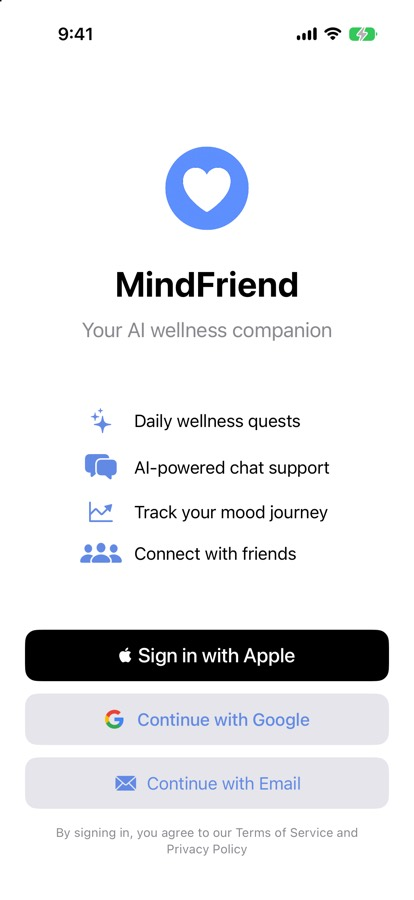 | 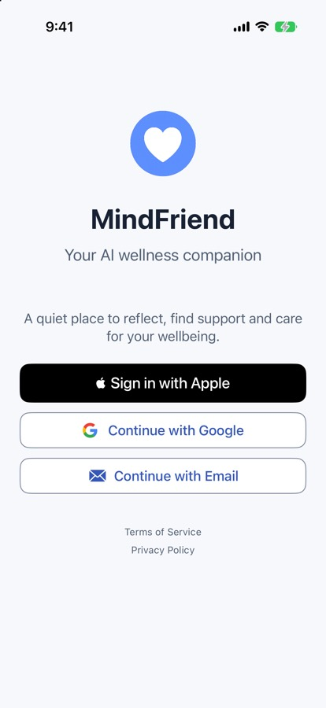 |

1.0.5 lists four features with colored icons. 2.0 is calmer, with one sentence and outlined buttons.

1.0.5: [dark](img/01-first-launch-v105-dark-default.jpg) · [large text](img/01-first-launch-v105-light-large.jpg) · [dark large](img/01-first-launch-v105-dark-large.jpg) &nbsp;|&nbsp; 2.0: [dark](img/01-first-launch-v20-dark-default.jpg) · [large text](img/01-first-launch-v20-light-large.jpg) · [dark large](img/01-first-launch-v20-dark-large.jpg)

### Home / Today

| 1.0.5 | 2.0 |
|---|---|
| 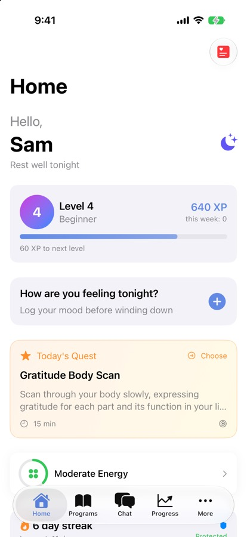 | 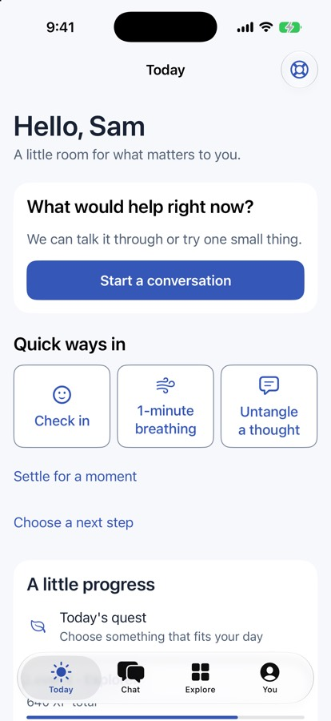 |

Lost: the gradient level badge, the warm orange quest card, the green energy ring and the violet moon. Gained: one clear "What would help right now?" card and simple quick ways in.

1.0.5: [dark](img/02-home-v105-dark-default.jpg) · [large text](img/02-home-v105-light-large.jpg) · [dark large](img/02-home-v105-dark-large.jpg) &nbsp;|&nbsp; 2.0: [dark](img/02-home-v20-dark-default.jpg) · [large text](img/02-home-v20-light-large.jpg) · [dark large](img/02-home-v20-dark-large.jpg)

### Chat

| 1.0.5 | 2.0 |
|---|---|
| 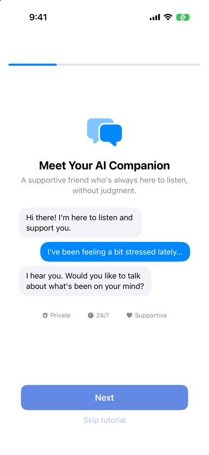 | 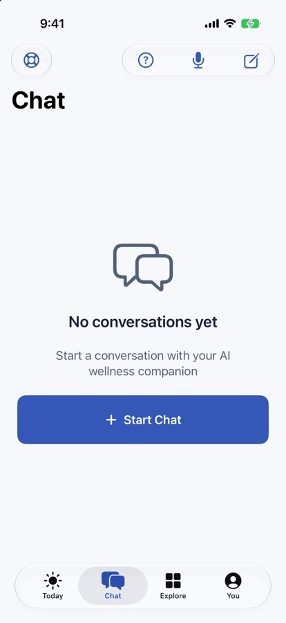 |

Both are calm. 2.0 adds How Chat works and a cleaner composer.

1.0.5: [dark](img/04-chat-v105-dark-default.jpg) · [large text](img/04-chat-v105-light-large.jpg) · [dark large](img/04-chat-v105-dark-large.jpg) &nbsp;|&nbsp; 2.0: [dark](img/04-chat-v20-dark-default.jpg) · [large text](img/04-chat-v20-light-large.jpg) · [dark large](img/04-chat-v20-dark-large.jpg)

### Voice mode (orb)

| 1.0.5 | 2.0 |
|---|---|
| 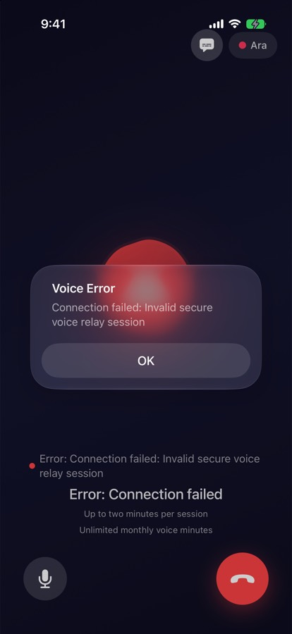 | 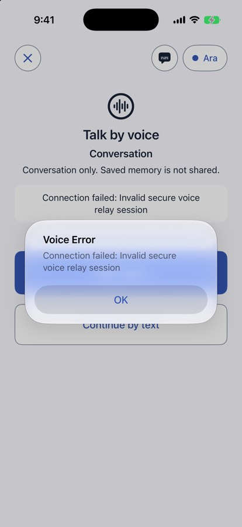 |

Lost the most. 1.0.5 renders a large animated orb that changes color by state; 2.0 shows a small gray waveform glyph. The local stack has no voice provider, so both show the connection error.

1.0.5: [dark](img/05-voice-v105-dark-default.jpg) · [large text](img/05-voice-v105-light-large.jpg) · [dark large](img/05-voice-v105-dark-large.jpg) &nbsp;|&nbsp; 2.0: [dark](img/05-voice-v20-dark-default.jpg) · [large text](img/05-voice-v20-light-large.jpg) · [dark large](img/05-voice-v20-dark-large.jpg)

### Journal

| 1.0.5 | 2.0 |
|---|---|
| 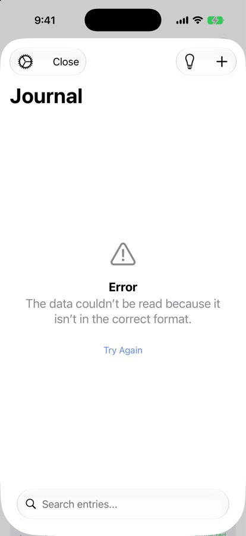 | 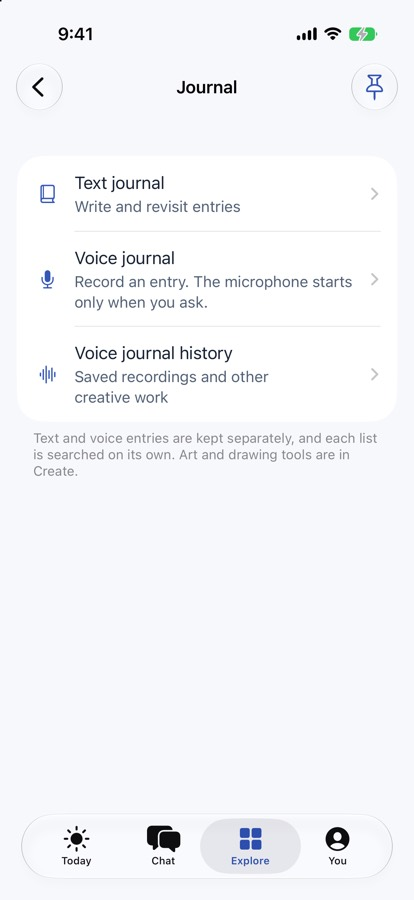 |

2.0 gains a tidy hub (text, voice, history). 1.0.5's list could not read the synthetic entries, so this pair shows an error state.

1.0.5: [dark](img/06-journal-v105-dark-default.jpg) · [large text](img/06-journal-v105-light-large.jpg) · [dark large](img/06-journal-v105-dark-large.jpg) &nbsp;|&nbsp; 2.0: [dark](img/06-journal-v20-dark-default.jpg) · [large text](img/06-journal-v20-light-large.jpg) · [dark large](img/06-journal-v20-dark-large.jpg)

### Sleep

| 1.0.5 | 2.0 |
|---|---|
| 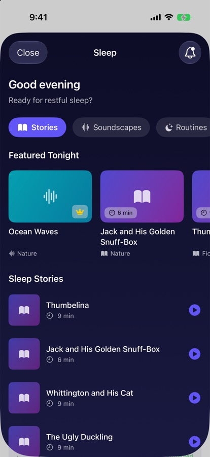 | 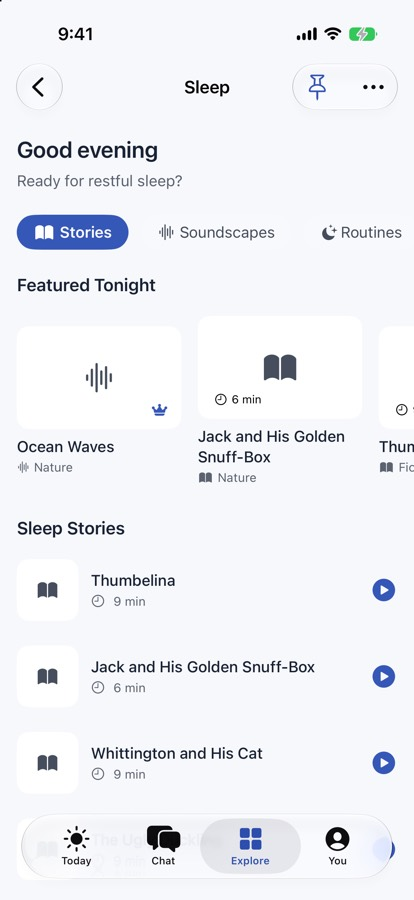 |

The clearest loss. 1.0.5 is a night-indigo space with teal and purple cards; 2.0 is white with gray glyphs.

1.0.5: [dark](img/09-sleep-v105-dark-default.jpg) · [large text](img/09-sleep-v105-light-large.jpg) · [dark large](img/09-sleep-v105-dark-large.jpg) &nbsp;|&nbsp; 2.0: [dark](img/09-sleep-v20-dark-default.jpg) · [large text](img/09-sleep-v20-light-large.jpg) · [dark large](img/09-sleep-v20-dark-large.jpg)

### Sensory toolkit

| 1.0.5 | 2.0 |
|---|---|
| 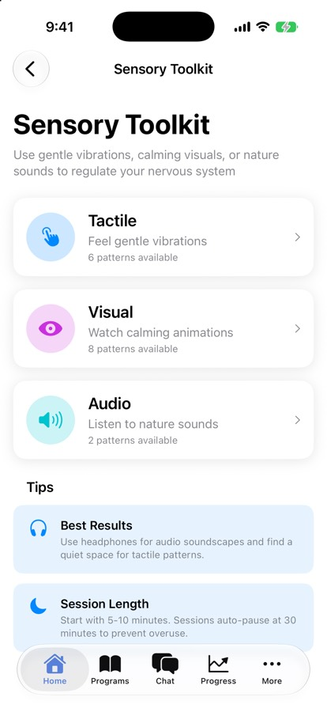 | 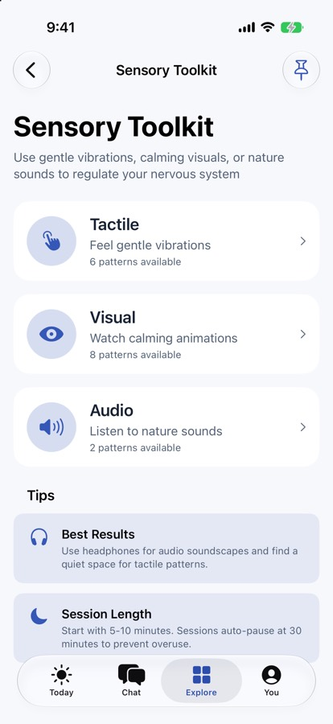 |

Lost: blue, purple and teal tiles that told the three senses apart. 2.0 uses one navy tile for all three.

1.0.5: [dark](img/10-sensory-v105-dark-default.jpg) · [large text](img/10-sensory-v105-light-large.jpg) · [dark large](img/10-sensory-v105-dark-large.jpg) &nbsp;|&nbsp; 2.0: [dark](img/10-sensory-v20-dark-default.jpg) · [large text](img/10-sensory-v20-light-large.jpg) · [dark large](img/10-sensory-v20-dark-large.jpg)

### Exercise library

| 1.0.5 | 2.0 |
|---|---|
| 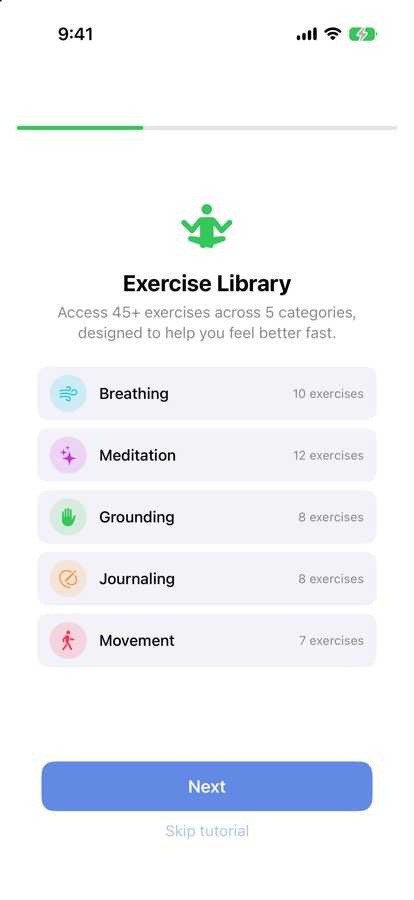 | 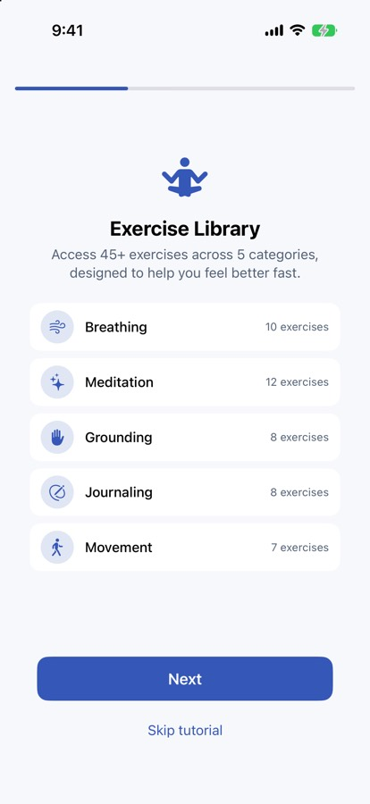 |

Lost: five category colors (breathing blue, meditation purple, grounding green, journaling orange, movement pink). Gained: stronger contrast.

1.0.5: [dark](img/11-exercises-v105-dark-default.jpg) · [large text](img/11-exercises-v105-light-large.jpg) · [dark large](img/11-exercises-v105-dark-large.jpg) &nbsp;|&nbsp; 2.0: [dark](img/11-exercises-v20-dark-default.jpg) · [large text](img/11-exercises-v20-light-large.jpg) · [dark large](img/11-exercises-v20-dark-large.jpg)

### Programs

| 1.0.5 | 2.0 |
|---|---|
| 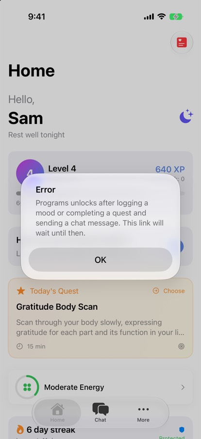 | 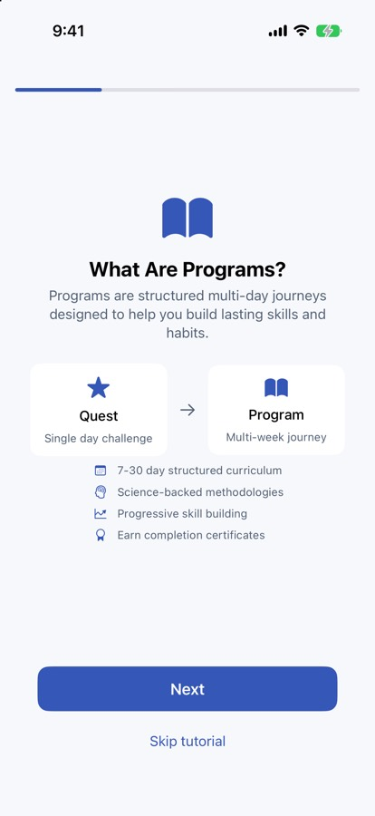 |

Same structure. 1.0.5's category chips and tiles were colored; 2.0's are navy.

1.0.5: [dark](img/12-programs-v105-dark-default.jpg) · [large text](img/12-programs-v105-light-large.jpg) · [dark large](img/12-programs-v105-dark-large.jpg) &nbsp;|&nbsp; 2.0: [dark](img/12-programs-v20-dark-default.jpg) · [large text](img/12-programs-v20-light-large.jpg) · [dark large](img/12-programs-v20-dark-large.jpg)

### Quest arcs

| 1.0.5 | 2.0 |
|---|---|
| *(not reached)* | 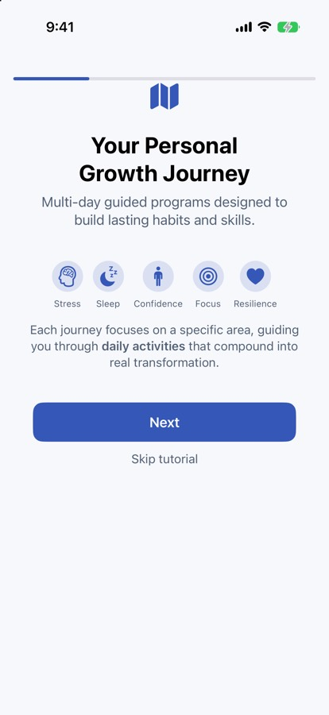 |

2.0's intro is navy; 1.0.5 used orange and yellow for quests and milestones (not reached in this run).

2.0: [dark](img/13-quest-arcs-v20-dark-default.jpg) · [large text](img/13-quest-arcs-v20-light-large.jpg) · [dark large](img/13-quest-arcs-v20-dark-large.jpg)

### Achievements

| 1.0.5 | 2.0 |
|---|---|
| 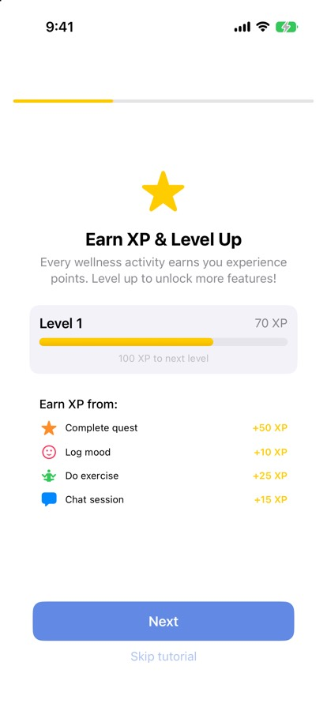 | 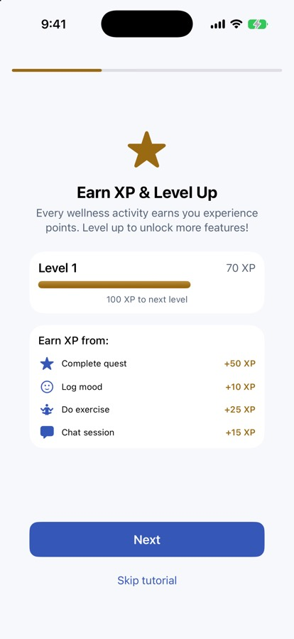 |

Badges keep their art in both; 2.0 frames them more consistently.

1.0.5: [dark](img/14-achievements-v105-dark-default.jpg) · [large text](img/14-achievements-v105-light-large.jpg) · [dark large](img/14-achievements-v105-dark-large.jpg) &nbsp;|&nbsp; 2.0: [dark](img/14-achievements-v20-dark-default.jpg) · [large text](img/14-achievements-v20-light-large.jpg) · [dark large](img/14-achievements-v20-dark-large.jpg)

### Insights

| 1.0.5 | 2.0 |
|---|---|
| 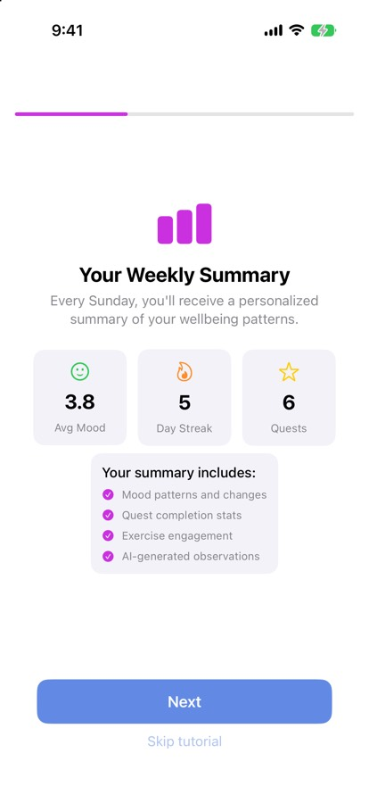 | 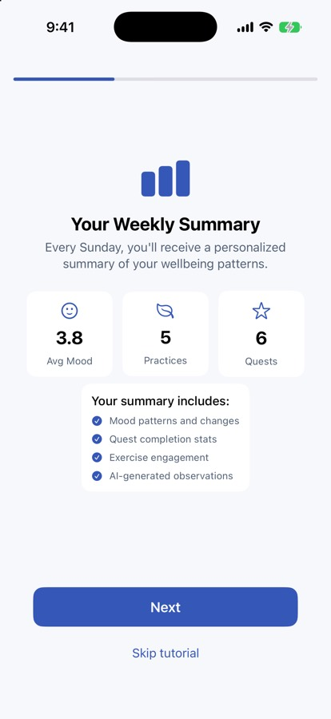 |

Lost: magenta bars, an orange streak flame and a yellow star. In 2.0 every stat is navy.

1.0.5: [dark](img/15-insights-v105-dark-default.jpg) · [large text](img/15-insights-v105-light-large.jpg) · [dark large](img/15-insights-v105-dark-large.jpg) &nbsp;|&nbsp; 2.0: [dark](img/15-insights-v20-dark-default.jpg) · [large text](img/15-insights-v20-light-large.jpg) · [dark large](img/15-insights-v20-dark-large.jpg)

### Wellbeing debt

| 1.0.5 | 2.0 |
|---|---|
| 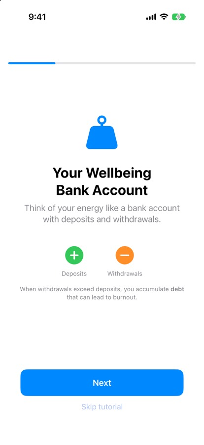 | 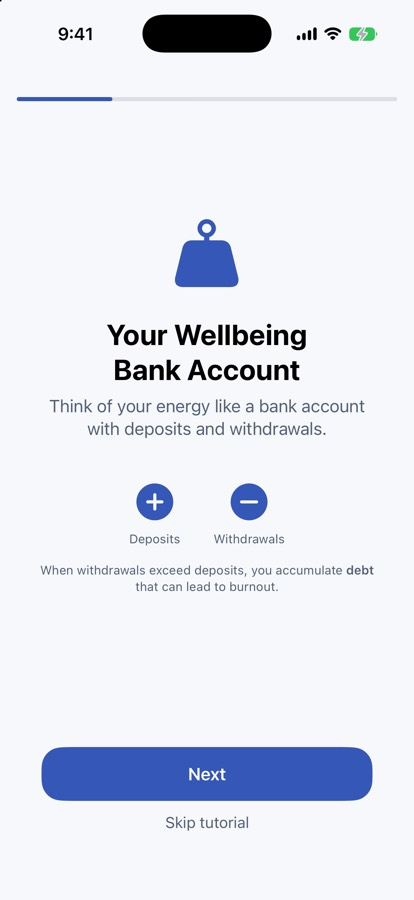 |

Lost meaning, not just color. 1.0.5's deposits are green and withdrawals orange; in 2.0 both are navy.

1.0.5: [dark](img/16-wellbeing-debt-v105-dark-default.jpg) · [large text](img/16-wellbeing-debt-v105-light-large.jpg) · [dark large](img/16-wellbeing-debt-v105-dark-large.jpg) &nbsp;|&nbsp; 2.0: [dark](img/16-wellbeing-debt-v20-dark-default.jpg) · [large text](img/16-wellbeing-debt-v20-light-large.jpg) · [dark large](img/16-wellbeing-debt-v20-dark-large.jpg)

### Circles

| 1.0.5 | 2.0 |
|---|---|
| 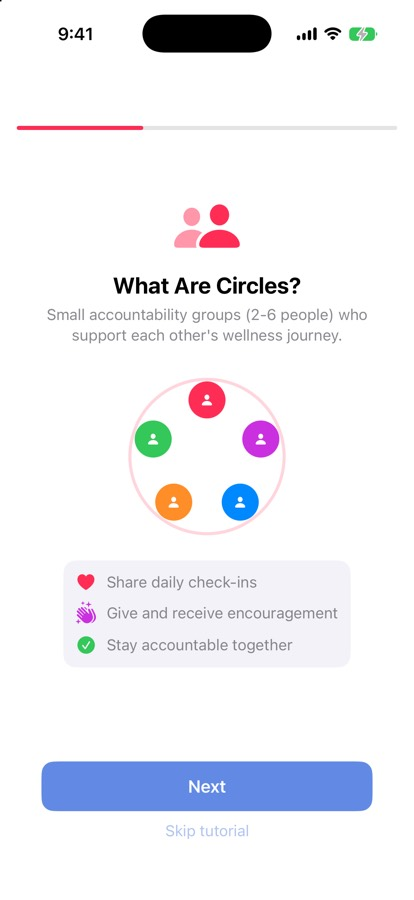 | 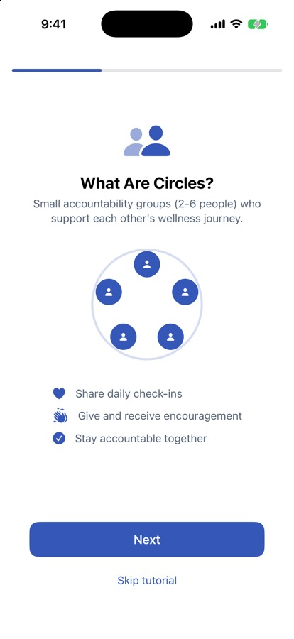 |

Lost: the pink identity and multicolor member dots. 2.0 is a single navy illustration.

1.0.5: [dark](img/17-circles-v105-dark-default.jpg) · [large text](img/17-circles-v105-light-large.jpg) · [dark large](img/17-circles-v105-dark-large.jpg) &nbsp;|&nbsp; 2.0: [dark](img/17-circles-v20-dark-default.jpg) · [large text](img/17-circles-v20-light-large.jpg) · [dark large](img/17-circles-v20-dark-large.jpg)

### Buddy

| 1.0.5 | 2.0 |
|---|---|
| 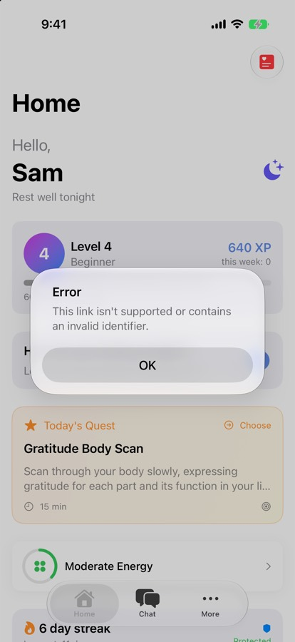 | 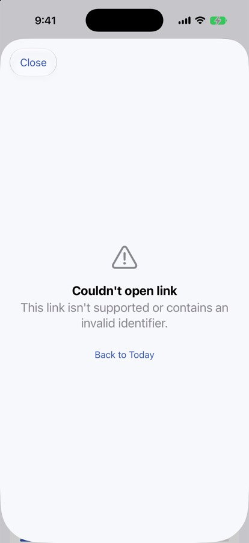 |

Close to equal. Both are mostly the accent color.

1.0.5: [dark](img/18-buddy-v105-dark-default.jpg) · [large text](img/18-buddy-v105-light-large.jpg) · [dark large](img/18-buddy-v105-dark-large.jpg) &nbsp;|&nbsp; 2.0: [dark](img/18-buddy-v20-dark-default.jpg) · [large text](img/18-buddy-v20-light-large.jpg) · [dark large](img/18-buddy-v20-dark-large.jpg)

### Safety plan

| 1.0.5 | 2.0 |
|---|---|
| 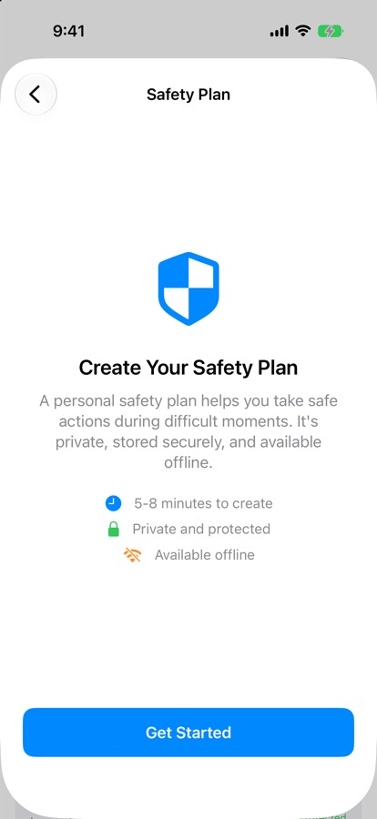 | 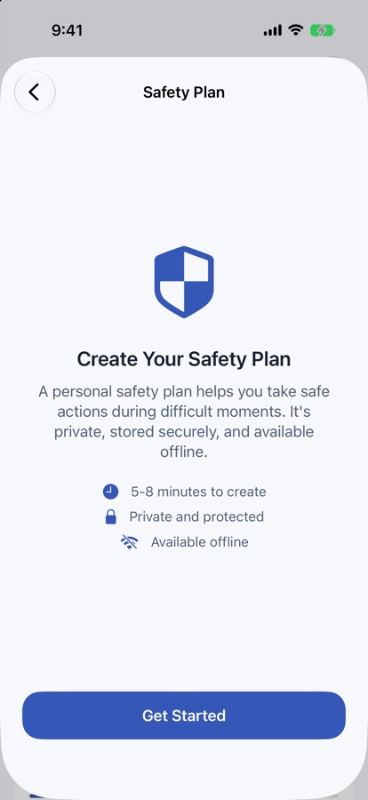 |

1.0.5 is bright blue with green and orange status icons. 2.0 is calm navy. Calm is right here; a little warmth can come back.

1.0.5: [dark](img/19-safety-plan-v105-dark-default.jpg) · [large text](img/19-safety-plan-v105-light-large.jpg) · [dark large](img/19-safety-plan-v105-dark-large.jpg) &nbsp;|&nbsp; 2.0: [dark](img/19-safety-plan-v20-dark-default.jpg) · [large text](img/19-safety-plan-v20-light-large.jpg) · [dark large](img/19-safety-plan-v20-dark-large.jpg)

### Crisis resources

| 1.0.5 | 2.0 |
|---|---|
| 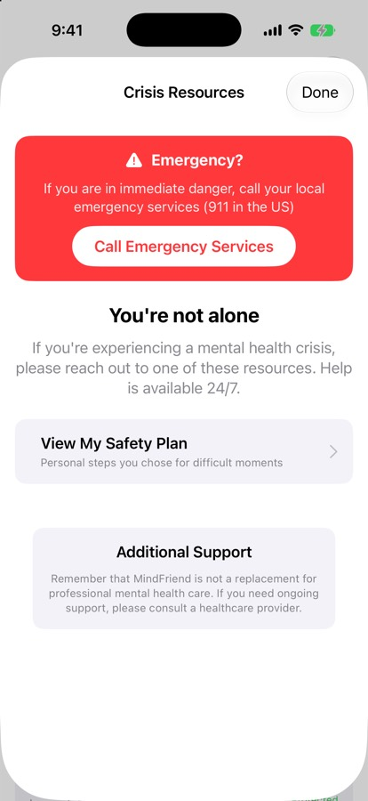 | 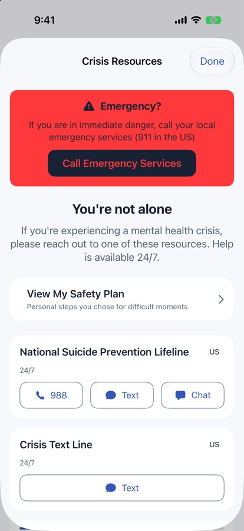 |

2.0 is better: it lists 988 and the Crisis Text Line with call, text and chat buttons, while 1.0.5's list is empty. Red stays reserved for the emergency card in both.

1.0.5: [dark](img/20-crisis-sos-v105-dark-default.jpg) · [large text](img/20-crisis-sos-v105-light-large.jpg) · [dark large](img/20-crisis-sos-v105-dark-large.jpg) &nbsp;|&nbsp; 2.0: [dark](img/20-crisis-sos-v20-dark-default.jpg) · [large text](img/20-crisis-sos-v20-light-large.jpg) · [dark large](img/20-crisis-sos-v20-dark-large.jpg)

### Settings

| 1.0.5 | 2.0 |
|---|---|
| 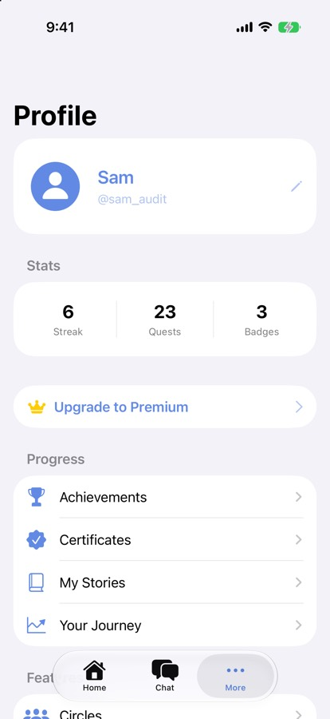 | 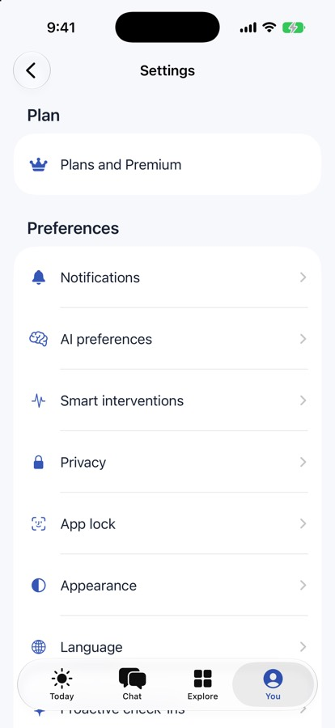 |

2.0 is tidier and easier to scan. Settings should stay neutral.

1.0.5: [dark](img/21-settings-v105-dark-default.jpg) · [large text](img/21-settings-v105-light-large.jpg) · [dark large](img/21-settings-v105-dark-large.jpg) &nbsp;|&nbsp; 2.0: [dark](img/21-settings-v20-dark-default.jpg) · [large text](img/21-settings-v20-light-large.jpg) · [dark large](img/21-settings-v20-dark-large.jpg)

### Paywall

| 1.0.5 | 2.0 |
|---|---|
| 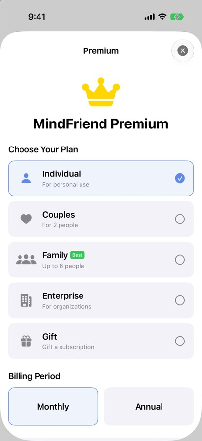 | 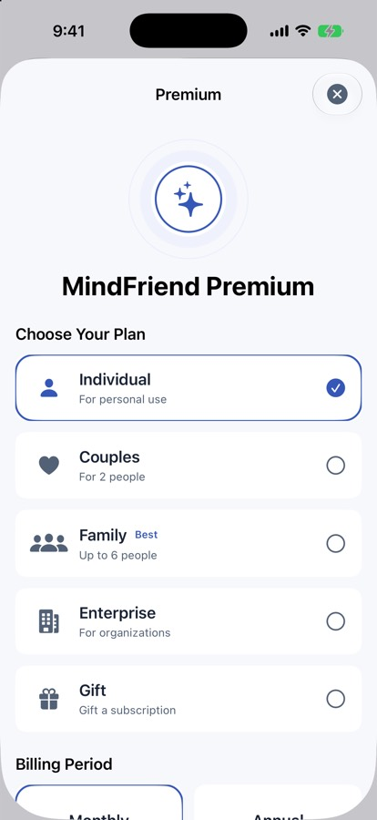 |

Same plans in both. 2.0's cards and fields are more consistent.

1.0.5: [dark](img/22-paywall-v105-dark-default.jpg) · [large text](img/22-paywall-v105-light-large.jpg) · [dark large](img/22-paywall-v105-dark-large.jpg) &nbsp;|&nbsp; 2.0: [dark](img/22-paywall-v20-dark-default.jpg) · [large text](img/22-paywall-v20-light-large.jpg) · [dark large](img/22-paywall-v20-dark-large.jpg)

### Onboarding (1.0.5 only)

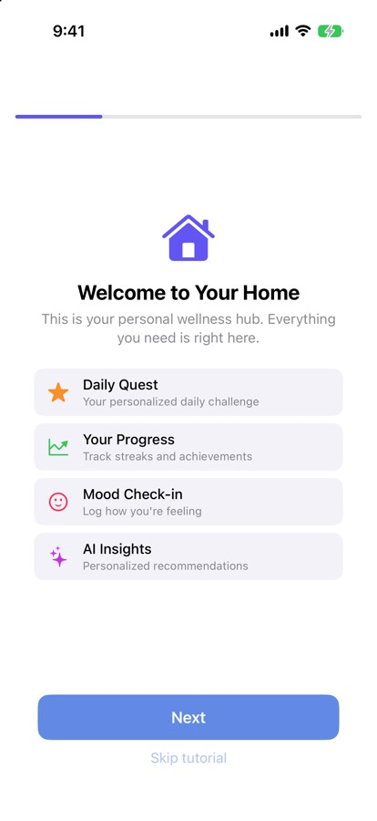

1.0.5 opened every tab with a colorful tutorial. 2.0 goes straight to Today; an onboarded account sees no tutorial.
