# After: 1.0.5 next to the new 2.0

Same simulator model, test account and seeded content as [README.md](README.md). Left: 1.0.5 (App Store build). Right: 2.0 from `main` at `800da60`, which includes the Phase 4 color work (PRs #105 to #109), captured 13 November 2026 after the merges. The 2.0 build before this work is linked under each pair.

## The three biggest changes

1. **Every area has its color again**: tiles, headers, rings, chips and charts, taken from the hues 1.0.5 used. Neutral surfaces stay calm.
2. **Hero moments came back**: the voice orb, celebrations, unlocks, coping kit completion, quest milestones and welcome back use gradients built from the area colors.
3. **Color carries meaning again**: deposits green, withdrawals orange, trends positive or caution. Red stays only for crisis and destructive actions.

Every token pair passes 4.5:1 for text and 3:1 for boundaries in light, dark and Increase Contrast (`AreaColorContrastTests`, in CI).

### Today

| 1.0.5 | 2.0 now |
|---|---|
| 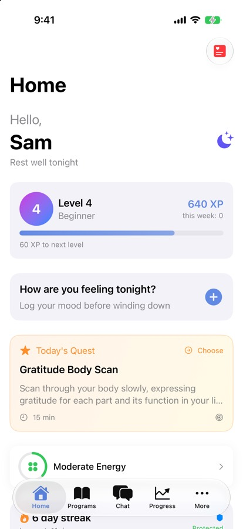 | 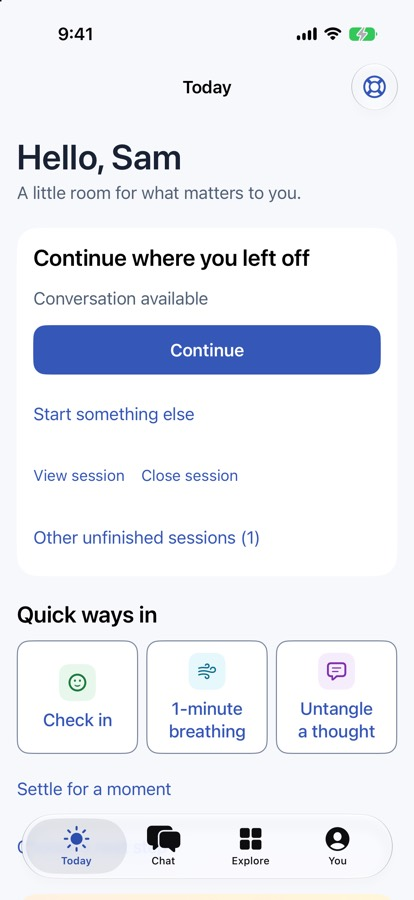 |

Quick ways in carry their areas again: green check in, cyan breathing, purple untangle. The quest card is back on its warm orange tint with an orange XP bar.

2.0 now: [dark](img/02-home-v20after-dark-default.jpg) · [large text](img/02-home-v20after-light-large.jpg) · [dark large](img/02-home-v20after-dark-large.jpg) · [2.0 before](img/02-home-v20-light-default.jpg)

### Explore (new in 2.0)

| 1.0.5 | 2.0 now |
|---|---|
| *(no 1.0.5 screen)* | 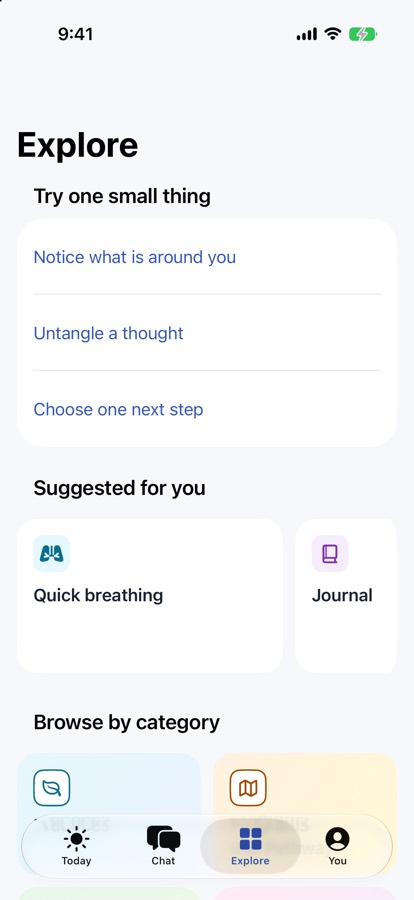 |

Every category and entry has its area tile: cyan practices, orange programs, green tools, pink people. Settings stay neutral.

2.0 now: [dark](img/23-explore-v20after-dark-default.jpg) · [large text](img/23-explore-v20after-light-large.jpg) · [dark large](img/23-explore-v20after-dark-large.jpg)

### Sleep

| 1.0.5 | 2.0 now |
|---|---|
| 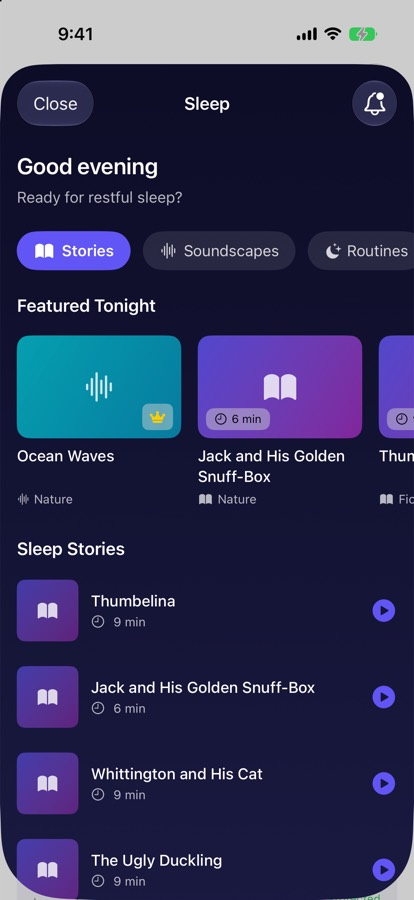 | 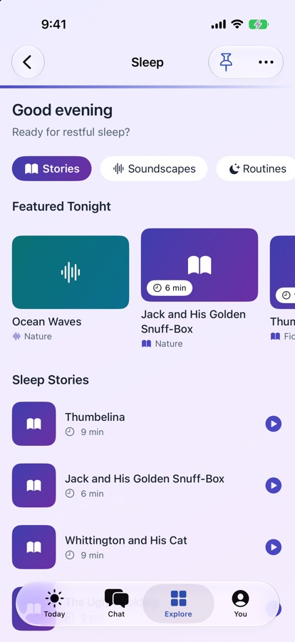 |

The night feel is back: teal soundscapes, indigo-to-purple stories, and a lavender wash in light mode or deep indigo in dark mode.

2.0 now: [dark](img/09-sleep-v20after-dark-default.jpg) · [large text](img/09-sleep-v20after-light-large.jpg) · [dark large](img/09-sleep-v20after-dark-large.jpg) · [2.0 before](img/09-sleep-v20-light-default.jpg)

### Voice

| 1.0.5 | 2.0 now |
|---|---|
| 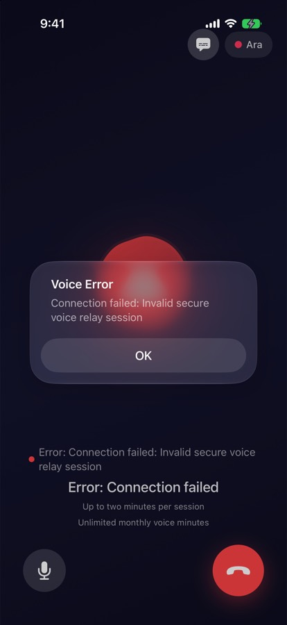 | 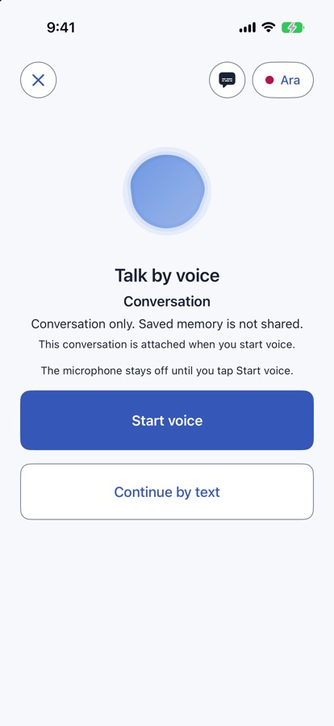 |

The orb is back. It rests in blue on the start panel and changes color with its state during a session, with no glow under Reduce Transparency and no looping motion under Reduce Motion.

2.0 now: [dark](img/05-voice-v20after-dark-default.jpg) · [large text](img/05-voice-v20after-light-large.jpg) · [dark large](img/05-voice-v20after-dark-large.jpg) · [2.0 before](img/05-voice-v20-light-default.jpg)

### Wellbeing debt

| 1.0.5 | 2.0 now |
|---|---|
| 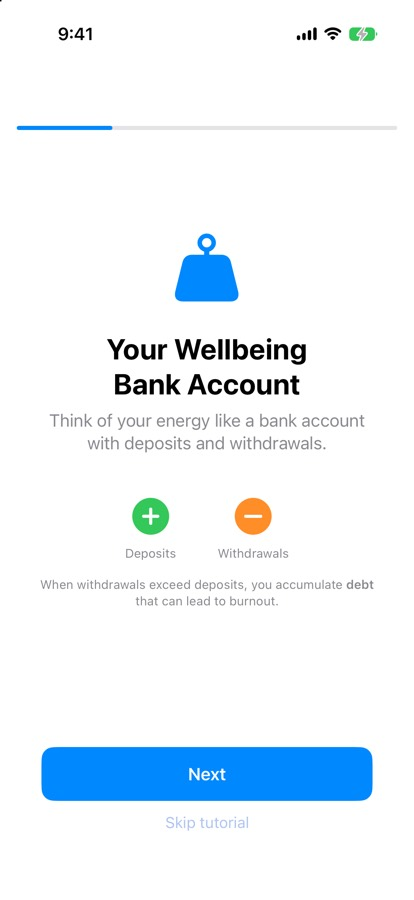 | 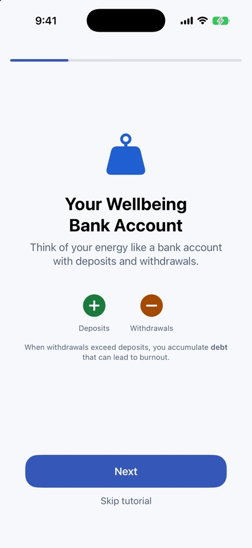 |

Color means something again: deposits green, withdrawals orange.

2.0 now: [dark](img/16-wellbeing-debt-v20after-dark-default.jpg) · [large text](img/16-wellbeing-debt-v20after-light-large.jpg) · [dark large](img/16-wellbeing-debt-v20after-dark-large.jpg) · [2.0 before](img/16-wellbeing-debt-v20-light-default.jpg)

### Insights

| 1.0.5 | 2.0 now |
|---|---|
| 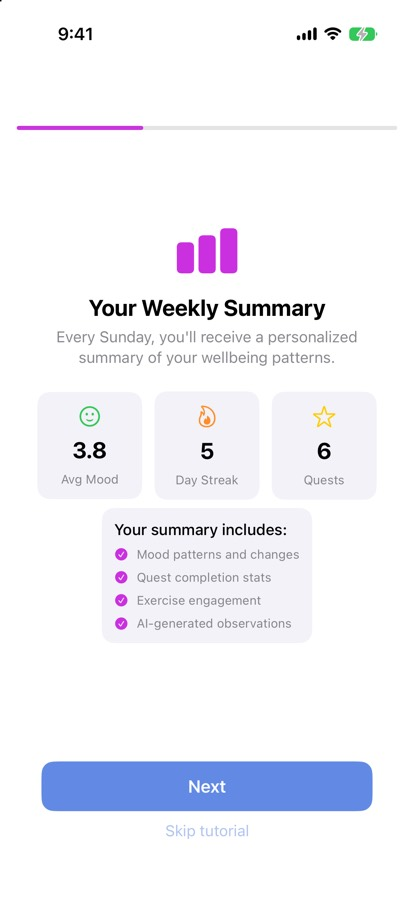 | 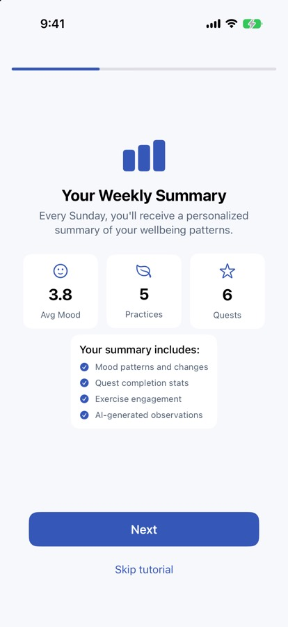 |

Not yet: this weekly summary intro is still blue, while 1.0.5 used magenta bars, an orange flame and a yellow star. The insight screens behind it (reports, experiments, patterns, weekly insights) now use green, positive and caution.

2.0 now: [dark](img/15-insights-v20after-dark-default.jpg) · [large text](img/15-insights-v20after-light-large.jpg) · [dark large](img/15-insights-v20after-dark-large.jpg) · [2.0 before](img/15-insights-v20-light-default.jpg)

### Exercise library

| 1.0.5 | 2.0 now |
|---|---|
| 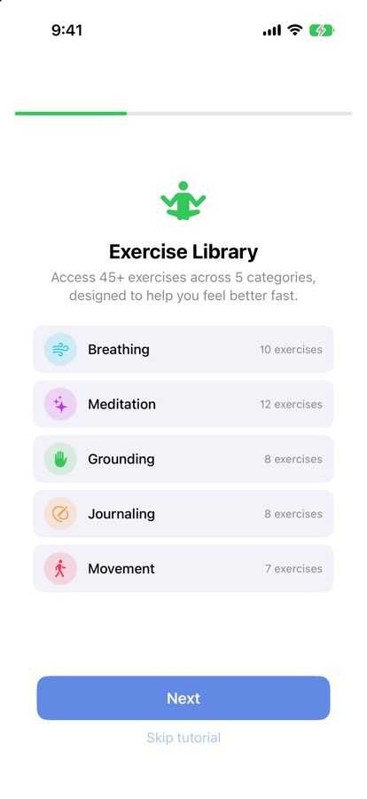 | 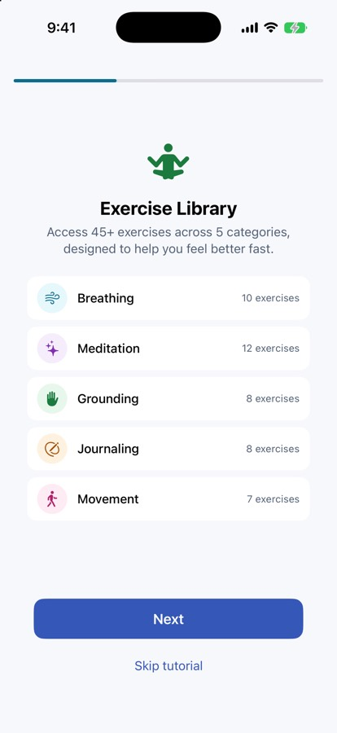 |

Five category colors return: breathing cyan, meditation purple, grounding green, journaling orange, movement pink.

2.0 now: [dark](img/11-exercises-v20after-dark-default.jpg) · [large text](img/11-exercises-v20after-light-large.jpg) · [dark large](img/11-exercises-v20after-dark-large.jpg) · [2.0 before](img/11-exercises-v20-light-default.jpg)

### Sensory toolkit

| 1.0.5 | 2.0 now |
|---|---|
| 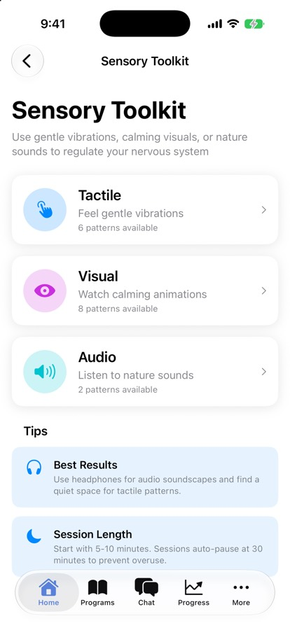 | 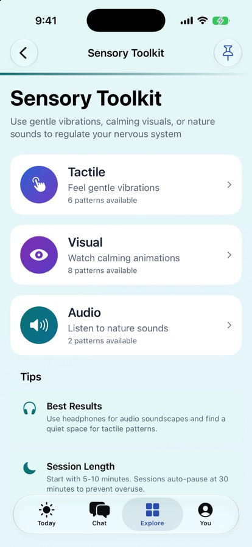 |

Tactile blue, visual purple and audio teal tiles on a teal wash.

2.0 now: [dark](img/10-sensory-v20after-dark-default.jpg) · [large text](img/10-sensory-v20after-light-large.jpg) · [dark large](img/10-sensory-v20after-dark-large.jpg) · [2.0 before](img/10-sensory-v20-light-default.jpg)

### Circles

| 1.0.5 | 2.0 now |
|---|---|
| 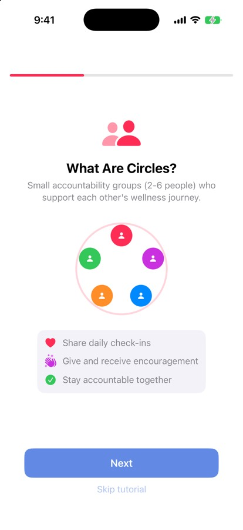 | 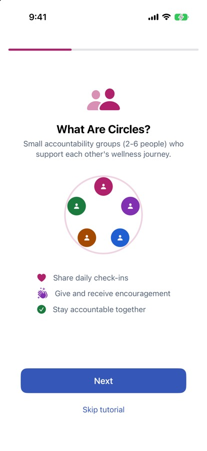 |

Pink identity and multicolor member dots.

2.0 now: [dark](img/17-circles-v20after-dark-default.jpg) · [large text](img/17-circles-v20after-light-large.jpg) · [dark large](img/17-circles-v20after-dark-large.jpg) · [2.0 before](img/17-circles-v20-light-default.jpg)

### Quest arcs

| 1.0.5 | 2.0 now |
|---|---|
| *(no 1.0.5 screen)* | 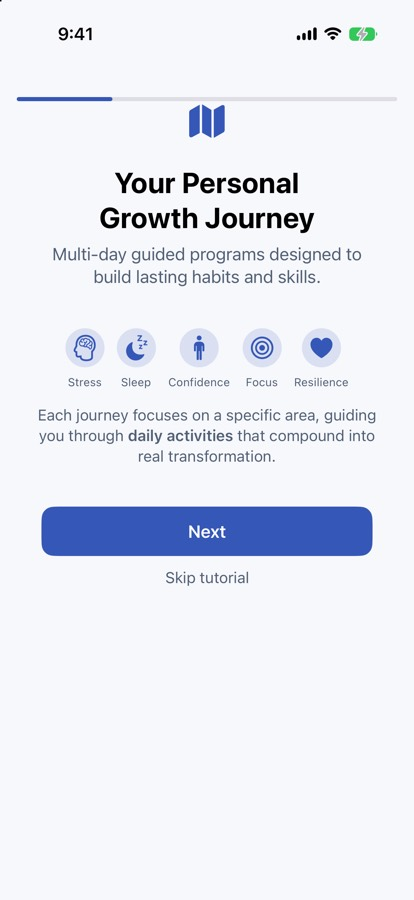 |

Orange quest identity.

2.0 now: [dark](img/13-quest-arcs-v20after-dark-default.jpg) · [large text](img/13-quest-arcs-v20after-light-large.jpg) · [dark large](img/13-quest-arcs-v20after-dark-large.jpg) · [2.0 before](img/13-quest-arcs-v20-light-default.jpg)

### Journal

| 1.0.5 | 2.0 now |
|---|---|
| 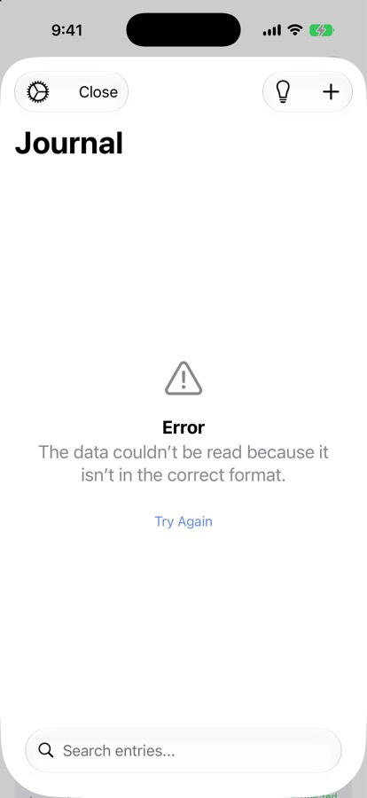 | 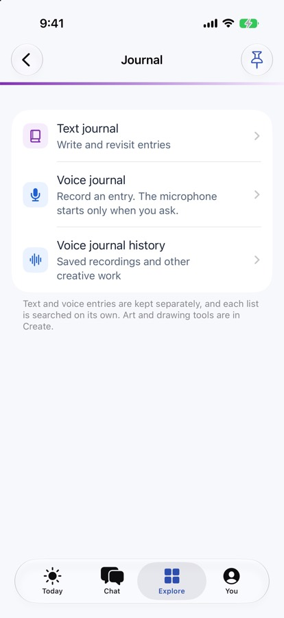 |

Purple journal rows.

2.0 now: [dark](img/06-journal-v20after-dark-default.jpg) · [large text](img/06-journal-v20after-light-large.jpg) · [dark large](img/06-journal-v20after-dark-large.jpg) · [2.0 before](img/06-journal-v20-light-default.jpg)

### Safety plan

| 1.0.5 | 2.0 now |
|---|---|
| 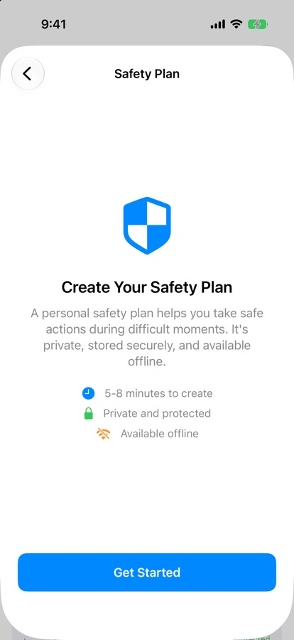 | 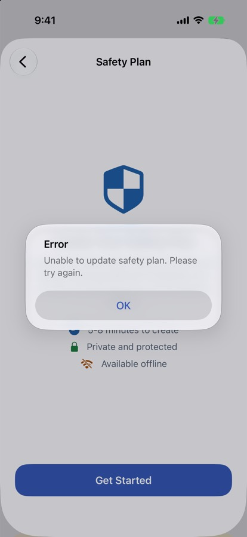 |

Calm safety blue, with a green lock and a warm orange icon for reassurance. The crisis actions are unchanged.

2.0 now: [dark](img/19-safety-plan-v20after-dark-default.jpg) · [large text](img/19-safety-plan-v20after-light-large.jpg) · [dark large](img/19-safety-plan-v20after-dark-large.jpg) · [2.0 before](img/19-safety-plan-v20-light-default.jpg)

### Crisis resources

| 1.0.5 | 2.0 now |
|---|---|
| 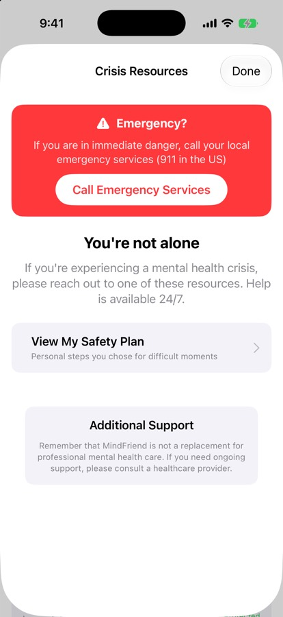 | 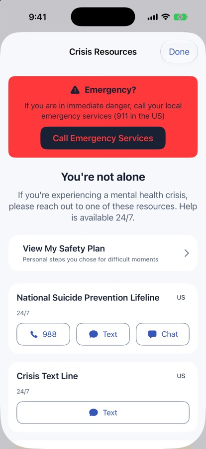 |

Unchanged on purpose: red stays for the emergency card, and the hotlines keep their layout.

2.0 now: [dark](img/20-crisis-sos-v20after-dark-default.jpg) · [large text](img/20-crisis-sos-v20after-light-large.jpg) · [dark large](img/20-crisis-sos-v20after-dark-large.jpg) · [2.0 before](img/20-crisis-sos-v20-light-default.jpg)

### Chat

| 1.0.5 | 2.0 now |
|---|---|
| 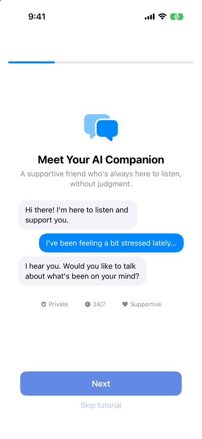 | 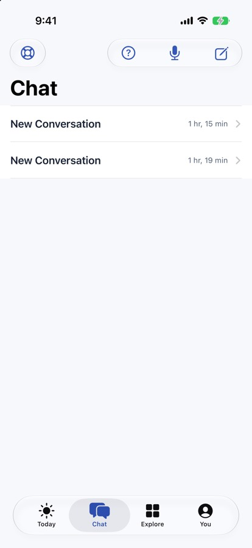 |

Unchanged; the conversation stays calm and neutral.

2.0 now: [dark](img/04-chat-v20after-dark-default.jpg) · [large text](img/04-chat-v20after-light-large.jpg) · [dark large](img/04-chat-v20after-dark-large.jpg) · [2.0 before](img/04-chat-v20-light-default.jpg)

### Programs

| 1.0.5 | 2.0 now |
|---|---|
| 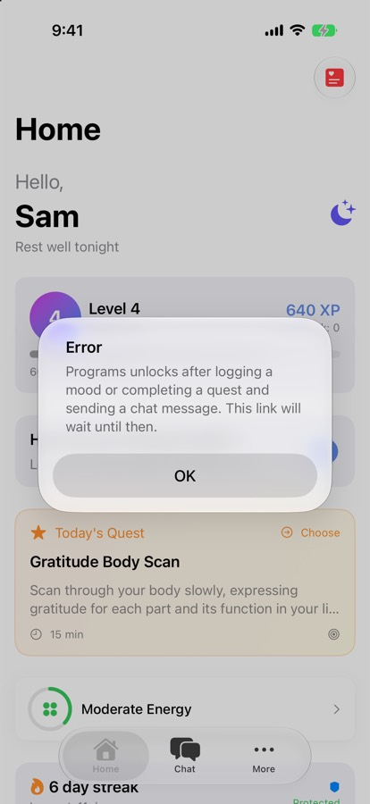 | 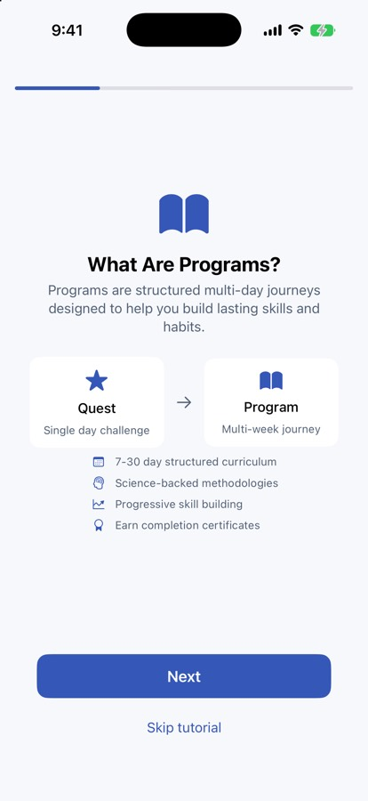 |

Programs carry the quests orange.

2.0 now: [dark](img/12-programs-v20after-dark-default.jpg) · [large text](img/12-programs-v20after-light-large.jpg) · [dark large](img/12-programs-v20after-dark-large.jpg) · [2.0 before](img/12-programs-v20-light-default.jpg)

### Achievements

| 1.0.5 | 2.0 now |
|---|---|
| 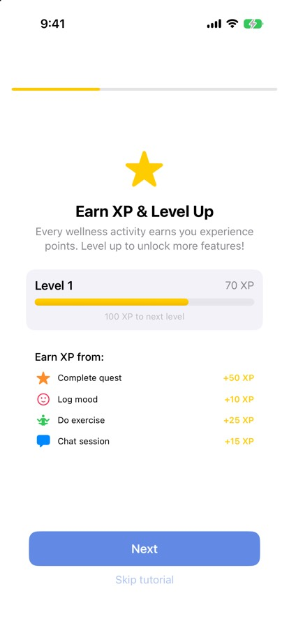 | 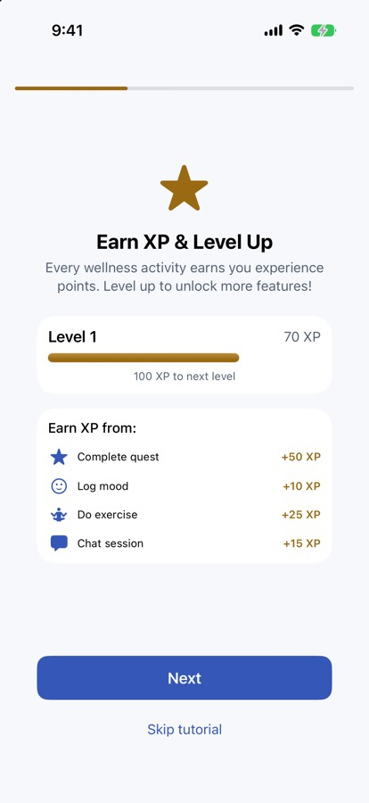 |

Unchanged; the badge art carries the color.

2.0 now: [dark](img/14-achievements-v20after-dark-default.jpg) · [large text](img/14-achievements-v20after-light-large.jpg) · [dark large](img/14-achievements-v20after-dark-large.jpg) · [2.0 before](img/14-achievements-v20-light-default.jpg)

### Buddy

| 1.0.5 | 2.0 now |
|---|---|
| 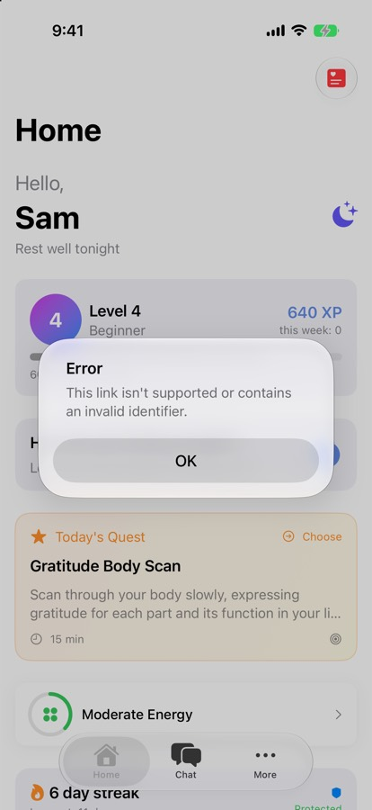 | 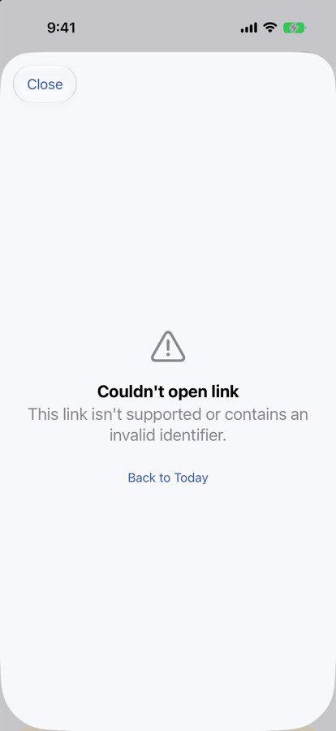 |

People pink on the invite.

2.0 now: [dark](img/18-buddy-v20after-dark-default.jpg) · [large text](img/18-buddy-v20after-light-large.jpg) · [dark large](img/18-buddy-v20after-dark-large.jpg) · [2.0 before](img/18-buddy-v20-light-default.jpg)

### Settings

| 1.0.5 | 2.0 now |
|---|---|
| 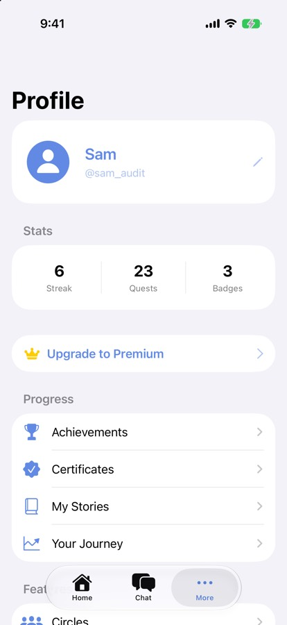 | 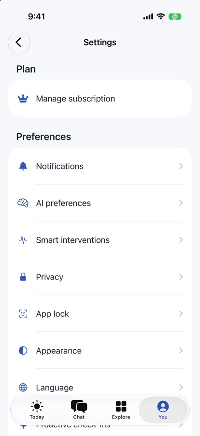 |

Neutral on purpose.

2.0 now: [dark](img/21-settings-v20after-dark-default.jpg) · [large text](img/21-settings-v20after-light-large.jpg) · [dark large](img/21-settings-v20after-dark-large.jpg) · [2.0 before](img/21-settings-v20-light-default.jpg)

## Left alone on purpose

- **Crisis resources and SOS actions**: red, layout and hotline buttons are unchanged.
- **Chat and settings**: they stay neutral.
- **First launch and paywall**: no Phase 4 change (see README.md for both).
- **Still plain:** the weekly summary intro on Insights (a tutorial file outside this round).
- **Coping kits and welcome back** were recolored, but nothing in 2.0 opens them yet, so there is no screenshot.
